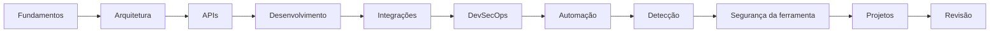

# MOC - Integração de Ferramentas

## Resumo

Vault de estudos sobre **Desenvolvimento e Integração de Ferramentas de Segurança**, com foco defensivo: arquitetura, APIs, desenvolvimento, integrações, DevSecOps, automação, detecção e segurança da própria ferramenta.

## Mapa de conteúdo

- [[MOC - Fundamentos - Integração]] — Base conceitual: CIA, SSDLC, modelagem de ameaças, frameworks e panorama de ferramentas.
- [[MOC - Arquitetura e Padrões de Integração]] — Padrões arquiteturais, webhooks, filas, normalização, idempotência e resiliência.
- [[MOC - APIs e Autenticação]] — REST, GraphQL, gRPC, OAuth 2.0, OIDC, mTLS, JWT e gestão de credenciais.
- [[MOC - Desenvolvimento de Ferramentas]] — Python e Go, CLI, plugins, parsing, testes, empacotamento e logging.
- [[MOC - Integração com Ferramentas de Segurança]] — SIEM, scanners, SAST/SCA, segredos, ticketing, mensageria e threat intelligence.
- [[MOC - DevSecOps e CI-CD]] — Security gates, pipelines, SBOM, assinatura, SLSA, OPA e IaC scanning.
- [[MOC - Automação e Orquestração]] — Playbooks, SOAR, resposta a incidentes, human-in-the-loop e métricas.
- [[MOC - Observabilidade e Detecção]] — Logs, métricas, tracing, Sigma, YARA, Suricata e detecção como código.
- [[MOC - Segurança da Própria Ferramenta]] — Validação de entrada, SSRF, segredos, supply chain, hardening e LGPD.
- [[MOC - Projetos Práticos]] — Projetos guiados de ponta a ponta.
- [[MOC - Revisão - Integração]] — Flashcards e questões para fixação.
- [[Glossário#Cibersegurança]] — Termos técnicos com links para as notas.

> [!tip] Trilha sugerida
> Fundamentos → Arquitetura → APIs → Desenvolvimento → Integrações → DevSecOps → Automação → Detecção → Segurança da ferramenta → Projetos → Revisão.

## Conceitos-chave

Integração segura, automação com supervisão humana, normalização de dados e defesa em profundidade.

## Como funciona

Cada pasta tem um MOC; cada nota segue o mesmo esqueleto de seções e traz exemplos, callouts e diagramas.

## Exemplo prático

Estude [[Modelo CIA e Princípios de Segurança]] e depois [[Panorama de Ferramentas de Segurança]].

## Boas práticas

Use os flashcards com frequência.

## Erros comuns

Pular os fundamentos e ir direto às ferramentas.

## Referências para aprofundar

## Veja também

- [[MOC - Fundamentos - Integração]]
- [[MOC - Projetos Práticos]]
