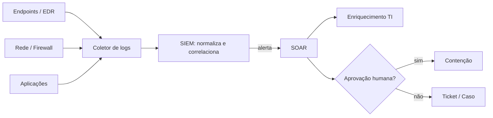

# Ferramentas de Detecção e Resposta - EDR SIEM SOAR

## Resumo

Esta nota cobre as três categorias centrais de operações de segurança. **EDR** (Endpoint Detection and Response) monitora hosts, detecta comportamento suspeito e permite contenção remota. **SIEM** (Security Information and Event Management) coleta, normaliza e correlaciona logs de várias fontes para gerar alertas. **SOAR** (Security Orchestration, Automation and Response) automatiza a triagem e a resposta por meio de *playbooks* e integrações. Juntos formam o pipeline de detecção à resposta, e são os principais destinos de código de integração.

## Conceitos-chave

- **EDR:** telemetria de processos, arquivos, rede e registro; ações como isolar host.
- **SIEM:** ingestão, parsing, normalização, correlação, retenção e busca; exemplos: Splunk, Elastic Security, Wazuh.
- **SOAR:** orquestração entre ferramentas, automação de tarefas, gestão de casos; exemplos: Shuffle, TheHive com Cortex, n8n.
- **XDR:** visão estendida que une endpoint, rede, e-mail e nuvem.
- **Alerta, caso e incidente:** estágios crescentes de gravidade e tratamento.
- **Métricas:** MTTD (tempo médio de detecção) e MTTR (tempo médio de resposta).

## Como funciona



O SIEM transforma logs heterogêneos em eventos comparáveis (via esquemas como ECS ou OCSF) e aplica regras. O alerta é enviado ao SOAR por webhook ou API; o playbook consulta reputação de IP/hash, decide a gravidade e abre um caso. Ações destrutivas, como isolar um servidor, normalmente exigem confirmação humana.

## Exemplo prático

Recebendo um alerta e preparando-o para enriquecimento (Python):

```python
def normalizar_alerta(bruto: dict) -> dict:
    # Mapeia campos de origem para um esquema interno mínimo
    return {
        "id": bruto.get("alert_id"),
        "titulo": bruto.get("rule", {}).get("name", "sem título"),
        "severidade": bruto.get("severity", "media"),
        "origem_ip": bruto.get("src_ip"),
        "tecnicas": bruto.get("mitre", []),
    }
```

> [!example] Próximo passo
> O alerta normalizado segue para um enriquecedor que consulta reputação do IP e anexa o resultado ao caso.

## Boas práticas

- Garanta qualidade dos logs antes de escrever regras.
- Documente cada playbook e teste em laboratório.
- Mantenha humano no ciclo para ações de alto impacto.
- Acompanhe MTTD e MTTR para medir melhoria.

## Erros comuns

- Ingerir tudo sem curadoria, estourando custo e ruído.
- Automatizar contenção sem salvaguardas.
- Regras sem dono e sem revisão periódica.

> [!warning] Cuidado
> Uma automação errada pode causar indisponibilidade maior que o incidente original.

## Referências para aprofundar

- Documentação de Splunk, Elastic, Wazuh, Shuffle e TheHive; MITRE ATT&CK para tagueamento.

## Veja também

- [[Panorama de Ferramentas de Segurança]]
- [[MITRE ATT&CK - Integração]]
- [[NIST CSF]]
- [[Ferramentas de Postura e Proteção - CSPM WAF Scanners e Segredos]]
- [[MOC - Fundamentos - Integração]]

#seguranca/fundamentos/siem #seguranca/deteccao #seguranca/soar
