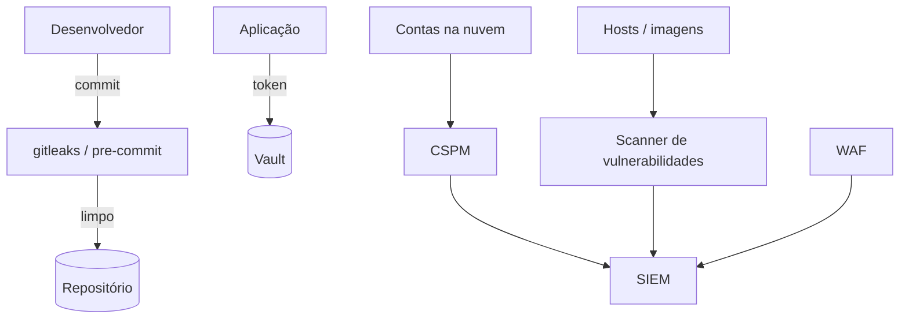

# Ferramentas de Postura e Proteção - CSPM WAF Scanners e Segredos

## Resumo

Este grupo reúne controles que reduzem a superfície de ataque e mantêm a postura de segurança. **CSPM** (Cloud Security Posture Management) avalia configurações de nuvem contra benchmarks. **WAF** (Web Application Firewall) filtra tráfego HTTP para proteger aplicações. **Scanners de vulnerabilidade** (Nessus, OpenVAS, Trivy) identificam falhas conhecidas em hosts, imagens e dependências. **Gestão de segredos** (HashiCorp Vault, gitleaks) armazena credenciais com segurança e detecta vazamentos em repositórios.

## Conceitos-chave

- **CSPM:** verifica buckets públicos, regras de rede permissivas, contas sem MFA; baseia-se em CIS Benchmarks.
- **WAF:** regras gerenciadas (ex.: OWASP CRS), modos de detecção e bloqueio, proteção contra bots e flood.
- **Scanner de vulnerabilidade:** varredura autenticada ou não; base CVE; pontuação CVSS; priorização com EPSS e contexto.
- **Gestão de segredos:** cofre central, segredos dinâmicos, rotação, auditoria; **secrets scanning** em commits.
- **Drift:** divergência entre configuração desejada e real.

## Como funciona



O scanner coleta dados de ativos, correlaciona com a base de CVEs e gera achados com severidade. O CSPM compara a configuração com regras e reporta desvios. O cofre entrega segredos sob autenticação, com política e auditoria, e o secrets scanning impede que credenciais cheguem ao repositório. Todos exportam resultados que são consumidos por integrações.

## Exemplo prático

Exemplo de leitura de segredo sem deixá-lo no código (Python, usando variável de ambiente injetada pelo orquestrador):

```python
import os

def obter_token_api() -> str:
    token = os.environ.get("SCANNER_API_TOKEN")
    if not token:
        # Falha segura: não segue sem credencial
        raise RuntimeError("SCANNER_API_TOKEN não configurado")
    return token
```

> [!tip] Evolução
> Em produção, prefira buscar o segredo em um cofre (Vault) com credencial de curta duração, em vez de variáveis estáticas.

## Boas práticas

- Priorize vulnerabilidades por exposição e explorabilidade, não só por CVSS.
- Rode WAF primeiro em modo de detecção para calibrar.
- Rotacione segredos e revogue imediatamente os vazados.
- Automatize correção de drift via infraestrutura como código.

## Erros comuns

- Confiar apenas no WAF e ignorar correção na aplicação.
- Varreduras sem credencial que perdem achados relevantes.
- Guardar segredos em repositório "privado".
- Tratar o relatório do CSPM como fim, sem remediação.

> [!warning] Autorização
> Execute scans apenas em ativos que você possui ou está autorizado a testar.

## Referências para aprofundar

- CIS Benchmarks, OWASP Core Rule Set, documentação do HashiCorp Vault e do gitleaks, FIRST EPSS.

## Veja também

- [[Panorama de Ferramentas de Segurança]]
- [[CIS Controls]]
- [[Ferramentas de Teste de Aplicação - SAST DAST IAST SCA]]
- [[Ferramentas de Detecção e Resposta - EDR SIEM SOAR]]
- [[MOC - Fundamentos - Integração]]

#seguranca/fundamentos/cspm #seguranca/nuvem #seguranca/segredos
