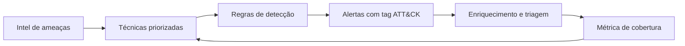

# MITRE ATT&CK - Integração

## Resumo

**MITRE ATT&CK** é uma base de conhecimento pública de táticas, técnicas e procedimentos (TTPs) de adversários, construída a partir de observações reais. Funciona como linguagem comum entre equipes de detecção, resposta e threat intelligence. Para quem integra ferramentas, o ATT&CK é o principal esquema de *enriquecimento*: um alerta ganha contexto ao ser mapeado a uma técnica (por exemplo, T1059 Command and Scripting Interpreter).

## Conceitos-chave

- **Tática:** o objetivo do adversário (ex.: Initial Access, Persistence, Exfiltration).
- **Técnica e sub-técnica:** como o objetivo é atingido (ex.: T1059.001 PowerShell).
- **Procedimento:** implementação específica observada em grupos ou malwares.
- **Matrizes:** Enterprise, Mobile e ICS.
- **Cobertura de detecção:** quais técnicas têm regra associada; visualizável no ATT&CK Navigator.
- **IDs estáveis:** permitem tags em regras Sigma, alertas de SIEM e objetos STIX.

## Como funciona

O ATT&CK é consumido de três modos: *planejamento* (priorizar técnicas relevantes ao seu cenário), *detecção* (marcar regras com técnicas) e *validação* (emular comportamento em laboratório para testar a cobertura).



Os dados oficiais são distribuídos em formato STIX 2.1, o que permite automatizar a consulta.

## Exemplo prático

Mapeando um alerta para uma tática a partir de tags (Python):

```python
def extrair_tecnicas(tags: list[str]) -> list[str]:
    # Tags no padrão attack.t1059 ou attack.t1059.001
    return [t.split(".", 1)[1].upper()
            for t in tags if t.lower().startswith("attack.t")]

alerta = {"regra": "Execução suspeita de PowerShell",
          "tags": ["attack.execution", "attack.t1059.001"]}
print(extrair_tecnicas(alerta["tags"]))  # ['T1059.001']
```

> [!example] Uso em integração
> O enriquecedor de alertas anexa nome, tática e mitigações da técnica ao ticket aberto.

## Boas práticas

- Use ATT&CK como mapa de cobertura, não como checklist de conformidade.
- Priorize técnicas com base em ameaças reais ao seu setor.
- Valide as regras com testes de emulação em laboratório.
- Versione o dataset utilizado, pois o ATT&CK evolui.

## Erros comuns

- Perseguir 100% de cobertura sem considerar qualidade da detecção.
- Confundir tática com técnica.
- Taguear regras sem verificar se realmente detectam a técnica.

> [!warning] Atenção
> Cobertura numérica alta pode esconder regras frágeis e fáceis de contornar.

## Referências para aprofundar

- attack.mitre.org e ATT&CK Navigator.
- Repositório `mitre-attack/attack-stix-data`.

## Veja também

- [[Modelagem de Ameaças - STRIDE e PASTA]]
- [[Ferramentas de Detecção e Resposta - EDR SIEM SOAR]]
- [[NIST CSF]]
- [[MOC - Fundamentos - Integração]]

#seguranca/fundamentos/frameworks #seguranca/deteccao/attack
