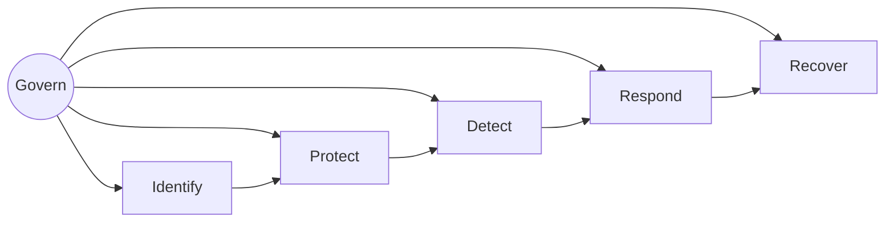

# NIST CSF

## Resumo

O **NIST Cybersecurity Framework (CSF)** é um arcabouço voluntário para gerenciar riscos de cibersegurança, organizado em funções de alto nível que descrevem o ciclo de gestão de risco. A versão 2.0 (2024) acrescentou a função **Govern** às cinco já conhecidas. Ele não prescreve tecnologias, e sim resultados desejados, o que o torna útil para alinhar equipes técnicas e executivas e para classificar onde cada ferramenta de segurança contribui.

## Conceitos-chave

Funções do CSF 2.0:

- **Govern (GV):** estratégia, papéis, políticas e supervisão de risco.
- **Identify (ID):** inventário de ativos, avaliação de riscos.
- **Protect (PR):** controle de acesso, treinamento, proteção de dados, plataformas seguras.
- **Detect (DE):** monitoramento contínuo e análise de eventos adversos.
- **Respond (RS):** gestão, análise, mitigação e comunicação de incidentes.
- **Recover (RC):** recuperação e comunicação pós-incidente.

Além disso: **Perfis** (atual e alvo) e **Níveis de implementação** (Tiers).

## Como funciona

O uso prático segue três passos: criar o *perfil atual*, definir o *perfil alvo* e planejar a lacuna entre eles. Ferramentas são mapeadas às funções: um scanner de vulnerabilidades apoia Identify; um WAF, Protect; um SIEM, Detect; um SOAR, Respond; backups e runbooks, Recover.



## Exemplo prático

Mapeamento de ferramentas a funções do CSF em Python, útil para gerar relatórios de cobertura:

```python
COBERTURA = {
    "Identify": ["Nessus", "OpenVAS", "inventário de ativos"],
    "Protect":  ["WAF", "Vault", "gitleaks"],
    "Detect":   ["Wazuh", "Splunk", "Suricata"],
    "Respond":  ["Shuffle", "TheHive"],
    "Recover":  ["backup", "runbooks"],
}

lacunas = [f for f, ferramentas in COBERTURA.items() if not ferramentas]
print("Funções sem cobertura:", lacunas)
```

> [!tip] Perfil
> Comece com um perfil alvo pequeno e realista, ligado a riscos do negócio.

## Boas práticas

- Envolva a gestão desde a função Govern.
- Use o CSF para priorizar, não para "tirar nota".
- Relacione cada controle técnico a um resultado do framework.
- Combine com [[CIS Controls]] para ações concretas.

## Erros comuns

- Ver o CSF como certificação.
- Investir apenas em Detect e esquecer Recover.
- Não atualizar o perfil após mudanças relevantes.

## Referências para aprofundar

- nist.gov/cyberframework e guias de implementação rápida (Quick Start Guides).

## Veja também

- [[CIS Controls]]
- [[Modelo CIA e Princípios de Segurança]]
- [[MITRE ATT&CK - Integração]]
- [[MOC - Fundamentos - Integração]]

#seguranca/fundamentos/nist #seguranca/governanca
