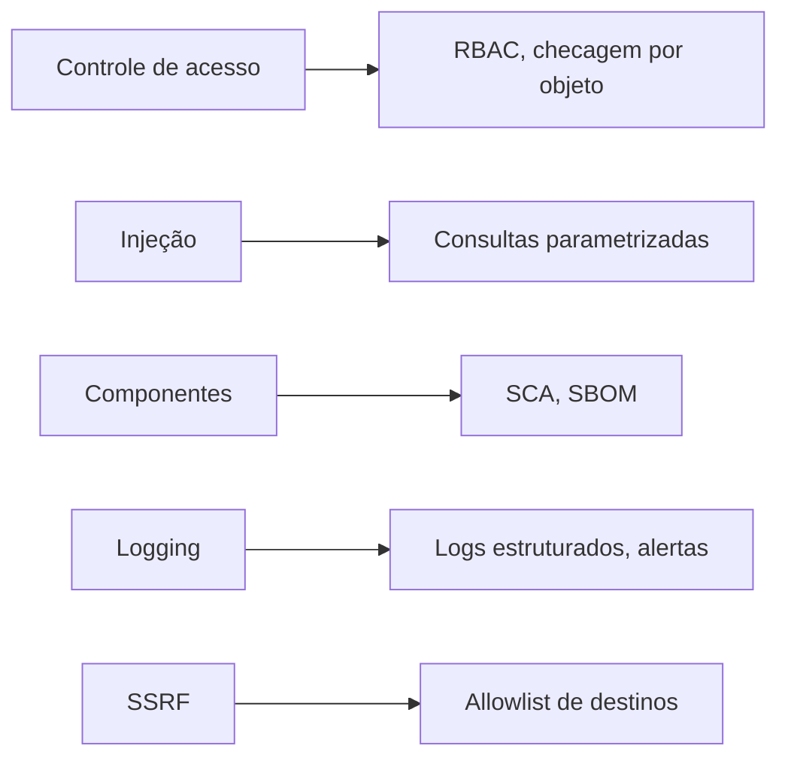

# OWASP Top 10 - Integração

## Resumo

O **OWASP Top 10** é um documento de conscientização que lista as categorias de risco mais críticas em aplicações web, baseado em dados de incidentes e consenso da comunidade. Não é um padrão de conformidade completo, e sim um ponto de partida. Para quem desenvolve ferramentas de segurança, serve como lista de verificação do que a própria ferramenta (que costuma expor APIs e painéis web) deve evitar, e como vocabulário comum nos relatórios de SAST e DAST.

## Conceitos-chave

Categorias da edição 2021 (a mais difundida; confira a edição vigente no site do OWASP):

- A01 Broken Access Control
- A02 Cryptographic Failures
- A03 Injection
- A04 Insecure Design
- A05 Security Misconfiguration
- A06 Vulnerable and Outdated Components
- A07 Identification and Authentication Failures
- A08 Software and Data Integrity Failures
- A09 Security Logging and Monitoring Failures
- A10 Server-Side Request Forgery (SSRF)

Existem listas específicas, como o **OWASP API Security Top 10** (BOLA, autenticação quebrada, consumo irrestrito de recursos etc.), muito relevante para integrações.

## Como funciona

As categorias se ligam a controles técnicos. Controle de acesso quebrado exige verificar autorização em **cada** requisição no servidor. Injeção se previne com consultas parametrizadas e validação de entrada. Componentes vulneráveis são tratados com SCA e SBOM. Falhas de log e monitoramento são mitigadas com logging estruturado e alertas.



## Exemplo prático

Prevenção de injeção SQL com consulta parametrizada em uma ferramenta que guarda achados:

```python
import sqlite3

def buscar_achados(conn: sqlite3.Connection, severidade: str):
    # Parâmetro vinculado: o valor nunca é concatenado à query
    cur = conn.execute(
        "SELECT id, titulo FROM achados WHERE severidade = ?",
        (severidade,),
    )
    return cur.fetchall()
```

> [!example] API
> Em `GET /achados/{id}`, valide que o usuário autenticado tem acesso àquele `id`; não basta estar autenticado.

## Boas práticas

- Use o Top 10 para treinamento e como critério mínimo, e o [[OWASP ASVS]] para requisitos verificáveis.
- Mapeie achados de ferramentas às categorias para priorização.
- Revise a lista quando uma nova edição for publicada.

## Erros comuns

- Tratar o Top 10 como checklist exaustivo.
- Corrigir apenas o sintoma apontado por um scanner, sem tratar a causa.
- Ignorar o Top 10 de APIs ao construir conectores.

> [!tip] Dica
> Anote no relatório de cada achado a categoria OWASP e o CWE correspondente.

## Referências para aprofundar

- owasp.org/Top10 e OWASP API Security Top 10.
- Lista CWE (Common Weakness Enumeration).

## Veja também

- [[OWASP ASVS]]
- [[Ferramentas de Teste de Aplicação - SAST DAST IAST SCA]]
- [[SDLC e SSDLC]]
- [[MOC - Fundamentos - Integração]]

#seguranca/fundamentos/owasp #seguranca/appsec
