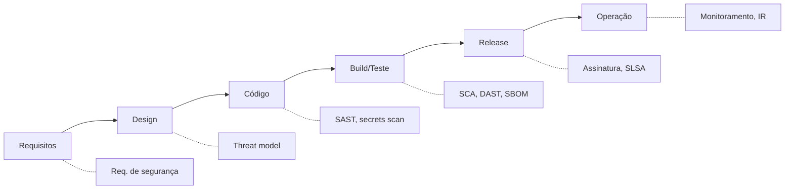

# SDLC e SSDLC

## Resumo

O **SDLC** (Software Development Life Cycle) descreve as fases pelas quais um software passa: planejamento, requisitos, design, implementação, testes, implantação e manutenção. O **SSDLC** (Secure SDLC) insere atividades de segurança em cada fase, em vez de tratá-las como etapa final. A ideia central é o *shift-left*: quanto mais cedo uma falha é encontrada, mais barato é corrigi-la. Para quem desenvolve ferramentas de segurança, o SSDLC vale duas vezes: a ferramenta é software e ainda protege outros sistemas.

## Conceitos-chave

- **Requisitos de segurança:** derivados de risco, conformidade e padrões como [[OWASP ASVS]].
- **Design seguro:** revisão de arquitetura e [[Modelagem de Ameaças - STRIDE e PASTA]].
- **Implementação segura:** padrões de código, revisão por pares, pre-commit hooks.
- **Verificação:** SAST, SCA, DAST, testes de segurança (veja [[Ferramentas de Teste de Aplicação - SAST DAST IAST SCA]]).
- **Release e operação:** assinatura de artefatos, SBOM, monitoramento, resposta a incidentes.
- **Modelos de referência:** Microsoft SDL, OWASP SAMM, BSIMM, NIST SSDF (SP 800-218).

## Como funciona

Cada fase recebe *atividades* e *portões* (gates). Um gate é um critério objetivo para avançar, como "nenhuma vulnerabilidade crítica sem exceção aprovada".



O SSDLC é iterativo: achados de operação alimentam novos requisitos. Maturidade é medida com modelos como SAMM, que avaliam práticas por nível.

## Exemplo prático

Checklist mínimo de gates em um repositório de conector, expresso como estrutura Python:

```python
GATES = {
    "commit":  ["secrets-scan", "lint"],
    "pull_request": ["sast", "sca", "unit-tests"],
    "release": ["sbom", "assinatura", "dast-opcional"],
}

def gate_aprovado(etapa: str, resultados: dict) -> bool:
    # Todos os controles da etapa devem ter passado
    return all(resultados.get(c) == "ok" for c in GATES[etapa])
```

> [!example] Aplicação
> No projeto do conector Trivy→Jira, o gate de PR bloqueia dependências com CVE crítica sem correção disponível.

## Boas práticas

- Defina critérios de aceite de segurança junto com os requisitos funcionais.
- Automatize verificações no pipeline; use revisão humana para decisões de design.
- Registre exceções com dono e prazo de expiração.
- Meça: tempo de correção, densidade de vulnerabilidades, cobertura de modelagem de ameaças.

## Erros comuns

- Fazer testes de segurança apenas antes do release.
- Gates tão rígidos que as equipes os contornam.
- Ignorar dependências de terceiros no escopo.
- Não retroalimentar incidentes no backlog.

> [!question] Reflexão
> Quais atividades do seu fluxo atual estão à direita demais no ciclo?

## Referências para aprofundar

- NIST SP 800-218 (SSDF), OWASP SAMM, Microsoft SDL.

## Veja também

- [[Modelo CIA e Princípios de Segurança]]
- [[Modelagem de Ameaças - STRIDE e PASTA]]
- [[OWASP ASVS]]
- [[Ferramentas de Teste de Aplicação - SAST DAST IAST SCA]]
- [[MOC - Fundamentos - Integração]]

#seguranca/fundamentos/sdlc #seguranca/devsecops
