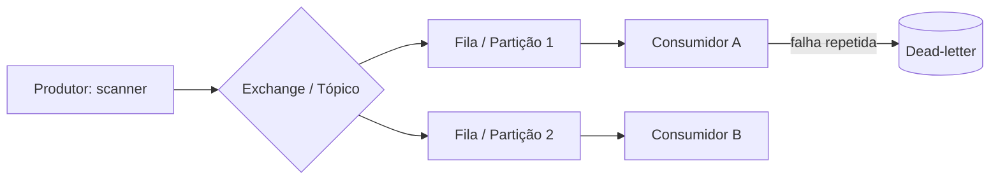

# Filas e Streaming - Kafka e RabbitMQ

## Resumo

Filas e plataformas de streaming desacoplam produtores e consumidores. **RabbitMQ** é um *message broker* tradicional (protocolo AMQP): roteia mensagens por exchanges para filas, e o consumidor confirma o processamento (ack). **Apache Kafka** é uma plataforma de *log distribuído*: eventos são anexados a tópicos particionados e retidos por tempo configurável, permitindo que vários consumidores leiam e **reprocessem** o histórico. Em segurança, usam-se para ingestão de logs, distribuição de alertas e pipelines de enriquecimento.

## Conceitos-chave

- **RabbitMQ:** exchange (direct, topic, fanout), fila, binding, ack/nack, dead-letter exchange (DLX), TTL.
- **Kafka:** tópico, partição, offset, consumer group, retenção, compactação.
- **Garantias de entrega:** at-most-once, at-least-once (padrão prático) e exactly-once (com restrições).
- **Ordem:** garantida dentro de uma partição (Kafka) ou fila (RabbitMQ, com um consumidor).
- **Dead-letter queue:** destino de mensagens que falharam repetidamente.
- **Backpressure:** o consumidor controla o ritmo (prefetch, polling de lote).

## Como funciona



Escolha por caso de uso: RabbitMQ brilha em filas de tarefas com roteamento flexível; Kafka, em alto volume, retenção e múltiplos leitores independentes (por exemplo, SIEM, data lake e detecção lendo o mesmo fluxo). Ambos suportam TLS e autenticação (SASL no Kafka; usuários e permissões por vhost no RabbitMQ).

## Exemplo prático

Consumidor RabbitMQ com ack manual (Python, biblioteca `pika`):

```python
import pika, json

conn = pika.BlockingConnection(pika.ConnectionParameters("localhost"))
ch = conn.channel()
ch.queue_declare(queue="achados", durable=True)   # fila durável
ch.basic_qos(prefetch_count=10)                   # controla backpressure

def tratar(ch, metodo, props, corpo):
    try:
        evento = json.loads(corpo)
        # ... processa o evento (idempotente) ...
        ch.basic_ack(metodo.delivery_tag)         # confirma só após sucesso
    except Exception:
        ch.basic_nack(metodo.delivery_tag, requeue=False)  # envia p/ DLX

ch.basic_consume(queue="achados", on_message_callback=tratar)
ch.start_consuming()
```

## Boas práticas

- Use filas **duráveis** e confirmações após o processamento.
- Configure DLQ e monitore seu tamanho.
- Habilite TLS, autenticação e ACLs por tópico ou vhost.
- Defina retenção e criptografia em repouso conforme a sensibilidade dos dados.

## Erros comuns

- Ack automático antes de concluir o trabalho (perda de mensagens).
- Reentrega infinita de mensagens "venenosas".
- Compartilhar uma única credencial entre todos os serviços.
- Assumir exactly-once sem projetar para duplicatas.

> [!question] Para pensar
> Se o consumidor processar a mesma mensagem duas vezes, o resultado muda? Veja [[Idempotência]].

## Referências para aprofundar

- Documentação do Apache Kafka e do RabbitMQ (guias de confiabilidade).

## Veja também

- [[Padrões de Integração - Point-to-Point Hub-and-Spoke e Event-Driven]]
- [[Idempotência]]
- [[Retries com Backoff e Tratamento de Falhas]]
- [[Webhooks e Polling]]
- [[MOC - Arquitetura e Padrões de Integração]]

#seguranca/integracao/mensageria #seguranca/integracao/kafka #seguranca/integracao/rabbitmq
