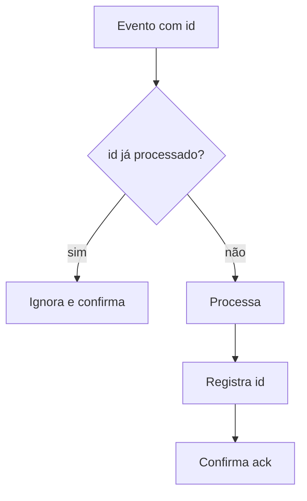

# Idempotência

## Resumo

Uma operação é **idempotente** quando executá-la várias vezes produz o mesmo efeito que executá-la uma vez. Em integrações isso é essencial, pois redes falham, webhooks são reenviados e consumidores de fila recebem a mesma mensagem mais de uma vez (entrega *at-least-once*). Sem idempotência, o mesmo achado de segurança viraria cinco tickets no Jira ou uma contenção seria aplicada repetidamente. Projetar para duplicatas é mais realista do que perseguir "exactly-once".

## Conceitos-chave

- **Métodos HTTP idempotentes:** GET, PUT, DELETE; POST normalmente não é.
- **Idempotency key:** identificador enviado pelo cliente para que o servidor reconheça a repetição.
- **Chave natural:** derivada do dado (por exemplo, hash de `scanner + regra + arquivo + linha`).
- **Deduplicação:** descartar eventos já vistos usando um armazenamento de ids.
- **Upsert:** criar se não existe, atualizar se existe.
- **Efeito observável vs. execução:** a função pode rodar duas vezes, o importante é o resultado.

## Como funciona

O consumidor recebe o evento, consulta um *registro de processados* e decide. A verificação e o registro devem ser **atômicos** (por exemplo, `INSERT` com restrição de unicidade), para evitar corrida entre dois workers.



Quando o destino não suporta idempotency key (como algumas APIs de ticketing), guarde o mapeamento `chave_natural → id_no_destino` e consulte antes de criar.

## Exemplo prático

Deduplicação atômica com SQLite (Python):

```python
import sqlite3, hashlib

conn = sqlite3.connect("processados.db")
conn.execute("CREATE TABLE IF NOT EXISTS processados (chave TEXT PRIMARY KEY)")

def chave_natural(achado: dict) -> str:
    base = f"{achado['regra']}|{achado['arquivo']}|{achado['linha']}"
    return hashlib.sha256(base.encode()).hexdigest()

def primeira_vez(achado: dict) -> bool:
    try:
        with conn:
            conn.execute("INSERT INTO processados VALUES (?)", (chave_natural(achado),))
        return True                      # inseriu: é a primeira vez
    except sqlite3.IntegrityError:
        return False                     # já existia
```

> [!tip] Expiração
> Defina um TTL para o registro de ids para que ele não cresça indefinidamente.

## Boas práticas

- Gere a chave de idempotência no **produtor** e propague-a.
- Faça checagem e registro em uma única operação atômica.
- Prefira operações naturalmente idempotentes (upsert, "definir estado" em vez de "incrementar").
- Teste enviando o mesmo evento várias vezes.

## Erros comuns

- Verificar com `SELECT` e depois inserir (condição de corrida).
- Usar timestamp como chave (colide ou muda entre reenvios).
- Registrar o id **antes** de concluir o trabalho e perder a ação em caso de falha.
- Esquecer efeitos colaterais externos (e-mails, notificações) que também precisam de deduplicação.

> [!question] Cenário
> O webhook chegou duas vezes com o mesmo `event_id`. O que impede dois tickets?

## Referências para aprofundar

- Documentação sobre idempotency keys de APIs de pagamento (padrão amplamente adotado).

## Veja também

- [[Retries com Backoff e Tratamento de Falhas]]
- [[Filas e Streaming - Kafka e RabbitMQ]]
- [[Webhooks e Polling]]
- [[Padrões de Integração - Point-to-Point Hub-and-Spoke e Event-Driven]]
- [[MOC - Arquitetura e Padrões de Integração]]

#seguranca/integracao/idempotencia #seguranca/integracao/confiabilidade
