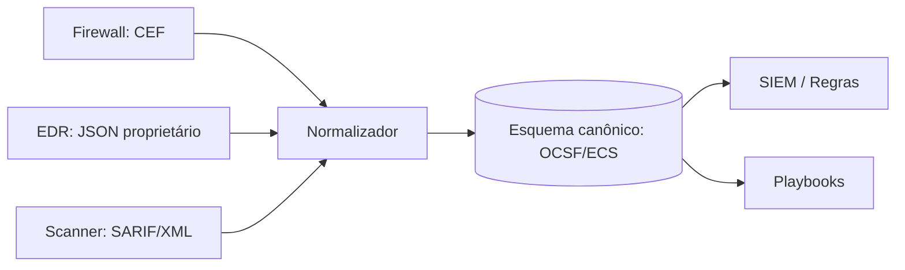

# Normalização de Dados - OCSF ECS CEF STIX e TAXII

## Resumo

Cada ferramenta de segurança descreve eventos à sua maneira: um firewall chama o IP de origem de `src`, outro de `source.ip`, um terceiro de `SourceAddress`. **Normalização** é converter esses formatos para um esquema comum, de modo que regras, painéis e playbooks funcionem independentemente da origem. Esquemas relevantes: **OCSF** (Open Cybersecurity Schema Framework), **ECS** (Elastic Common Schema), **CEF** (Common Event Format, da ArcSight) e, para threat intelligence, **STIX 2.1** transportado por **TAXII**.

## Conceitos-chave

- **OCSF:** esquema aberto organizado em categorias e classes de evento (ex.: Detection Finding, Network Activity), usado por AWS Security Lake e outros.
- **ECS:** conjunto de campos do Elastic (`source.ip`, `event.category`, `user.name`).
- **CEF:** formato de linha de texto com cabeçalho e extensões chave=valor, comum em syslog.
- **STIX 2.1:** linguagem JSON para objetos de inteligência (indicator, malware, attack-pattern, relationship).
- **TAXII 2.1:** protocolo HTTP para compartilhar STIX (coleções e objetos).
- **Mapeamento de campos (field mapping)** e **perda de informação** durante a conversão.
- **Esquema canônico interno:** o modelo que sua ferramenta adota como centro.

## Como funciona

A normalização ocorre em um adaptador na borda: o conector recebe o formato nativo, aplica um mapa de campos e emite o evento no esquema canônico. Campos sem equivalente podem ser preservados em uma área de extensão (por exemplo, `unmapped` no OCSF) para não perder dados.



Já STIX/TAXII segue outro fluxo: um servidor TAXII expõe *collections*; o cliente consulta objetos STIX e os converte em indicadores consumíveis pela detecção, com `valid_from` e `valid_until` para controlar o ciclo de vida.

## Exemplo prático

Mapeamento de um evento proprietário para campos no estilo ECS (Python):

```python
MAPA = {
    "src":  "source.ip",
    "dst":  "destination.ip",
    "usr":  "user.name",
    "act":  "event.action",
}

def para_ecs(bruto: dict) -> dict:
    saida, extra = {}, {}
    for chave, valor in bruto.items():
        destino = MAPA.get(chave)
        if destino:
            # monta estrutura aninhada a partir de 'a.b'
            a, b = destino.split(".", 1)
            saida.setdefault(a, {})[b] = valor
        else:
            extra[chave] = valor     # preserva o que não foi mapeado
    saida["unmapped"] = extra
    return saida

print(para_ecs({"src": "10.0.0.5", "usr": "ana", "x": 1}))
```

> [!example] Objeto STIX mínimo
> Um `indicator` com `pattern: "[ipv4-addr:value = '203.0.113.7']"` descreve um IP malicioso de forma portátil.

## Boas práticas

- Escolha **um** esquema canônico e mapeie tudo para ele.
- Preserve o evento original (`raw`) para auditoria e reprocessamento.
- Normalize tipos e fusos horários (UTC, ISO 8601).
- Versione os mapeamentos e teste com amostras reais.

## Erros comuns

- Descartar campos sem mapeamento.
- Misturar timestamps locais e UTC.
- Confiar em campos livres de texto sem sanitizar (risco de injeção em painéis e logs).
- Tratar STIX como lista de IPs, ignorando confiança e validade.

> [!warning] Dados não confiáveis
> Campos vindos de terceiros e de threat intel devem ser tratados como entrada não confiável.

## Referências para aprofundar

- ocsf.io, Elastic Common Schema, especificações STIX/TAXII 2.1 (OASIS).

## Veja também

- [[Padrão Adapter e Connector]]
- [[Ferramentas de Detecção e Resposta - EDR SIEM SOAR]]
- [[MITRE ATT&CK - Integração]]
- [[Padrões de Integração - Point-to-Point Hub-and-Spoke e Event-Driven]]
- [[MOC - Arquitetura e Padrões de Integração]]

#seguranca/integracao/normalizacao #seguranca/integracao/ocsf #seguranca/integracao/stix
