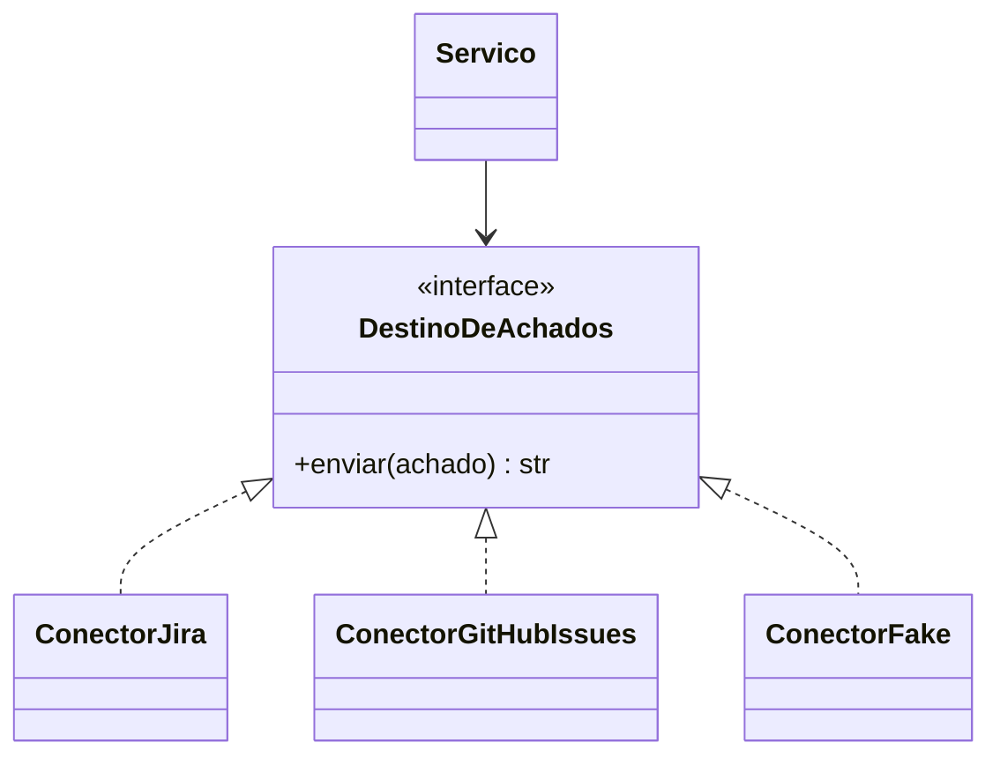

# Padrão Adapter e Connector

## Resumo

O padrão **Adapter** traduz a interface de um sistema para a interface que o restante da aplicação espera. Em integrações, um **connector** é a implementação concreta: encapsula autenticação, chamadas de API, paginação, tratamento de erros e mapeamento de dados de uma ferramenta específica (Jira, Splunk, VirusTotal). O núcleo da aplicação conversa com uma interface estável e não conhece detalhes de cada fornecedor. Isso permite trocar uma ferramenta por outra, ou adicionar novas, sem reescrever a lógica de negócio.

## Conceitos-chave

- **Interface (porta):** contrato abstrato, por exemplo `enviar_achado(achado)`.
- **Adaptador (conector):** implementação específica por ferramenta.
- **Modelo canônico:** representação interna comum, veja [[Normalização de Dados - OCSF ECS CEF STIX e TAXII]].
- **Registro de conectores:** mecanismo de descoberta (plugins).
- **Anti-corruption layer:** impede que peculiaridades externas contaminem o domínio.
- **Testabilidade:** conectores falsos (fakes) para testes sem rede.

## Como funciona



O serviço depende apenas da interface. A configuração decide qual conector é instanciado. Cada conector traduz o modelo canônico para o formato da API de destino e traduz as respostas (e erros) de volta para exceções do domínio.

## Exemplo prático

Interface e dois conectores (Python):

```python
from abc import ABC, abstractmethod

class DestinoDeAchados(ABC):
    @abstractmethod
    def enviar(self, achado: dict) -> str:
        # Retorna o identificador do item criado no destino

class ConectorFake(DestinoDeAchados):
    def __init__(self): self.itens = []
    def enviar(self, achado: dict) -> str:
        self.itens.append(achado)       # útil em testes
        return f"FAKE-{len(self.itens)}"

class ConectorJira(DestinoDeAchados):
    def __init__(self, cliente_http, projeto: str):
        self.http, self.projeto = cliente_http, projeto
    def enviar(self, achado: dict) -> str:
        payload = {"fields": {"project": {"key": self.projeto},
                              "summary": achado["titulo"],
                              "issuetype": {"name": "Bug"}}}
        r = self.http.post("/rest/api/2/issue", json=payload)
        r.raise_for_status()
        return r.json()["key"]
```

## Boas práticas

- Mantenha o conector **sem estado** de negócio; estado fica no núcleo ou em armazenamento próprio.
- Injete cliente HTTP e credenciais (facilita testes).
- Traduza erros específicos em exceções do domínio.
- Aplique timeouts, retries e limites dentro do conector.

## Erros comuns

- Vazar tipos da biblioteca do fornecedor para o domínio.
- Um conector "faz-tudo" que mistura regras de negócio.
- Sem timeout nas chamadas de rede.
- Credenciais fixas no código do conector.

> [!tip] Testes de contrato
> Teste cada conector contra a mesma suíte de comportamento da interface.

## Referências para aprofundar

- *Design Patterns* (GoF), capítulo Adapter; arquitetura hexagonal (ports and adapters).

## Veja também

- [[Padrões de Integração - Point-to-Point Hub-and-Spoke e Event-Driven]]
- [[Normalização de Dados - OCSF ECS CEF STIX e TAXII]]
- [[Retries com Backoff e Tratamento de Falhas]]
- [[Webhooks e Polling]]
- [[MOC - Arquitetura e Padrões de Integração]]

#seguranca/integracao/adapter #seguranca/desenvolvimento/padroes
