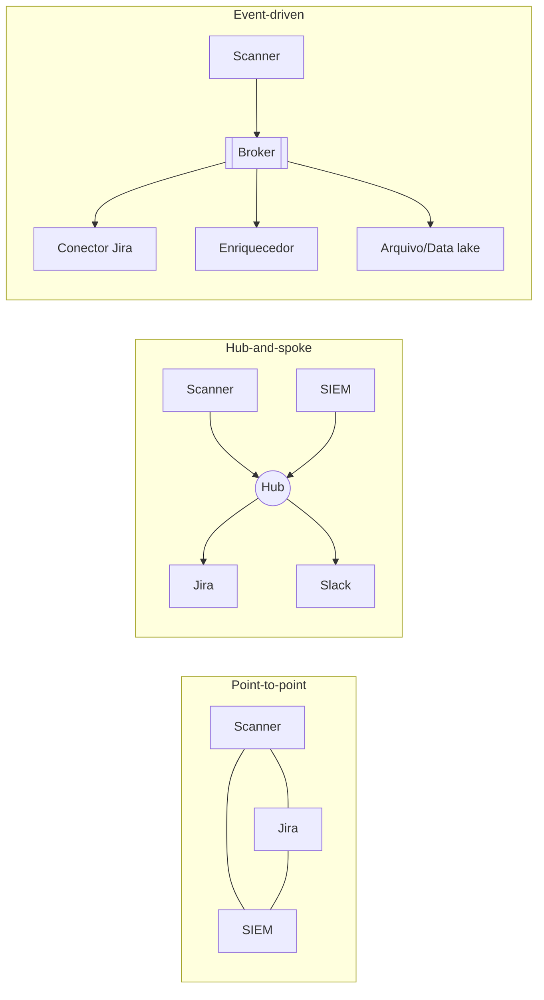

# Padrões de Integração - Point-to-Point Hub-and-Spoke e Event-Driven

## Resumo

Integrar ferramentas de segurança significa decidir *como* os componentes trocam dados. Três estilos dominam: **point-to-point** (cada par de sistemas se conecta diretamente), **hub-and-spoke** (um intermediário central roteia e transforma mensagens) e **event-driven** (produtores publicam eventos e consumidores reagem de forma assíncrona). A escolha afeta acoplamento, escalabilidade, resiliência e a superfície de ataque. Em ambientes de segurança, onde scanners, SIEM, ticketing e SOAR evoluem em ritmos distintos, a arquitetura certa evita que cada nova ferramenta multiplique o número de integrações.

## Conceitos-chave

- **Point-to-point:** simples no início; com *n* sistemas pode chegar a n(n−1)/2 conexões, cada uma com autenticação e formato próprios.
- **Hub-and-spoke:** o hub (ESB, gateway, orquestrador) centraliza roteamento, transformação e políticas; risco de ponto único de falha.
- **Event-driven:** broker de mensagens desacopla produtor e consumidor; favorece escala e reprocessamento; exige tratamento de ordem, duplicidade e consistência eventual.
- **Acoplamento temporal:** chamadas síncronas exigem que ambos os lados estejam disponíveis ao mesmo tempo.
- **Contratos:** schemas explícitos (OpenAPI, JSON Schema) reduzem quebras.

## Como funciona



Em event-driven, o scanner publica um evento `finding.created`; vários consumidores o processam de forma independente. Se o conector do Jira cair, as mensagens ficam retidas e são processadas quando ele voltar. Em compensação, é preciso lidar com [[Idempotência]] e com [[Retries com Backoff e Tratamento de Falhas]].

## Exemplo prático

Esqueleto de publicação de evento com envelope padronizado (Python):

```python
import json, uuid
from datetime import datetime, timezone

def criar_evento(tipo: str, origem: str, dados: dict) -> str:
    envelope = {
        "id": str(uuid.uuid4()),          # identificador único (útil p/ idempotência)
        "tipo": tipo,                      # ex.: finding.created
        "origem": origem,
        "ocorrido_em": datetime.now(timezone.utc).isoformat(),
        "dados": dados,
    }
    return json.dumps(envelope)
```

> [!example] Escolha prática
> Dois sistemas, uma integração estável: point-to-point basta. Cinco ferramentas que mudam sempre: prefira eventos ou um hub.

## Boas práticas

- Defina um **envelope** comum de mensagem (id, tipo, versão, timestamp).
- Centralize autenticação e políticas no hub ou gateway, mas elimine pontos únicos de falha.
- Versione eventos e mantenha compatibilidade retroativa.
- Modele ameaças em cada fronteira (veja [[Modelagem de Ameaças - STRIDE e PASTA]]).

## Erros comuns

- Criar um "hub" monolítico difícil de manter.
- Usar eventos sem estratégia para duplicatas e ordem.
- Deixar credenciais compartilhadas entre todas as conexões.
- Ignorar observabilidade: sem rastreio por `id`, depurar é quase impossível.

> [!warning] Segurança
> O broker é um alvo valioso: autentique produtores e consumidores e restrinja tópicos por papel.

## Referências para aprofundar

- *Enterprise Integration Patterns*, Hohpe e Woolf.

## Veja também

- [[Webhooks e Polling]]
- [[Filas e Streaming - Kafka e RabbitMQ]]
- [[Padrão Adapter e Connector]]
- [[Panorama de Ferramentas de Segurança]]
- [[MOC - Arquitetura e Padrões de Integração]]

#seguranca/integracao/arquitetura #seguranca/integracao/padroes
