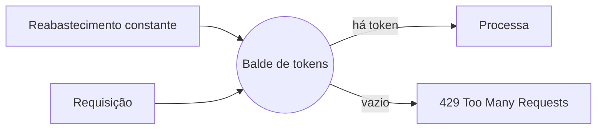

# Rate Limiting

## Resumo

**Rate limiting** controla quantas requisições um cliente pode fazer em um intervalo de tempo. Há dois lados: como **consumidor** de APIs externas (VirusTotal, Jira, GitHub), você precisa respeitar cotas para não ser bloqueado; como **provedor** (seu webhook ou API), precisa limitar clientes para proteger a disponibilidade e dificultar abuso, força bruta e negação de serviço. É um controle direto do pilar de disponibilidade da tríade [[Modelo CIA e Princípios de Segurança]].

## Conceitos-chave

- **Janela fixa:** contador reiniciado a cada período; simples, permite rajadas na virada.
- **Janela deslizante:** distribui melhor a contagem.
- **Token bucket:** tokens reabastecidos em taxa constante; permite rajadas controladas.
- **Leaky bucket:** processa em taxa constante, suavizando o tráfego.
- **Cabeçalhos comuns:** `X-RateLimit-Limit`, `X-RateLimit-Remaining`, `Retry-After`; resposta HTTP 429.
- **Chave do limite:** por IP, por token, por usuário ou por rota.
- **Quotas:** limites de longo prazo (diário, mensal).

## Como funciona



Como consumidor, implemente um *limitador cliente* que espaça as chamadas conforme a cota (por exemplo, 4 req/min na API gratuita do VirusTotal) e reaja a 429 com `Retry-After`. Como provedor, aplique o limite o mais cedo possível (gateway) e use armazenamento compartilhado (como Redis) quando houver várias instâncias.

## Exemplo prático

Token bucket simples no cliente (Python):

```python
import time, threading

class TokenBucket:
    def __init__(self, taxa_por_seg: float, capacidade: int):
        self.taxa, self.cap = taxa_por_seg, capacidade
        self.tokens, self.ultimo = capacidade, time.monotonic()
        self.lock = threading.Lock()

    def aguardar(self):
        while True:
            with self.lock:
                agora = time.monotonic()
                self.tokens = min(self.cap, self.tokens + (agora - self.ultimo) * self.taxa)
                self.ultimo = agora
                if self.tokens >= 1:
                    self.tokens -= 1
                    return
            time.sleep(0.05)

limite = TokenBucket(taxa_por_seg=4/60, capacidade=1)  # 4 por minuto
limite.aguardar()  # chame antes de cada requisição
```

## Boas práticas

- Leia a documentação de cotas de cada API e configure o limitador por ferramenta.
- Respeite `Retry-After` e combine com [[Retries com Backoff e Tratamento de Falhas]].
- No provedor, devolva 429 com mensagem clara e registre abusos.
- Use limites mais rígidos em rotas sensíveis (login, geração de token).

## Erros comuns

- Ignorar cotas e ser bloqueado em plena resposta a incidente.
- Limitar apenas por IP, atrás de NAT ou proxy.
- Contadores locais em ambientes com várias réplicas.
- Não monitorar quantos 429 foram recebidos.

> [!warning] Limite não é autenticação
> Rate limiting complementa, mas não substitui, autenticação e autorização.

## Referências para aprofundar

- Documentação de rate limit do GitHub e do VirusTotal; OWASP API4: Unrestricted Resource Consumption.

## Veja também

- [[Retries com Backoff e Tratamento de Falhas]]
- [[Webhooks e Polling]]
- [[Padrões de Integração - Point-to-Point Hub-and-Spoke e Event-Driven]]
- [[Idempotência]]
- [[MOC - Arquitetura e Padrões de Integração]]

#seguranca/integracao/rate-limit #seguranca/api/protecao
