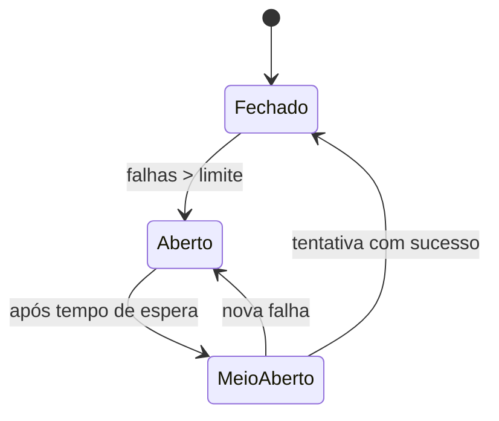

# Retries com Backoff e Tratamento de Falhas

## Resumo

Falhas são normais em integrações: timeouts, erros 5xx, limites de taxa e quedas de rede. **Retry** é tentar novamente; **backoff exponencial** aumenta o intervalo a cada tentativa (1s, 2s, 4s...); **jitter** adiciona aleatoriedade para evitar que muitos clientes tentem ao mesmo tempo. Além disso, padrões como **circuit breaker**, **timeouts** e **dead-letter queue** impedem que uma dependência lenta derrube todo o sistema. Retries só são seguros se a operação for [[Idempotência]].

## Conceitos-chave

- **Erros transitórios vs. permanentes:** repetir 503 e 429; não repetir 400, 401 ou 404.
- **Backoff exponencial com jitter** e teto máximo de espera.
- **Cabeçalho `Retry-After`:** respeite a orientação do servidor.
- **Timeout:** toda chamada de rede precisa de limite (conexão e leitura).
- **Circuit breaker:** estados fechado, aberto e meio-aberto.
- **Bulkhead:** isolar recursos para que uma falha não se espalhe.
- **Dead-letter queue:** destino de mensagens que esgotaram tentativas.

## Como funciona



Quando o circuito está **aberto**, as chamadas falham imediatamente, sem sobrecarregar o serviço degradado. Após um intervalo, permite-se uma tentativa de teste. Em fluxos assíncronos, mensagens que falham são reenfileiradas com atraso crescente e, após *N* tentativas, vão para a DLQ para análise humana.

## Exemplo prático

Retry com backoff exponencial e jitter (Python):

```python
import random, time
import requests

TRANSITORIOS = {429, 500, 502, 503, 504}

def chamar_com_retry(url: str, tentativas: int = 5, base: float = 1.0):
    for i in range(tentativas):
        try:
            r = requests.get(url, timeout=(3, 10))   # conexão, leitura
            if r.status_code not in TRANSITORIOS:
                return r
            espera = float(r.headers.get("Retry-After", base * 2 ** i))
        except (requests.ConnectionError, requests.Timeout):
            espera = base * 2 ** i
        # jitter: sorteia entre 0 e o valor calculado
        time.sleep(random.uniform(0, min(espera, 60)))
    raise RuntimeError("tentativas esgotadas")
```

> [!warning] POST
> Não repita um POST não idempotente sem chave de idempotência.

## Boas práticas

- Limite o número de tentativas e o tempo total.
- Registre cada falha com contexto (alvo, tentativa, erro) sem expor segredos.
- Exponha métricas: taxa de erro, tentativas, tamanho da DLQ.
- Falhe de forma segura: se o destino de segurança está fora, enfileire em vez de descartar.

## Erros comuns

- Retry infinito sem espera (tempestade de requisições).
- Sem jitter, gerando picos sincronizados.
- Repetir erros permanentes (credencial inválida).
- Engolir exceções e perder o alerta.

> [!tip] Fail-safe
> Em ferramenta de segurança, perder um alerta silenciosamente é pior do que atrasá-lo.

## Referências para aprofundar

- *Release It!*, Michael Nygard; guia "Timeouts, retries and backoff with jitter" (AWS Builders' Library).

## Veja também

- [[Idempotência]]
- [[Rate Limiting]]
- [[Filas e Streaming - Kafka e RabbitMQ]]
- [[Padrões de Integração - Point-to-Point Hub-and-Spoke e Event-Driven]]
- [[MOC - Arquitetura e Padrões de Integração]]

#seguranca/integracao/retry #seguranca/integracao/confiabilidade
