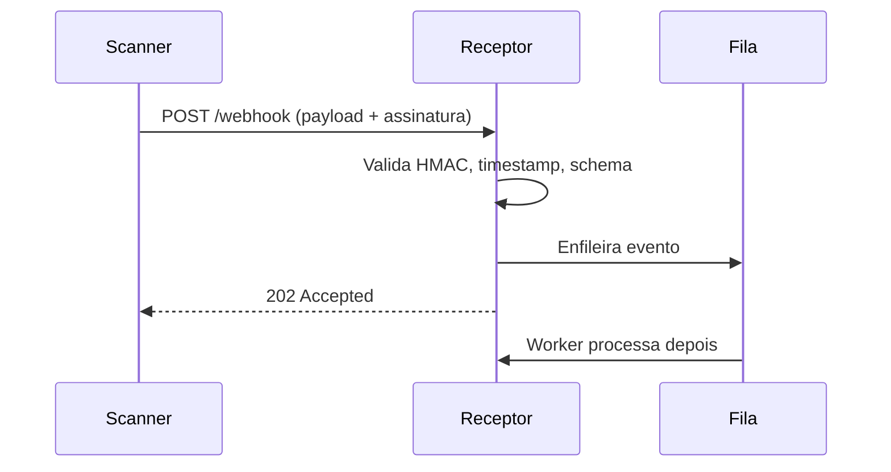

# Webhooks e Polling

## Resumo

**Webhook** é um callback HTTP: quando algo acontece no sistema de origem, ele envia uma requisição POST para uma URL registrada pelo consumidor. **Polling** é o oposto: o consumidor consulta a origem em intervalos regulares para saber se há novidades. Webhooks entregam dados quase em tempo real e economizam chamadas, mas exigem um endpoint público (ou acessível) e defesa contra requisições forjadas. Polling é simples e funciona atrás de firewalls, porém consome cota de API e introduz latência.

## Conceitos-chave

- **Push (webhook) vs. pull (polling):** quem inicia a comunicação.
- **Assinatura do payload:** HMAC com segredo compartilhado, enviado em cabeçalho (ex.: `X-Signature`).
- **Anti-replay:** timestamp e tolerância curta, além de id do evento.
- **Resposta rápida:** o receptor deve responder 2xx logo e processar de forma assíncrona.
- **Long polling e cursor:** reduzem latência e evitam reprocessar dados antigos.
- **Entrega ao-menos-uma-vez:** o emissor pode reenviar; o receptor precisa ser idempotente.

## Como funciona



No polling, o consumidor guarda um *cursor* (último id ou timestamp processado) e pergunta "o que mudou desde X?". Isso evita varreduras completas e reduz carga. A combinação comum é webhook como gatilho e polling como rede de segurança para reconciliar eventos perdidos.

## Exemplo prático

Receptor mínimo de webhook com validação (Python/FastAPI):

```python
import hmac, hashlib, time
from fastapi import FastAPI, Request, HTTPException

app = FastAPI()
SEGREDO = b"troque-por-segredo-do-cofre"  # na prática, vem de um cofre

@app.post("/webhook")
async def receber(req: Request):
    corpo = await req.body()
    assinatura = req.headers.get("X-Signature", "")
    ts = int(req.headers.get("X-Timestamp", "0"))
    if abs(time.time() - ts) > 300:           # janela anti-replay de 5 min
        raise HTTPException(401, "timestamp fora da janela")
    esperado = hmac.new(SEGREDO, f"{ts}.".encode() + corpo, hashlib.sha256).hexdigest()
    if not hmac.compare_digest(esperado, assinatura):
        raise HTTPException(401, "assinatura inválida")
    # enfileirar corpo e responder rápido
    return {"status": "aceito"}
```

> [!tip] Reconciliação
> Rode um polling periódico de baixa frequência para recuperar eventos que o webhook possa ter perdido.

## Boas práticas

- Sempre valide assinatura **sobre o corpo bruto**, antes de parsear.
- Limite tamanho do corpo e aplique [[Rate Limiting]].
- Responda 2xx rapidamente e processe fora da requisição.
- Use TLS e, quando possível, allowlist de IPs do emissor.

## Erros comuns

- Parsear JSON antes de validar a assinatura.
- Aceitar eventos antigos (replay).
- Processar de forma síncrona e estourar o timeout do emissor.
- Expor o endpoint sem autenticação alguma.

> [!warning] SSRF
> Se a sua ferramenta *envia* webhooks para URLs informadas por usuários, valide o destino para evitar SSRF.

## Referências para aprofundar

- Documentação de webhooks do GitHub e do Stripe (boas referências de assinatura).

## Veja também

- [[Padrões de Integração - Point-to-Point Hub-and-Spoke e Event-Driven]]
- [[Filas e Streaming - Kafka e RabbitMQ]]
- [[Rate Limiting]]
- [[Idempotência]]
- [[MOC - Arquitetura e Padrões de Integração]]

#seguranca/integracao/webhook #seguranca/integracao/polling
