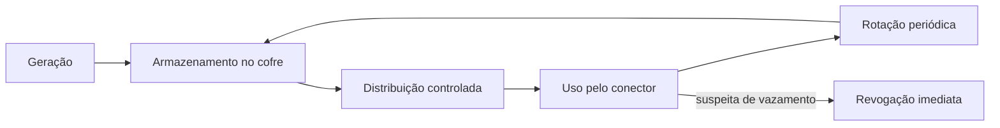

# API Keys e Gestão de Credenciais

## Resumo

Uma **API key** é um segredo estático que identifica e autoriza um cliente. É o mecanismo de autenticação mais comum em ferramentas de segurança (VirusTotal, Shodan, Nessus) por sua simplicidade, mas também o mais mal usado: chaves vazadas em repositórios, logs e capturas de tela estão entre as causas mais frequentes de incidentes. **Gestão de credenciais** abrange todo o ciclo de vida: geração, armazenamento, distribuição, uso, rotação e revogação.

## Conceitos-chave

- **Segredo de longa duração vs. credencial efêmera:** prefira tokens curtos e dinâmicos quando possível.
- **Cofre de segredos:** HashiCorp Vault, AWS Secrets Manager, Azure Key Vault, GCP Secret Manager.
- **Rotação:** troca periódica e automática, com janela de sobreposição.
- **Escopo e restrições:** chaves limitadas por IP, por API ou por tempo.
- **Hash de armazenamento:** servidores guardam apenas o hash da chave (como senhas).
- **Detecção de vazamento:** secrets scanning (gitleaks) e revogação imediata.
- **Transporte:** cabeçalho `Authorization` ou `X-API-Key`, nunca na query string.

## Como funciona



A aplicação lê o segredo do cofre em tempo de execução (ou o recebe injetado pelo orquestrador) e nunca o grava em disco, imagem de container ou repositório. Cada serviço tem sua própria credencial com permissões mínimas, o que limita o raio de impacto de um vazamento e facilita auditoria.

## Exemplo prático

Carregando configuração sem expor o segredo (Python):

```python
import os, logging

log = logging.getLogger("conector")

def carregar_chave() -> str:
    chave = os.environ.get("VT_API_KEY")
    if not chave:
        raise RuntimeError("VT_API_KEY ausente")
    return chave

def mascarar(segredo: str) -> str:
    # Exibe apenas o final, útil para depuração segura
    return "*" * (len(segredo) - 4) + segredo[-4:]

log.info("Chave carregada: %s", mascarar(carregar_chave()))
```

> [!example] Pre-commit
> Configure o gitleaks como hook para barrar commits com padrões de chave.

## Boas práticas

- Uma chave por serviço e por ambiente; nunca reutilize entre dev e produção.
- Rotacione em calendário e após qualquer suspeita de exposição.
- Registre uso (quem, quando, de onde) e alerte sobre anomalias.
- Prefira credenciais efêmeras e identidades de workload.

## Erros comuns

- Colocar a chave na URL ou em código-fonte.
- Compartilhar uma chave "mestra" entre equipes.
- Revogar sem plano e derrubar integrações críticas.
- Imprimir cabeçalhos completos em logs de depuração.

> [!warning] Vazou?
> Revogue primeiro, investigue depois: remover o commit do histórico não invalida a chave.

## Referências para aprofundar

- OWASP Secrets Management Cheat Sheet; documentação do HashiCorp Vault.

## Veja também

- [[OAuth 2.0 e OIDC]]
- [[Escopos e Menor Privilégio]]
- [[mTLS]]
- [[OWASP ASVS]]
- [[MOC - APIs e Autenticação]]

#seguranca/api/credenciais #seguranca/segredos
