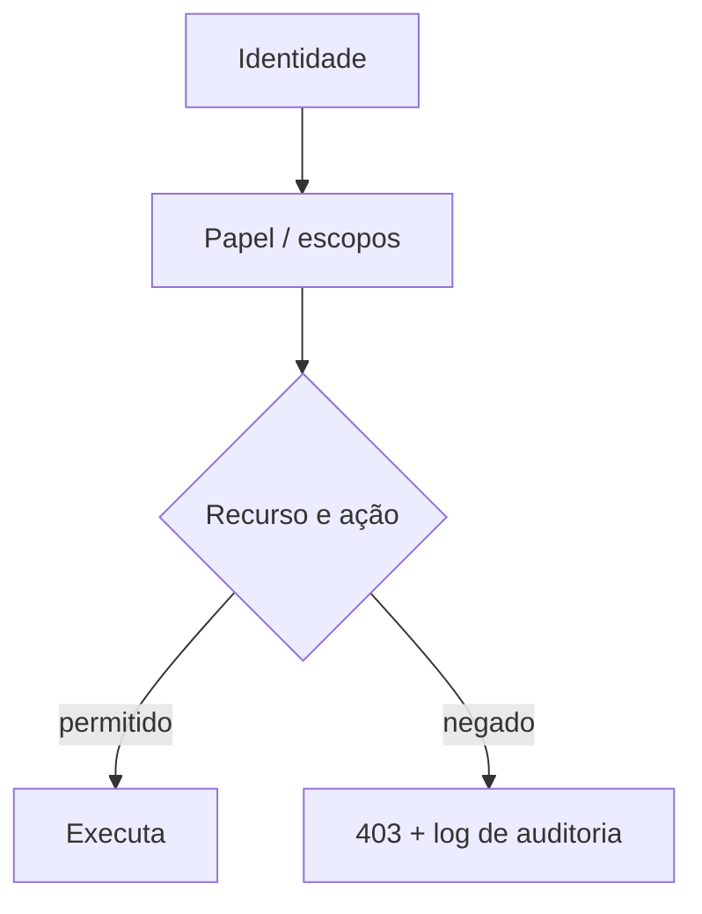

# Escopos e Menor Privilégio

## Resumo

O **princípio do menor privilégio** determina que cada identidade (usuário, serviço, token) receba apenas as permissões necessárias para sua função, pelo tempo necessário. Em APIs, isso se implementa com **escopos** (nos tokens OAuth), **papéis** (RBAC), **atributos** (ABAC) e políticas por recurso. Um conector que só precisa criar tickets não deve poder apagar projetos; um scanner que lê repositórios não deve poder escrever neles. Quando uma credencial vaza, o menor privilégio determina o tamanho do estrago.

## Conceitos-chave

- **Escopo:** permissão nomeada no token (ex.: `findings:read`, `tickets:create`).
- **RBAC:** permissões agrupadas em papéis atribuídos a identidades.
- **ABAC:** decisões com base em atributos (departamento, ambiente, horário).
- **Autorização por objeto e por propriedade.**
- **Just-in-time e permissões temporárias.**
- **Separação de funções:** quem aprova não executa.
- **Revisão periódica de acessos** (access review) e remoção de permissões ociosas.

## Como funciona



O desenho começa pelo inventário de ações que o conector realmente realiza. Cada ação vira um escopo mínimo; o provedor de identidade emite tokens contendo apenas esses escopos. No servidor, o middleware compara os escopos exigidos pela rota com os presentes no token e retorna 403 se faltarem. Em nuvem, aplica-se o mesmo raciocínio às políticas de IAM.

## Exemplo prático

Decorador de verificação de escopo (Python):

```python
from functools import wraps

def exige_escopo(escopo: str):
    def deco(fn):
        @wraps(fn)
        def interno(token_claims: dict, *a, **kw):
            escopos = set(token_claims.get("scope", "").split())
            if escopo not in escopos:
                raise PermissionError(f"escopo ausente: {escopo}")
            return fn(token_claims, *a, **kw)
        return interno
    return deco

@exige_escopo("tickets:create")
def criar_ticket(claims, dados):
    ...
```

> [!example] Aplicação
> O conector Trivy→Jira recebe apenas `tickets:create` e `findings:read`, nunca `admin`.

## Boas práticas

- Comece com **negar por padrão** e conceda o necessário.
- Use contas de serviço distintas por integração.
- Registre decisões de autorização para auditoria.
- Revise permissões trimestralmente e remova as ociosas.

## Erros comuns

- Tokens "admin" para facilitar testes que vão parar em produção.
- Checar permissão no front-end apenas.
- Esquecer de limitar escopos na emissão e só validar no uso.
- Papéis excessivamente amplos que se acumulam com o tempo.

> [!tip] Teste
> Escreva testes que provam que uma identidade **não** consegue executar ações fora do seu escopo.

## Referências para aprofundar

- NIST SP 800-162 (ABAC); OWASP Authorization Cheat Sheet.

## Veja também

- [[OAuth 2.0 e OIDC]]
- [[JWT]]
- [[API Keys e Gestão de Credenciais]]
- [[OWASP ASVS]]
- [[MOC - APIs e Autenticação]]

#seguranca/api/autorizacao #seguranca/principios/menor-privilegio
