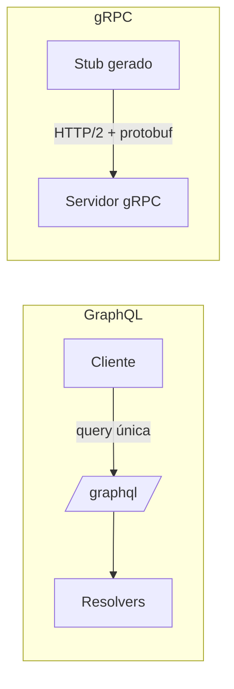

# GraphQL e gRPC

## Resumo

**GraphQL** é uma linguagem de consulta em que o cliente descreve exatamente os campos que quer, em um único endpoint, sobre um esquema tipado. **gRPC** é um framework de chamada remota sobre HTTP/2 que usa **Protocol Buffers** (protobuf) como formato binário e contrato (`.proto`), com suporte a streaming bidirecional. Ferramentas de segurança como GitHub (GraphQL v4) e componentes internos de alta performance (gRPC) expõem essas interfaces. Ambas têm riscos próprios que diferem do REST.

## Conceitos-chave

- **GraphQL:** schema, queries, mutations, subscriptions, resolvers, introspecção.
- **Riscos GraphQL:** consultas profundas ou caras (negação de serviço), *batching* para força bruta, introspecção habilitada em produção, autorização por campo ausente.
- **gRPC:** serviços e mensagens definidos em `.proto`; códigos de status próprios; streaming unário, servidor, cliente e bidirecional.
- **Segurança gRPC:** TLS/mTLS, interceptors para autenticação e logging, limites de tamanho de mensagem.
- **Contrato forte:** geração de código reduz erros de integração.

## Como funciona



Em GraphQL, defenda-se com **limite de profundidade e de complexidade**, desativando introspecção quando não for necessária e autorizando em cada resolver. Em gRPC, o contrato `.proto` vira fonte da verdade: mudanças compatíveis (adicionar campos opcionais) não quebram clientes, enquanto renumerar campos quebra.

## Exemplo prático

Consulta GraphQL à API do GitHub com variáveis, sem concatenar strings (Python):

```python
import requests

QUERY = '''
query($owner: String!, $nome: String!) {
  repository(owner: $owner, name: $nome) {
    vulnerabilityAlerts(first: 10) {
      nodes { securityVulnerability { severity package { name } } }
    }
  }
}
'''
r = requests.post(
    "https://api.github.com/graphql",
    json={"query": QUERY, "variables": {"owner": "org", "nome": "repo"}},
    headers={"Authorization": "Bearer TOKEN_DO_COFRE"},
    timeout=15,
)
```

Contrato gRPC mínimo:

```protobuf
syntax = "proto3";
service Achados {
  rpc Enviar (Achado) returns (Resposta);
}
message Achado { string id = 1; string titulo = 2; string severidade = 3; }
message Resposta { bool ok = 1; }
```

## Boas práticas

- Use variáveis (nunca interpolação) em queries GraphQL.
- Imponha limites de profundidade, custo e tamanho de resposta.
- Em gRPC, habilite TLS e autenticação por interceptor; defina deadlines em toda chamada.
- Versione o `.proto` com cuidado e nunca reutilize números de campo.

## Erros comuns

- Deixar introspecção e IDE de testes abertos em produção.
- Autorização apenas no nível da consulta, não por campo ou objeto.
- Chamadas gRPC sem deadline, ficando penduradas.
- Expor gRPC sem TLS "porque é rede interna".

> [!question] Escolha
> Precisa de flexibilidade para clientes variados (GraphQL) ou de baixa latência entre serviços internos (gRPC)?

## Referências para aprofundar

- graphql.org/learn; grpc.io; OWASP GraphQL Cheat Sheet.

## Veja também

- [[REST e Design de APIs de Segurança]]
- [[OpenAPI]]
- [[mTLS]]
- [[OWASP Top 10 - Integração]]
- [[MOC - APIs e Autenticação]]

#seguranca/api/graphql #seguranca/api/grpc
