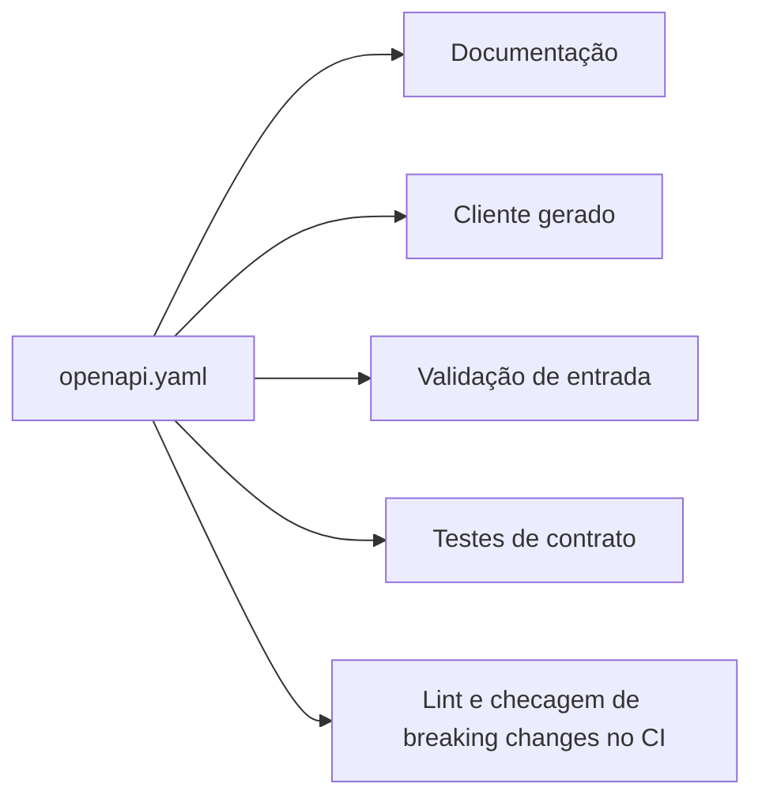

# OpenAPI

## Resumo

**OpenAPI** (antes Swagger) é uma especificação para descrever APIs REST em YAML ou JSON: caminhos, métodos, parâmetros, esquemas de dados, respostas e mecanismos de segurança. Funciona como **contrato** entre quem fornece e quem consome a API. A partir dele é possível gerar documentação, clientes, servidores-esqueleto, mocks e testes de contrato. Para a segurança, o contrato é valioso: define o que é aceito, permitindo validação automática de entrada e detecção de desvios, e serve de entrada para ferramentas de teste de API.

## Conceitos-chave

- **Documento:** `openapi: 3.x`, `info`, `servers`, `paths`, `components`.
- **Schemas:** tipos, formatos, `required`, `enum`, limites (`maxLength`, `minimum`).
- **securitySchemes:** `apiKey`, `http` (bearer), `oauth2`, `openIdConnect`, `mutualTLS`.
- **Referências `$ref`:** reutilização de componentes.
- **Geração de código** e **validação de requisição/resposta**.
- **Linting de contrato** (Spectral) e **detecção de breaking changes**.

## Como funciona



O fluxo "contract-first" escreve o contrato antes do código; o "code-first" gera o contrato a partir do código. Em ambos, o CI deve falhar se o contrato mudar de forma incompatível. Esquemas com limites explícitos reduzem risco de entradas excessivas e *mass assignment* (`additionalProperties: false`).

## Exemplo prático

Trecho de contrato para receber achados:

```yaml
openapi: 3.0.3
info: {title: API de Achados, version: "1.0.0"}
paths:
  /v1/achados:
    post:
      security: [{bearerAuth: []}]
      requestBody:
        required: true
        content:
          application/json:
            schema: {$ref: "#/components/schemas/Achado"}
      responses:
        "202": {description: Aceito}
        "422": {description: Payload inválido}
components:
  securitySchemes:
    bearerAuth: {type: http, scheme: bearer, bearerFormat: JWT}
  schemas:
    Achado:
      type: object
      required: [titulo, severidade]
      additionalProperties: false
      properties:
        titulo: {type: string, maxLength: 200}
        severidade: {type: string, enum: [baixa, media, alta, critica]}
```

> [!example] Validação
> No Python, `jsonschema` ou `openapi-core` validam requisições contra esse contrato.

## Boas práticas

- Declare `securitySchemes` e aplique segurança em cada operação.
- Use `additionalProperties: false` e limites de tamanho.
- Versione o contrato e rode checagem de breaking changes no CI.
- Não inclua segredos nem URLs internas em exemplos publicados.

## Erros comuns

- Contrato desatualizado em relação à implementação.
- Documentar endpoints internos em documentação pública.
- Esquemas sem limites, permitindo payloads gigantes.
- Esquecer de descrever respostas de erro.

> [!tip] Automação
> Ferramentas como Spectral (lint) e openapi-diff (mudanças incompatíveis) se encaixam bem no pipeline.

## Referências para aprofundar

- spec.openapis.org; Spectral; OWASP API Security Top 10.

## Veja também

- [[REST e Design de APIs de Segurança]]
- [[Paginação e Versionamento]]
- [[GraphQL e gRPC]]
- [[OWASP Top 10 - Integração]]
- [[MOC - APIs e Autenticação]]

#seguranca/api/openapi #seguranca/desenvolvimento/contratos
