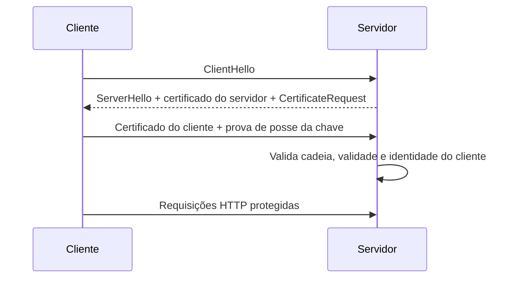

# mTLS

## Resumo

No TLS comum, apenas o **servidor** prova sua identidade com um certificado; no **mTLS** (mutual TLS), o **cliente também** apresenta um certificado e o servidor o valida. O resultado é autenticação forte e bidirecional na camada de transporte, sem enviar segredos reutilizáveis a cada requisição. É muito usado entre serviços internos (service mesh), em APIs de alto risco e em integrações máquina a máquina em que se quer evitar chaves estáticas.

## Conceitos-chave

- **CA (Autoridade Certificadora):** entidade que assina certificados; pode ser interna (PKI privada).
- **Certificado e chave privada:** a chave nunca sai do cliente.
- **Cadeia de confiança:** o servidor confia em uma lista de CAs para clientes.
- **Subject / SAN:** identidade presente no certificado, usada para autorização.
- **Rotação e expiração:** certificados de vida curta reduzem risco.
- **Revogação:** CRL ou OCSP; na prática, vida curta costuma ser mais simples.
- **Certificate pinning** e **SPIFFE/SPIRE** para identidades de workload.

## Como funciona



Após o handshake, o servidor extrai a identidade do certificado (por exemplo, o SAN `conector-jira.interno`) e a usa na autorização. Como a identidade é provada criptograficamente, não há token de longa duração a vazar. O custo operacional está em emitir, distribuir e renovar certificados, que costuma ser automatizado.

## Exemplo prático

Cliente Python com mTLS (para laboratório):

```python
import requests

r = requests.get(
    "https://api.interna.local/v1/status",
    cert=("cliente.crt", "cliente.key"),   # certificado e chave do cliente
    verify="ca-interna.pem",               # CA que assina o servidor
    timeout=10,
)
print(r.status_code)
```

Geração de certificado de laboratório (somente para testes):

```bash
openssl req -x509 -newkey rsa:2048 -nodes -keyout cliente.key \
  -out cliente.crt -days 7 -subj "/CN=conector-lab"
```

> [!warning] Laboratório
> Certificados autoassinados são só para estudo. Em produção, use uma PKI com rotação automática.

## Boas práticas

- Emita certificados de vida curta e automatize a renovação.
- Proteja chaves privadas (permissões restritas, HSM ou cofre).
- Nunca desative a verificação do servidor (`verify=False`).
- Autorize pela identidade do certificado, não apenas pela validade da cadeia.

## Erros comuns

- Confiar em "qualquer certificado assinado por qualquer CA".
- Esquecer a expiração e derrubar a integração.
- Compartilhar o mesmo certificado entre vários serviços.
- Terminar o mTLS em um proxy e não propagar a identidade com segurança.

> [!question] Pergunta
> Quem monitora a expiração dos certificados da sua integração?

## Referências para aprofundar

- RFC 8446 (TLS 1.3); RFC 8705 (OAuth 2.0 mTLS); documentação do SPIFFE.

## Veja também

- [[OAuth 2.0 e OIDC]]
- [[API Keys e Gestão de Credenciais]]
- [[GraphQL e gRPC]]
- [[Modelo CIA e Princípios de Segurança]]
- [[MOC - APIs e Autenticação]]

#seguranca/api/mtls #seguranca/autenticacao/tls
