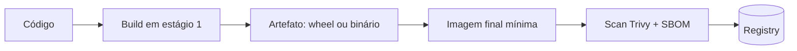

# Empacotamento e Containers

## Resumo

**Empacotar** é transformar o código em algo instalável e reproduzível. Em Python, o resultado típico é uma *wheel* publicada em um índice de pacotes (interno ou público); em Go, um binário estático; em ambos, uma **imagem de container** para execução em Kubernetes, CI ou servidores. O empacotamento é também uma fronteira de segurança: o que entra na imagem (pacotes do sistema, interpretador, bibliotecas) vira sua superfície de ataque e precisa ser mínimo, versionado e verificável.

## Conceitos-chave

- **Wheel / sdist** (Python) e **`go build`** com `CGO_ENABLED=0` para binário estático.
- **Dockerfile multi-stage:** compila em uma etapa e copia apenas o resultado para a imagem final.
- **Imagens base mínimas:** `python:slim`, `distroless`, `scratch` (Go).
- **Usuário não root** e sistema de arquivos somente leitura.
- **Digest pinning:** referenciar imagem por `@sha256:...`.
- **Escaneamento da imagem** (Trivy) e geração de SBOM.
- **Versionamento semântico** e *tags* imutáveis.

## Como funciona



Na etapa de build ficam compiladores e ferramentas; na imagem final, apenas o necessário para executar. Isso reduz tamanho, número de CVEs e utilitários disponíveis a um invasor (shell, gerenciador de pacotes).

## Exemplo prático

Dockerfile multi-stage para uma ferramenta Go:

```dockerfile
# Estágio de build
FROM golang:1.22 AS build
WORKDIR /src
COPY go.mod go.sum ./
RUN go mod download
COPY . .
RUN CGO_ENABLED=0 go build -trimpath -o /out/conector ./cmd/conector

# Imagem final mínima, sem shell
FROM gcr.io/distroless/static-debian12:nonroot
COPY --from=build /out/conector /conector
USER nonroot:nonroot
ENTRYPOINT ["/conector"]
```

Variante Python:

```dockerfile
FROM python:3.12-slim
RUN useradd --create-home --uid 10001 app
WORKDIR /app
COPY pyproject.toml ./
COPY src ./src
RUN pip install --no-cache-dir .
USER app
ENTRYPOINT ["conector"]
```

> [!tip] Execução endurecida
> Rode com `--read-only`, `--cap-drop=ALL` e `--security-opt=no-new-privileges` quando possível.

## Boas práticas

- Fixe versões e, se possível, digests de imagens base.
- Nunca copie `.env`, chaves ou histórico git para a imagem (use `.dockerignore`).
- Escaneie a imagem no CI e falhe em CVEs críticas corrigíveis.
- Publique SBOM e assine as imagens (veja a parte de DevSecOps).

## Erros comuns

- Executar como root dentro do container.
- Colocar segredos em `ENV` ou `ARG` do Dockerfile (ficam nas camadas).
- Usar a tag `latest`.
- Imagem gigante com compiladores e ferramentas de depuração em produção.

> [!warning] Camadas
> Remover um arquivo em uma camada posterior não o apaga das camadas anteriores.

## Referências para aprofundar

- Docker Best Practices; CIS Docker Benchmark; Distroless images (Google).

## Veja também

- [[Escolha de Linguagem - Python e Go]]
- [[Logging e Configuração Segura]]
- [[Estrutura de Projeto]]
- [[Ferramentas de Postura e Proteção - CSPM WAF Scanners e Segredos]]
- [[MOC - Desenvolvimento de Ferramentas]]

#seguranca/desenvolvimento/empacotamento #seguranca/containers
