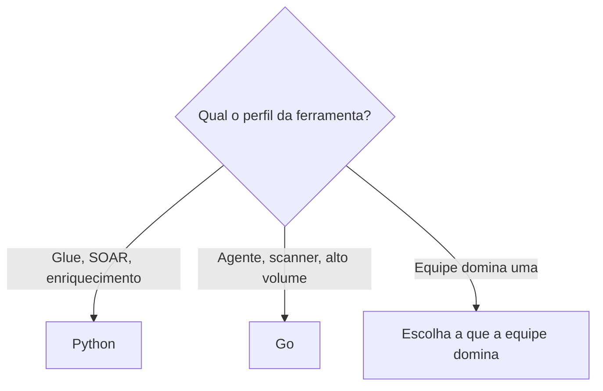

# Escolha de Linguagem - Python e Go

## Resumo

A linguagem escolhida para uma ferramenta de segurança influencia velocidade de desenvolvimento, desempenho, distribuição e superfície de ataque. **Python** domina a automação de segurança: bibliotecas maduras para HTTP, parsing, dados e integração com praticamente todo produto (PyMISP, python-gvm, hvac, pycti), além de prototipação rápida. **Go** brilha em ferramentas distribuídas como binário único, concorrência simples e alto desempenho; muitas ferramentas de segurança de referência (Trivy, gitleaks, Nuclei, Vault) são escritas em Go. Não há vencedora absoluta: a escolha depende do problema.

## Conceitos-chave

- **Python:** tipagem dinâmica (com *type hints*), ecossistema vasto, ótimo para glue code, SOAR e análise de dados; exige gerenciar interpretador e dependências.
- **Go:** tipagem estática, compilação para binário estático, goroutines, biblioteca padrão forte em rede e HTTP; menos flexível para scripts rápidos.
- **Critérios de decisão:** equipe, desempenho, distribuição, ecossistema de integração, segurança de memória, tempo de partida.
- **Segurança de memória:** ambas as linguagens são gerenciadas por coletor de lixo, reduzindo classes inteiras de falhas comuns em C/C++.
- **Dependências:** pip/PyPI e módulos Go têm riscos de supply chain, veja [[SDLC e SSDLC]].

## Como funciona

| Critério | Python | Go |
|---|---|---|
| Prototipação | Muito rápida | Moderada |
| Distribuição | Interpretador + dependências (ou container) | Binário único |
| Concorrência | `asyncio`, threads, processos | Goroutines e canais |
| Integrações prontas | Abundantes | Boas, menos abrangentes |
| Desempenho CPU | Moderado | Alto |
| Curva de aprendizado | Suave | Suave a moderada |



Uma estratégia comum: protótipo e orquestração em Python; componentes de alto volume ou distribuídos aos hosts em Go.

## Exemplo prático

O mesmo cliente HTTP com timeout em cada linguagem.

Python:

```python
import requests

def status(url: str) -> int:
    # timeout evita chamada pendurada indefinidamente
    return requests.get(url, timeout=10).status_code
```

Go:

```go
package main

import (
	"fmt"
	"net/http"
	"time"
)

func status(url string) (int, error) {
	// Cliente com timeout total de 10 segundos
	cli := &http.Client{Timeout: 10 * time.Second}
	resp, err := cli.Get(url)
	if err != nil {
		return 0, err
	}
	defer resp.Body.Close() // sempre feche o corpo
	return resp.StatusCode, nil
}

func main() {
	code, err := status("https://example.com")
	fmt.Println(code, err)
}
```

> [!tip] Padrão do Go
> O `http.DefaultClient` não tem timeout; crie sempre um cliente próprio.

## Boas práticas

- Escolha pela equipe e pelo ciclo de manutenção, não pela moda.
- Fixe versões de linguagem e dependências (`requirements.txt` com hashes, `go.sum`).
- Use *type hints* e verificadores (mypy) em Python; `go vet` e `staticcheck` em Go.
- Prefira bibliotecas padrão quando suficientes para reduzir dependências.

## Erros comuns

- Reescrever em outra linguagem sem necessidade real.
- Esquecer timeouts nos clientes HTTP (em ambas as linguagens).
- Instalar pacotes por nome sem verificar a procedência (typosquatting).
- Distribuir scripts sem controle de versão do interpretador.

> [!question] Decisão
> Sua ferramenta roda no laptop do analista, em um container ou em milhares de hosts? Isso pesa muito.

## Referências para aprofundar

- Documentação oficial de Python e Go; *Effective Go*; PEP 484 (type hints).

## Veja também

- [[Estrutura de Projeto]]
- [[CLI de Segurança]]
- [[Empacotamento e Containers]]
- [[Panorama de Ferramentas de Segurança]]
- [[MOC - Desenvolvimento de Ferramentas]]

#seguranca/desenvolvimento/linguagens #seguranca/desenvolvimento/python #seguranca/desenvolvimento/go
