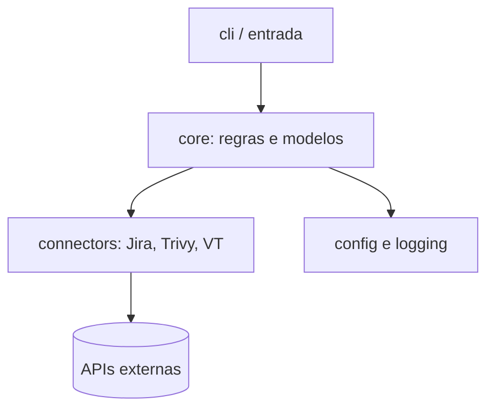

# Estrutura de Projeto

## Resumo

Uma boa estrutura de projeto torna a ferramenta testável, auditável e fácil de estender. Separar **entrada** (CLI, API, webhook), **domínio** (regras de negócio e modelos), **conectores** (integração com terceiros) e **infraestrutura** (configuração, logging) facilita trocar uma ferramenta sem reescrever o resto, aplicando o [[Padrão Adapter e Connector]]. Em segurança, isso também delimita fronteiras de confiança: o código que toca dados externos fica isolado e é validado antes de chegar ao núcleo.

## Conceitos-chave

- **Layout `src/`** em Python para evitar importações acidentais do diretório atual.
- **`pyproject.toml`:** metadados, dependências e configuração de ferramentas (ruff, mypy, pytest).
- **Go:** `cmd/<app>/main.go` para executáveis e `internal/` para código não exportado.
- **Camadas:** `cli`, `core` (domínio), `connectors`, `config`, `logging`.
- **Arquivos de governança:** `README`, `SECURITY.md`, `CHANGELOG`, `LICENSE`.
- **Automação:** `Makefile`, pre-commit, workflow de CI.

## Como funciona



Árvore sugerida para um conector Python:

```text
conector-trivy-jira/
├── pyproject.toml
├── README.md
├── SECURITY.md
├── src/
│   └── conector/
│       ├── __init__.py
│       ├── cli.py
│       ├── core/        # modelos e regras (sem rede)
│       ├── connectors/  # trivy.py, jira.py
│       ├── config.py
│       └── logs.py
├── tests/
│   ├── unit/
│   └── integration/
└── .github/workflows/ci.yml
```

A regra de dependência é unidirecional: `cli` conhece `core`; `core` não conhece `connectors` concretos, apenas interfaces.

## Exemplo prático

`pyproject.toml` mínimo com dependências travadas por faixa e ferramentas de qualidade:

```toml
[project]
name = "conector-trivy-jira"
version = "0.1.0"
requires-python = ">=3.11"
dependencies = ["requests>=2.31", "pydantic>=2.5"]

[project.scripts]
conector = "conector.cli:main"      # cria o comando 'conector'

[tool.ruff]
line-length = 100

[tool.pytest.ini_options]
testpaths = ["tests"]
```

> [!example] Fronteira
> `core/` não importa `requests`. Assim, os testes de domínio rodam sem rede e em milissegundos.

## Boas práticas

- Mantenha o domínio livre de I/O.
- Inclua `SECURITY.md` com canal de reporte de vulnerabilidades.
- Versione tudo, incluindo configurações de CI.
- Documente como executar testes e a ferramenta em poucos comandos.

## Erros comuns

- Um único arquivo `main.py` de 2.000 linhas.
- Misturar parsing, regras e chamadas de rede na mesma função.
- Commitar arquivos `.env`, chaves ou relatórios com dados reais.
- Dependências sem limite de versão ou sem lockfile.

> [!warning] .gitignore
> Inclua `.env`, `*.pem`, `*.key` e relatórios gerados no `.gitignore` desde o primeiro commit.

## Referências para aprofundar

- Python Packaging User Guide; *Standard Go Project Layout* (como referência, não dogma).

## Veja também

- [[Escolha de Linguagem - Python e Go]]
- [[Testes - Unitários Integração e Contratos]]
- [[CLI de Segurança]]
- [[SDLC e SSDLC]]
- [[MOC - Desenvolvimento de Ferramentas]]

#seguranca/desenvolvimento/estrutura #seguranca/desenvolvimento/boas-praticas
