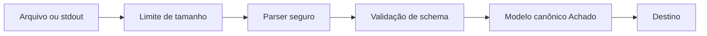

# Parsing de Formatos - SARIF JSON e XML

## Resumo

Ferramentas de segurança emitem relatórios em vários formatos, e o integrador precisa lê-los com robustez. **SARIF** (Static Analysis Results Interchange Format, OASIS) é o padrão JSON para resultados de análise estática, aceito por GitHub Code Scanning, VS Code e muitas ferramentas. **JSON** é o formato dominante em APIs e saídas de CLI (Trivy, Semgrep, gitleaks). **XML** persiste em produtos mais antigos (Nessus `.nessus`, OpenVAS, JUnit). Ler esses formatos é *processar entrada não confiável*: um arquivo malformado ou malicioso não pode comprometer a ferramenta.

## Conceitos-chave

- **SARIF:** `runs[]` → `tool.driver.rules[]` e `results[]` com `ruleId`, `level`, `message.text`, `locations[].physicalLocation.artifactLocation.uri` e `region.startLine`.
- **JSON:** estrutura variável por ferramenta; use schemas e modelos tipados.
- **XML:** risco de **XXE** (XML External Entity) e *billion laughs*; use `defusedxml`.
- **Parsing em streaming** (`ijson`, `iterparse`) para arquivos grandes.
- **Validação de schema** (JSON Schema, pydantic) antes de usar os dados.
- **Tolerância:** campos opcionais ausentes não podem derrubar o parser.

## Como funciona



O fluxo defensivo impõe limite de tamanho antes de ler, usa parser seguro (sem resolver entidades externas), valida a estrutura e só então converte para o modelo interno. Campos de texto vindos do relatório (mensagens, caminhos) devem ser tratados como não confiáveis ao serem enviados a tickets, dashboards ou shells.

## Exemplo prático

Convertendo SARIF para um modelo interno (Python):

```python
import json
from dataclasses import dataclass

@dataclass
class Achado:
    regra: str
    severidade: str
    arquivo: str
    linha: int
    mensagem: str

NIVEIS = {"error": "alta", "warning": "media", "note": "baixa", "none": "baixa"}

def ler_sarif(caminho: str) -> list[Achado]:
    with open(caminho, encoding="utf-8") as f:
        dados = json.load(f)
    achados = []
    for run in dados.get("runs", []):
        for r in run.get("results", []):
            loc = (r.get("locations") or [{}])[0].get("physicalLocation", {})
            achados.append(Achado(
                regra=r.get("ruleId", "desconhecida"),
                severidade=NIVEIS.get(r.get("level", "warning"), "media"),
                arquivo=loc.get("artifactLocation", {}).get("uri", "?"),
                linha=loc.get("region", {}).get("startLine", 0),
                mensagem=r.get("message", {}).get("text", "")[:500],  # limita tamanho
            ))
    return achados
```

Leitura segura de XML:

```python
from defusedxml import ElementTree as ET   # pip install defusedxml

arvore = ET.parse("relatorio.nessus")       # bloqueia entidades externas
```

## Boas práticas

- Use `defusedxml` (ou desabilite entidades externas) para qualquer XML externo.
- Limite tamanho e profundidade de entrada.
- Use `.get()` com padrões e trate ausência de campos.
- Teste o parser com relatórios reais anonimizados e com arquivos malformados.

## Erros comuns

- Usar `xml.etree` padrão com arquivos de origem desconhecida.
- Assumir que o primeiro `location` sempre existe.
- Carregar relatórios de centenas de MB na memória.
- Copiar mensagens do relatório diretamente para comandos ou HTML.

> [!warning] XXE
> Entidades externas em XML podem ler arquivos locais ou fazer requisições de rede a partir do servidor que processa o arquivo.

## Referências para aprofundar

- Especificação SARIF 2.1.0 (OASIS); OWASP XXE Prevention Cheat Sheet; docs do defusedxml.

## Veja também

- [[Normalização de Dados - OCSF ECS CEF STIX e TAXII]]
- [[Ferramentas de Teste de Aplicação - SAST DAST IAST SCA]]
- [[CLI de Segurança]]
- [[Integração com SAST e SCA - Semgrep SonarQube Dependabot e Snyk]]
- [[MOC - Desenvolvimento de Ferramentas]]

#seguranca/desenvolvimento/parsing #seguranca/desenvolvimento/sarif
