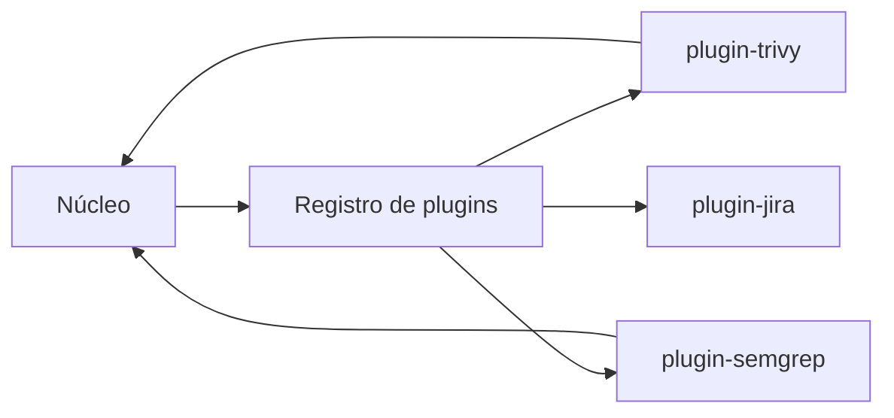

# Plugins e Extensões

## Resumo

Ferramentas de segurança precisam suportar novas fontes e destinos sem modificar o núcleo. Uma **arquitetura de plugins** permite que conectores sejam adicionados como pacotes separados, descobertos em tempo de execução. Em Python, o mecanismo padrão são os **entry points** de pacotes; em Go, costuma-se usar interfaces e registro em tempo de compilação, ou processos externos (como o modelo do HashiCorp go-plugin). A extensibilidade traz um risco central: **plugin é código executado com os privilégios da ferramenta**.

## Conceitos-chave

- **Contrato do plugin:** interface ou classe base com métodos obrigatórios e versão de API.
- **Descoberta:** entry points (`importlib.metadata`), diretório de plugins, registro explícito.
- **Registro (registry):** mapeia nome → implementação.
- **Isolamento:** executar plugins em processo separado, com permissões reduzidas.
- **Versionamento da API de plugin** e verificação de compatibilidade.
- **Confiança:** apenas plugins de origem verificada; considere assinatura e allowlist.

## Como funciona



No Python, um pacote de plugin declara em seu `pyproject.toml` um grupo de entry points; o núcleo lista o grupo e carrega somente os nomes presentes em uma **allowlist** configurada, evitando carregar tudo o que estiver instalado no ambiente.

## Exemplo prático

Declaração no pacote do plugin:

```toml
[project.entry-points."conector.leitores"]
trivy = "conector_trivy.leitor:LeitorTrivy"
```

Carregamento no núcleo, com allowlist:

```python
from importlib.metadata import entry_points

PERMITIDOS = {"trivy", "semgrep"}      # vem da configuração

def carregar_leitores() -> dict:
    leitores = {}
    for ep in entry_points(group="conector.leitores"):
        if ep.name in PERMITIDOS:        # ignora plugins não autorizados
            classe = ep.load()
            leitores[ep.name] = classe()
    return leitores
```

> [!example] Contrato
> Cada leitor implementa `ler(caminho) -> list[Achado]`; o núcleo não conhece o formato de origem.

## Boas práticas

- Defina e documente a API de plugin, com número de versão.
- Carregue apenas plugins em allowlist.
- Trate falhas de plugin sem derrubar o núcleo (isole exceções).
- Aplique o menor privilégio ao processo que executa plugins.

## Erros comuns

- Carregar qualquer módulo de um diretório gravável por usuários.
- Plugins com acesso irrestrito a segredos do núcleo.
- Quebrar a API de plugin sem aviso.
- Sem testes de contrato, deixando cada plugin se comportar de um jeito.

> [!warning] Supply chain
> Um plugin malicioso ou comprometido equivale a execução de código na sua ferramenta; trate-o como dependência crítica.

## Referências para aprofundar

- Python Packaging: *Creating and discovering plugins*; HashiCorp go-plugin.

## Veja também

- [[Padrão Adapter e Connector]]
- [[Estrutura de Projeto]]
- [[Testes - Unitários Integração e Contratos]]
- [[SDLC e SSDLC]]
- [[MOC - Desenvolvimento de Ferramentas]]

#seguranca/desenvolvimento/plugins #seguranca/desenvolvimento/extensibilidade
