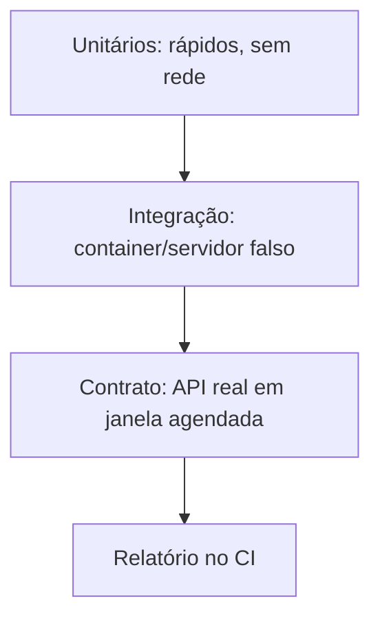

# Testes - Unitários Integração e Contratos

## Resumo

Ferramentas de segurança precisam ser confiáveis: um falso negativo causado por bug no conector é um risco real. A estratégia de testes combina três camadas. **Testes unitários** verificam funções puras (normalização, regras de gate) rapidamente. **Testes de integração** exercitam o conector contra um serviço real ou simulado (containers, servidor falso). **Testes de contrato** garantem que o que você assume sobre uma API externa (campos, tipos, códigos) continua verdadeiro, detectando quebras de versão antes da produção.

## Conceitos-chave

- **Pirâmide de testes:** muitos unitários, alguns de integração, poucos ponta a ponta.
- **Test doubles:** *fake* (implementação simples), *stub* (respostas fixas), *mock* (verifica chamadas).
- **Fixtures:** amostras reais (e anonimizadas) de relatórios e respostas de API.
- **Contrato:** validação de respostas contra schema OpenAPI ou testes de consumidor (Pact).
- **Testes de propriedade e fuzzing** para parsers (Hypothesis).
- **Cobertura** como indicador, não como meta isolada.
- **Testes de segurança:** verificar rejeição de entradas inválidas e ausência de vazamento de segredos em logs.

## Como funciona



Em CI, os unitários e de integração rodam a cada PR; os de contrato contra a API real rodam agendados (diariamente), pois dependem de rede e de cotas. Quando o contrato falha, o fornecedor mudou algo: isso vira ticket antes de virar incidente.

## Exemplo prático

Teste com `pytest` e um cliente HTTP simulado (Python):

```python
import pytest
from conector.core import classificar

@pytest.mark.parametrize("sev,esperado", [
    ("CRITICAL", "critica"),
    ("HIGH", "alta"),
    ("UNKNOWN", "media"),   # valor inesperado cai em padrão seguro
])
def test_classificar(sev, esperado):
    assert classificar(sev) == esperado

def test_envio_nao_vaza_token(caplog):
    from conector.connectors.jira import enviar
    with caplog.at_level("DEBUG"):
        enviar({"titulo": "x"}, token="SEGREDO123", cliente=FakeHTTP())
    assert "SEGREDO123" not in caplog.text      # garante que o segredo não vaza

class FakeHTTP:
    def post(self, *a, **kw):
        class R:
            status_code = 201
            def json(self): return {"key": "SEC-1"}
            def raise_for_status(self): pass
        return R()
```

> [!tip] Fakes
> Um `FakeHTTP` pequeno costuma ser mais legível do que mocks encadeados.

## Boas práticas

- Teste caminhos de erro (timeout, 429, JSON inválido), não só o caminho feliz.
- Mantenha fixtures versionadas e sem dados sensíveis.
- Rode testes em CI em todo PR; falha bloqueia o merge.
- Teste idempotência enviando o mesmo evento duas vezes (veja [[Idempotência]]).

## Erros comuns

- Testes que dependem de rede e falham aleatoriamente.
- Mocks que repetem a implementação e não detectam bugs reais.
- Fixtures com credenciais ou dados pessoais reais.
- Cobertura alta com asserções vazias.

> [!warning] Dados reais
> Anonimize relatórios antes de commitá-los como fixtures, em conformidade com a LGPD.

## Referências para aprofundar

- Documentação do pytest e do Hypothesis; Pact (consumer-driven contracts).

## Veja também

- [[Estrutura de Projeto]]
- [[Padrão Adapter e Connector]]
- [[Parsing de Formatos - SARIF JSON e XML]]
- [[Idempotência]]
- [[MOC - Desenvolvimento de Ferramentas]]

#seguranca/desenvolvimento/testes #seguranca/qualidade
