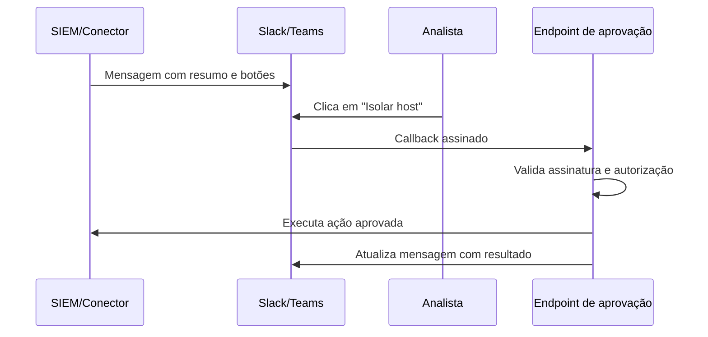

# Integração com Mensageria - Slack e Teams

## Resumo

Notificações levam o alerta certo à pessoa certa no canal que ela já acompanha. **Slack** e **Microsoft Teams** são os destinos mais comuns de *ChatOps*. A forma mais simples é o **incoming webhook** (uma URL que aceita um JSON e publica a mensagem); formas mais ricas usam apps com OAuth, botões interativos e aprovações (*human-in-the-loop*). Boas notificações são curtas, acionáveis e deduplicadas: alerta demais gera fadiga e é ignorado.

## Conceitos-chave

- **Slack:** incoming webhook (`POST` com `{"text": ...}` ou **Block Kit** para layout rico); Web API (`chat.postMessage`) com token de bot e escopo `chat:write`.
- **Teams:** os conectores antigos de webhook foram descontinuados em favor de **Workflows** (Power Automate) que recebem um payload, normalmente com *Adaptive Cards*; confirme o formato vigente na documentação da Microsoft.
- **A URL do webhook é um segredo:** quem a possui publica no canal.
- **Interatividade:** botões "Aprovar/Rejeitar" chamam seu endpoint, que deve **validar a assinatura** do pedido.
- **Agrupamento e *threads*** para reduzir ruído.

## Como funciona



O fluxo com botões implementa aprovação humana: o endpoint confirma que a requisição veio realmente do Slack (assinatura HMAC com timestamp), verifica se o usuário está autorizado e só então dispara a ação.

## Exemplo prático

Enviando alerta ao Slack via incoming webhook (Python):

```python
import os, requests

def notificar_slack(titulo: str, severidade: str, link: str):
    url = os.environ["SLACK_WEBHOOK_URL"]        # segredo: vem do cofre/ambiente
    emoji = {"critica": ":rotating_light:", "alta": ":warning:"}.get(severidade, ":information_source:")
    payload = {
        "text": f"{emoji} {titulo} ({severidade})",
        "blocks": [
            {"type": "section",
             "text": {"type": "mrkdwn", "text": f"*{titulo}*
Severidade: `{severidade}`"}},
            {"type": "section",
             "text": {"type": "mrkdwn", "text": f"<{link}|Abrir ticket>"}},
        ],
    }
    r = requests.post(url, json=payload, timeout=10)
    r.raise_for_status()
```

Validação de assinatura de requisições do Slack:

```python
import hmac, hashlib, time

def assinatura_slack_valida(segredo: str, ts: str, corpo: bytes, assinatura: str) -> bool:
    if abs(time.time() - int(ts)) > 300:         # anti-replay
        return False
    base = f"v0:{ts}:".encode() + corpo
    esperado = "v0=" + hmac.new(segredo.encode(), base, hashlib.sha256).hexdigest()
    return hmac.compare_digest(esperado, assinatura)
```

## Boas práticas

- Envie resumo + link para o detalhe, não dumps de log.
- Agrupe alertas repetidos em *threads* e aplique [[Rate Limiting]].
- Guarde URLs de webhook em cofre e rotacione se vazarem.
- Mascare dados sensíveis (tokens, PII) antes de enviar ao chat.

## Erros comuns

- Publicar segredos ou dados pessoais em canais amplos.
- Webhook em repositório público.
- Botões de ação sem validar assinatura e autorização.
- Notificar tudo, treinando a equipe a ignorar o canal.

> [!tip] Severidade
> Reserve menções (`@canal`) e canais de plantão para severidades altas.

## Referências para aprofundar

- Slack: Incoming webhooks, Block Kit, verificação de assinatura; Microsoft Teams Workflows e Adaptive Cards.

## Veja também

- [[Integração com Ticketing - Jira e GitHub Issues]]
- [[Integração com SIEM - Splunk Elastic e Wazuh]]
- [[Integração com Threat Intelligence - MISP OpenCTI e VirusTotal]]
- [[Rate Limiting]]
- [[MOC - Integração com Ferramentas de Segurança]]

#seguranca/integracao/mensageria-chat #seguranca/integracao/slack #seguranca/integracao/teams
