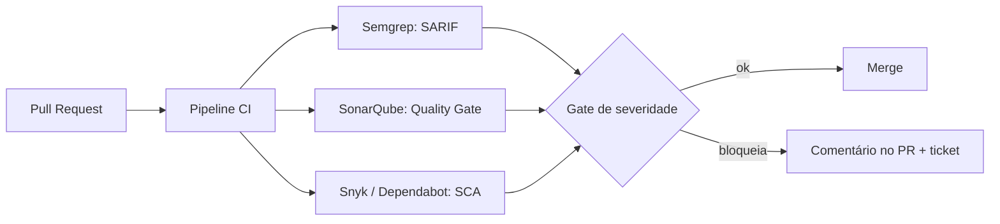

# Integração com SAST e SCA - Semgrep SonarQube Dependabot e Snyk

## Resumo

Esta nota cobre quatro ferramentas de análise de código e dependências. **Semgrep** (SAST baseado em padrões, com regras em YAML) e **SonarQube** (qualidade e segurança de código, com servidor e API) analisam o código-fonte. **Dependabot** (GitHub) e **Snyk** (SCA e mais) identificam dependências vulneráveis e propõem correções. A integração típica roda a ferramenta no CI, publica resultados em SARIF ou via API e aplica um **gate** para bloquear merges com achados graves.

## Conceitos-chave

- **Semgrep:** `semgrep scan --config <regras> --sarif` ou `--json`; campos `check_id`, `path`, `start.line`, `extra.severity`, `extra.message`.
- **SonarQube:** API `GET /api/issues/search` e *Quality Gates*; autenticação por token de usuário (como usuário no Basic Auth).
- **Dependabot:** alertas via API do GitHub (`/repos/{owner}/{repo}/dependabot/alerts`) e PRs automáticos de atualização.
- **Snyk:** `snyk test --json`, `snyk monitor`; também possui API REST.
- **SARIF upload:** envio ao GitHub Code Scanning.
- **Baseline e supressões:** controlar o legado sem travar o time.

## Como funciona



No PR, os resultados novos (não presentes na branch base) são os relevantes. Comparar com a *baseline* evita punir o time por dívida antiga. Os achados bloqueantes geram comentário no PR; os demais, tickets agrupados.

## Exemplo prático

Executando Semgrep e contando severidades (Python):

```python
import json, subprocess

def semgrep(caminho: str, regras: str = "p/ci") -> list[dict]:
    p = subprocess.run(
        ["semgrep", "scan", "--config", regras, "--json", "--quiet", caminho],
        capture_output=True, text=True, timeout=900)
    dados = json.loads(p.stdout or "{}")
    return [{
        "regra": r["check_id"],
        "arquivo": r["path"],
        "linha": r["start"]["line"],
        "severidade": r["extra"]["severity"],     # INFO, WARNING, ERROR
        "mensagem": r["extra"]["message"][:300],
    } for r in dados.get("results", [])]
```

Lendo alertas do Dependabot pela API do GitHub:

```python
import requests

def alertas_dependabot(owner, repo, token):
    r = requests.get(
        f"https://api.github.com/repos/{owner}/{repo}/dependabot/alerts",
        params={"state": "open", "per_page": 100},
        headers={"Authorization": f"Bearer {token}",
                 "Accept": "application/vnd.github+json",
                 "X-GitHub-Api-Version": "2022-11-28"},
        timeout=15)
    r.raise_for_status()
    return [{"pacote": a["dependency"]["package"]["name"],
             "severidade": a["security_advisory"]["severity"]} for a in r.json()]
```

Consulta ao SonarQube:

```bash
curl -s -u "$SONAR_TOKEN:" \
  "https://sonar.local/api/issues/search?componentKeys=meu-projeto&types=VULNERABILITY&ps=100"
```

## Boas práticas

- Comece com um conjunto pequeno de regras de alta confiança e expanda.
- Aplique o gate apenas a achados **novos** no PR.
- Siga a paginação da API (`per_page`, `Link`) para não perder alertas.
- Dê ao token do CI o menor escopo (`security_events: write`, leitura de alertas).

## Erros comuns

- Gate que bloqueia por qualquer achado, causando contornos pelo time.
- Ignorar dependências transitivas e de desenvolvimento.
- Suprimir regras sem justificativa nem prazo.
- Usar token pessoal em vez de token de serviço no CI.
- Esquecer que alertas do Dependabot exigem recurso habilitado no repositório.

> [!tip] Supressão auditável
> Registre supressões em arquivo versionado com dono, motivo e data de expiração.

## Referências para aprofundar

- Docs do Semgrep, SonarQube Web API, GitHub REST API (Dependabot), Snyk CLI; OASIS SARIF.

## Veja também

- [[Ferramentas de Teste de Aplicação - SAST DAST IAST SCA]]
- [[Parsing de Formatos - SARIF JSON e XML]]
- [[Integração com Ticketing - Jira e GitHub Issues]]
- [[Integração com Scanners - Nessus OpenVAS Trivy e Nuclei]]
- [[MOC - Integração com Ferramentas de Segurança]]

#seguranca/integracao/sast #seguranca/integracao/sca #seguranca/integracao/semgrep
