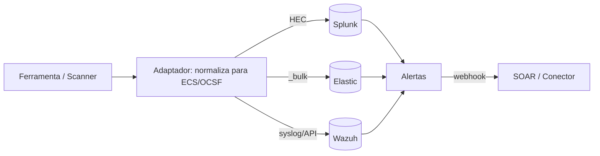

# Integração com SIEM - Splunk Elastic e Wazuh

## Resumo

O **SIEM** é o destino natural de eventos e alertas gerados por suas ferramentas. Esta nota cobre três plataformas: **Splunk** (comercial, com HTTP Event Collector), **Elastic Security** (Elasticsearch com esquema ECS) e **Wazuh** (open source, com agentes, regras e API REST). Integrar significa **enviar** eventos (ingestão) e **consultar** alertas ou dados (extração), com autenticação adequada e formato normalizado ([[Normalização de Dados - OCSF ECS CEF STIX e TAXII]]).

## Conceitos-chave

- **Caso de uso:** enviar achados de scanners ao SIEM para correlação; ler alertas do SIEM para enriquecer e abrir casos.
- **Splunk HEC:** endpoint `/services/collector/event`, cabeçalho `Authorization: Splunk <token>`, `sourcetype` e `index`.
- **Elastic:** API `_bulk` ou `_doc`, autenticação por API key (`Authorization: ApiKey ...`), mapeamento ECS.
- **Wazuh:** API em porta 55000; autenticação com usuário/senha que devolve um JWT; consulta de agentes, alertas via Indexer.
- **Syslog / CEF:** alternativa universal quando não há API.

## Como funciona



O fluxo de **saída** (SIEM → conector) usa webhook de ação de alerta (Splunk), *connector/rule action* (Elastic) ou integração customizada do Wazuh (`integrations` no `ossec.conf`, que chama um script com o alerta). O fluxo de **entrada** usa lotes para eficiência e respeita limites de payload.

## Exemplo prático

Enviando um evento ao Splunk HEC (Python):

```python
import requests, time

def enviar_splunk(evento: dict, token: str, url="https://splunk.local:8088"):
    payload = {
        "time": time.time(),
        "sourcetype": "_json",
        "index": "seguranca",
        "event": evento,
    }
    r = requests.post(
        f"{url}/services/collector/event",
        json=payload,
        headers={"Authorization": f"Splunk {token}"},
        timeout=10,
        verify="/etc/ssl/ca-interna.pem",   # nunca verify=False
    )
    r.raise_for_status()
```

Indexando em lote no Elasticsearch com `_bulk` (NDJSON):

```python
import json, requests

def bulk_elastic(docs: list[dict], api_key: str, url="https://es.local:9200"):
    linhas = []
    for d in docs:
        linhas.append(json.dumps({"index": {"_index": "achados-2026.10"}}))
        linhas.append(json.dumps(d))
    corpo = "\n".join(linhas) + "\n"          # NDJSON termina com quebra de linha
    r = requests.post(f"{url}/_bulk", data=corpo,
                      headers={"Authorization": f"ApiKey {api_key}",
                               "Content-Type": "application/x-ndjson"}, timeout=30)
    r.raise_for_status()
    return r.json().get("errors", False)       # True se algum item falhou
```

Consulta ao Wazuh (autenticação e lista de agentes):

```bash
TOKEN=$(curl -s -u usuario:senha -k -X POST \
  "https://wazuh.local:55000/security/user/authenticate?raw=true")
curl -s -k -H "Authorization: Bearer $TOKEN" "https://wazuh.local:55000/agents?limit=5"
```

## Boas práticas

- Use tokens/API keys dedicados e com permissão apenas de escrita no índice necessário.
- Envie em **lotes** e trate respostas parciais (no `_bulk`, `errors: true` não gera HTTP de erro).
- Padronize timestamps em UTC e campos no esquema ECS/OCSF.
- Configure TLS com CA própria; em laboratório, `-k`/`verify=False` apenas temporariamente.

## Erros comuns

- Esperar que `_bulk` retorne erro HTTP quando itens falham.
- Enviar eventos sem `sourcetype`/mapeamento, gerando campos inúteis.
- Estourar o limite de tamanho do HEC (lotes muito grandes).
- Usar credenciais administrativas na integração.
- Duplicar eventos por reenvio sem [[Idempotência]].

> [!warning] Custo
> Em SIEMs licenciados por volume, enviar dados ruidosos pode custar caro; filtre na origem.

## Referências para aprofundar

- Splunk HEC docs; Elastic Bulk API e ECS; Wazuh API e Integrator.

## Veja também

- [[Ferramentas de Detecção e Resposta - EDR SIEM SOAR]]
- [[Normalização de Dados - OCSF ECS CEF STIX e TAXII]]
- [[Webhooks e Polling]]
- [[Integração com Scanners - Nessus OpenVAS Trivy e Nuclei]]
- [[MOC - Integração com Ferramentas de Segurança]]

#seguranca/integracao/siem #seguranca/integracao/splunk #seguranca/integracao/elastic
