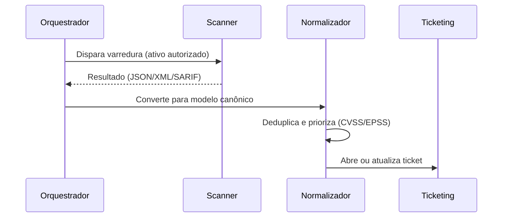

# Integração com Scanners - Nessus OpenVAS Trivy e Nuclei

## Resumo

Scanners identificam vulnerabilidades e configurações inseguras. **Nessus** e **OpenVAS/Greenbone** varrem hosts e redes; **Trivy** analisa imagens, sistemas de arquivos, repositórios e IaC; **Nuclei** executa templates YAML para detectar problemas conhecidos em aplicações e serviços. A integração consiste em disparar ou coletar varreduras, **normalizar** achados e encaminhá-los a ticketing e SIEM. Execute varreduras **apenas** em ativos que você possui ou tem autorização formal para testar.

## Conceitos-chave

- **Nessus:** API REST com cabeçalho `X-ApiKeys: accessKey=...; secretKey=...`; operações de listar scans, iniciar, exportar resultados.
- **OpenVAS/Greenbone:** protocolo GMP (XML sobre socket), usado via `python-gvm`.
- **Trivy:** CLI com saídas JSON e SARIF; subcomandos `image`, `fs`, `repo`, `config`.
- **Nuclei:** saída em JSON Lines (`-jsonl`), com `template-id`, `info.severity`, `host`.
- **CVSS / EPSS:** pontuação de severidade e probabilidade de exploração para priorizar.
- **Deduplicação** de achados entre varreduras (mesma CVE, mesmo ativo).

## Como funciona



Trivy é ideal para pipeline: roda em segundos e devolve códigos de saída configuráveis. Nessus/OpenVAS operam em janelas agendadas e produzem relatórios extensos; o integrador exporta e processa em lote. Nuclei é executado com templates revisados e limite de taxa.

## Exemplo prático

Executando o Trivy e lendo o resultado (Python):

```python
import json, subprocess

def trivy_imagem(imagem: str) -> list[dict]:
    # Lista de argumentos, sem shell: evita injeção de comando
    p = subprocess.run(
        ["trivy", "image", "--format", "json", "--quiet", imagem],
        capture_output=True, text=True, timeout=600, check=False)
    if p.returncode not in (0, 1) or not p.stdout:
        raise RuntimeError(f"trivy falhou: {p.stderr[:200]}")
    dados = json.loads(p.stdout)
    achados = []
    for res in dados.get("Results", []):
        for v in res.get("Vulnerabilities") or []:     # pode vir None
            achados.append({
                "id": v["VulnerabilityID"],
                "pacote": v["PkgName"],
                "instalada": v.get("InstalledVersion"),
                "corrigida": v.get("FixedVersion"),    # pode estar ausente
                "severidade": v["Severity"].lower(),
            })
    return achados
```

Listando scans do Nessus:

```bash
curl -s -k -H "X-ApiKeys: accessKey=$ACCESS; secretKey=$SECRET" \
  https://nessus.local:8834/scans
```

> [!example] Nuclei em ambiente autorizado
> `nuclei -u https://app.lab.local -severity high,critical -rl 10 -jsonl -o saida.jsonl` limita a taxa a 10 req/s e gera JSON Lines.

## Boas práticas

- Priorize por exposição, exploração conhecida (EPSS/KEV) e criticidade do ativo, não só CVSS.
- Mantenha as bases de vulnerabilidades atualizadas (`trivy` baixa DB; Nessus/OpenVAS têm feeds).
- Limite taxa e concorrência para não derrubar alvos.
- Use varreduras autenticadas quando possível, para reduzir falsos negativos.

## Erros comuns

- Tratar `Vulnerabilities` nulo como lista e quebrar com `TypeError`.
- Abrir um ticket por CVE por ativo sem agrupar.
- Executar scanners via `shell=True` com nomes de alvo digitados por usuários.
- Varrer ativos de terceiros sem autorização.
- Ignorar `FixedVersion` ausente (sem correção disponível exige outra ação).

> [!warning] Escopo e autorização
> Defina escopo e janela por escrito. Varreduras podem causar instabilidade em sistemas frágeis.

## Referências para aprofundar

- Documentação do Trivy, Nessus API, Greenbone (python-gvm), ProjectDiscovery Nuclei; CISA KEV.

## Veja também

- [[Ferramentas de Postura e Proteção - CSPM WAF Scanners e Segredos]]
- [[Parsing de Formatos - SARIF JSON e XML]]
- [[Integração com Ticketing - Jira e GitHub Issues]]
- [[Integração com SIEM - Splunk Elastic e Wazuh]]
- [[MOC - Integração com Ferramentas de Segurança]]

#seguranca/integracao/scanners #seguranca/integracao/trivy #seguranca/integracao/nuclei
