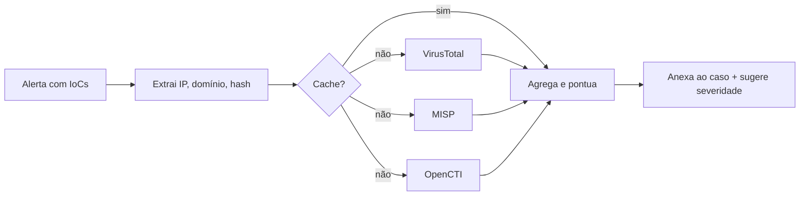

# Integração com Threat Intelligence - MISP OpenCTI e VirusTotal

## Resumo

**Threat intelligence** (TI) fornece contexto sobre ameaças: indicadores de comprometimento (IoCs) como IPs, domínios e hashes, além de táticas e atores. **MISP** é uma plataforma open source de compartilhamento de IoCs e eventos; **OpenCTI** organiza inteligência em um grafo de conhecimento baseado em STIX 2.1; **VirusTotal** agrega verdicts de dezenas de engines e fontes sobre arquivos, URLs, domínios e IPs. A integração mais comum é o **enriquecimento**: dado um alerta, consultar essas fontes e anexar reputação ao caso, para acelerar a triagem.

## Conceitos-chave

- **IoC:** artefato observável associado a atividade maliciosa (hash, IP, domínio, URL).
- **MISP:** API REST com cabeçalho `Authorization: <chave>`; busca em `/attributes/restSearch`; biblioteca `PyMISP`.
- **OpenCTI:** API GraphQL e biblioteca `pycti`; objetos STIX, conectores de importação/exportação.
- **VirusTotal v3:** `GET https://www.virustotal.com/api/v3/{ip_addresses|domains|files}/{id}` com cabeçalho `x-apikey`; estatísticas em `data.attributes.last_analysis_stats`.
- **Cotas:** a API gratuita do VirusTotal tem limites estritos (por exemplo, poucas consultas por minuto e por dia).
- **Confiança e validade:** nem todo IoC é igualmente confiável nem permanente.
- **TLP (Traffic Light Protocol):** define como a informação pode ser compartilhada.

## Como funciona



O enriquecedor extrai IoCs, consulta as fontes em paralelo respeitando cotas, usa **cache** para não repetir consultas e produz uma pontuação agregada. A decisão final (bloquear, isolar) permanece com humanos ou com regras explícitas, pois reputação pode ter falsos positivos.

## Exemplo prático

Consulta de reputação de IP no VirusTotal com cache simples (Python):

```python
import os, time, requests

_cache: dict[str, tuple[float, dict]] = {}
TTL = 3600  # 1 hora

def reputacao_ip(ip: str) -> dict:
    agora = time.time()
    if ip in _cache and agora - _cache[ip][0] < TTL:
        return _cache[ip][1]
    r = requests.get(
        f"https://www.virustotal.com/api/v3/ip_addresses/{ip}",
        headers={"x-apikey": os.environ["VT_API_KEY"]}, timeout=15)
    if r.status_code == 429:
        raise RuntimeError("cota do VirusTotal esgotada")
    r.raise_for_status()
    stats = r.json()["data"]["attributes"]["last_analysis_stats"]
    resultado = {"malicioso": stats.get("malicious", 0),
                 "suspeito": stats.get("suspicious", 0),
                 "inofensivo": stats.get("harmless", 0)}
    _cache[ip] = (agora, resultado)
    return resultado
```

Busca no MISP com PyMISP:

```python
from pymisp import PyMISP

misp = PyMISP("https://misp.local", chave_do_cofre, ssl=True)
resp = misp.search(controller="attributes", value="203.0.113.7", pythonify=True)
print(len(resp), "atributos encontrados")
```

> [!example] IP de documentação
> `203.0.113.0/24` é reservado para exemplos (RFC 5737); use-o em testes.

## Boas práticas

- Valide o formato do IoC antes de consultar (evita enviar dados internos por engano).
- Use cache com TTL e respeite as cotas.
- Registre a **fonte e a data** de cada verdict no caso.
- Nunca envie arquivos confidenciais da empresa ao VirusTotal: uploads tornam-se acessíveis a terceiros; prefira consultar por hash.

## Erros comuns

- Tratar "0 detecções" como "seguro".
- Consultar IPs privados ou domínios internos em serviços públicos.
- Importar feeds de IoC sem expiração, gerando falsos positivos antigos.
- Ignorar o TLP ao compartilhar.
- Estourar a cota em picos e deixar a triagem cega.

> [!warning] Privacidade
> Consultas a serviços externos expõem o que você está investigando; considere o impacto antes de enviar dados.

## Referências para aprofundar

- Documentação da API v3 do VirusTotal; MISP Book e PyMISP; OpenCTI docs e pycti; FIRST TLP.

## Veja também

- [[Normalização de Dados - OCSF ECS CEF STIX e TAXII]]
- [[Ferramentas de Detecção e Resposta - EDR SIEM SOAR]]
- [[MITRE ATT&CK - Integração]]
- [[Rate Limiting]]
- [[MOC - Integração com Ferramentas de Segurança]]

#seguranca/integracao/threat-intel #seguranca/integracao/misp #seguranca/integracao/virustotal
