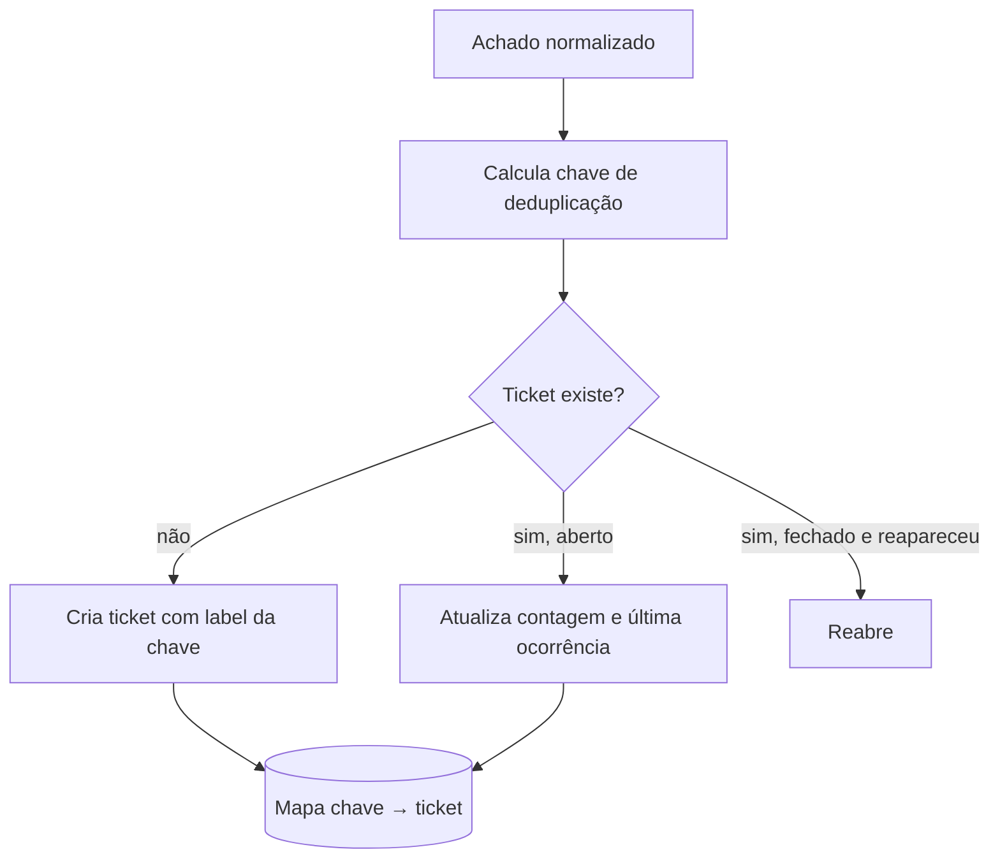

# Integração com Ticketing - Jira e GitHub Issues

## Resumo

Achados de segurança só geram valor quando alguém os corrige. **Ticketing** transforma um achado em trabalho rastreável, com dono, prazo e histórico. **Jira** (muito usado em empresas) e **GitHub Issues** (próximo do código) são os destinos mais comuns. A integração cria, atualiza e fecha tickets automaticamente, evitando duplicatas e mantendo o estado sincronizado com a ferramenta de origem: quando o scanner deixa de ver a vulnerabilidade, o ticket pode ser fechado.

## Conceitos-chave

- **Caso de uso:** Trivy/Semgrep encontra uma falha → ticket com severidade, localização, remediação e links.
- **Jira REST:** `POST /rest/api/2/issue` com `project`, `summary`, `description`, `issuetype`, `labels`; autenticação no Jira Cloud por e-mail + API token (Basic) ou OAuth 2.0.
- **Busca por JQL** para localizar tickets existentes (o endpoint de busca do Jira Cloud vem evoluindo; confirme na documentação).
- **GitHub Issues:** `POST /repos/{owner}/{repo}/issues` com `title`, `body`, `labels`, `assignees`.
- **Chave de deduplicação:** guardada em label ou campo customizado (por exemplo, `sec-key:<hash>`).
- **Ciclo de vida:** abrir → atualizar → fechar quando resolvido.

## Como funciona



Antes de criar, o conector procura por label/JQL com a chave. Isso implementa [[Idempotência]] mesmo que a API não ofereça idempotency key. Grupos de achados (mesma dependência em vários arquivos) devem virar **um** ticket, para não inundar a equipe.

## Exemplo prático

Criando uma issue no GitHub sem duplicar (Python):

```python
import requests

API = "https://api.github.com"

def criar_issue(owner, repo, achado, token):
    h = {"Authorization": f"Bearer {token}",
         "Accept": "application/vnd.github+json"}
    chave = f"sec-key:{achado['chave']}"
    # Procura issue já aberta com a label da chave
    r = requests.get(f"{API}/repos/{owner}/{repo}/issues",
                     params={"labels": chave, "state": "open"}, headers=h, timeout=15)
    r.raise_for_status()
    if r.json():
        return r.json()[0]["html_url"]          # já existe: não duplica
    corpo = {"title": f"[{achado['severidade'].upper()}] {achado['titulo']}",
             "body": achado["descricao"][:6000],
             "labels": ["seguranca", chave]}
    r = requests.post(f"{API}/repos/{owner}/{repo}/issues", json=corpo,
                      headers=h, timeout=15)
    r.raise_for_status()
    return r.json()["html_url"]
```

Criando issue no Jira:

```python
def criar_jira(base, auth, projeto, achado):
    payload = {"fields": {
        "project": {"key": projeto},
        "summary": achado["titulo"][:250],
        "description": achado["descricao"],
        "issuetype": {"name": "Bug"},
        "labels": ["seguranca", f"sec-key-{achado['chave']}"],
    }}
    r = requests.post(f"{base}/rest/api/2/issue", json=payload, auth=auth, timeout=15)
    r.raise_for_status()
    return r.json()["key"]
```

> [!example] Projeto
> Este conector é o tema do projeto guiado em [[MOC - Projetos Práticos]], a ser criado na Parte 6.

## Boas práticas

- Agrupe achados por causa-raiz e limite o número de tickets por execução.
- Inclua remediação, link para a evidência e SLA conforme a severidade.
- Use label ou campo customizado para a chave de deduplicação.
- Trate 429 e 5xx com [[Retries com Backoff e Tratamento de Falhas]].

## Erros comuns

- Criar um ticket por achado e sobrecarregar a equipe.
- Colocar segredos ou dados sensíveis na descrição de tickets amplamente visíveis.
- Campos obrigatórios do Jira não preenchidos (erro 400).
- Descrição maior que o limite da API.
- Esquecer de fechar tickets resolvidos, acumulando ruído.

> [!warning] Dados sensíveis
> Um ticket pode ser lido por muita gente; nunca inclua o valor de um segredo detectado.

## Referências para aprofundar

- Jira Cloud REST API; GitHub REST API (Issues).

## Veja também

- [[Integração com Scanners - Nessus OpenVAS Trivy e Nuclei]]
- [[Integração com SAST e SCA - Semgrep SonarQube Dependabot e Snyk]]
- [[Integração com Mensageria - Slack e Teams]]
- [[Idempotência]]
- [[MOC - Integração com Ferramentas de Segurança]]

#seguranca/integracao/ticketing #seguranca/integracao/jira #seguranca/integracao/github
