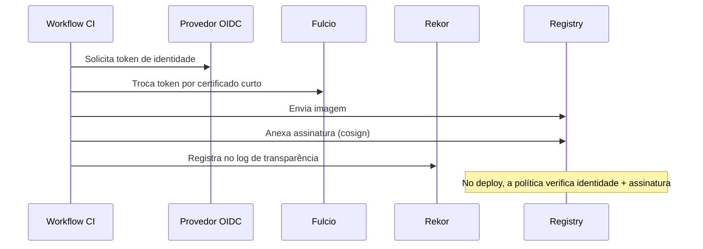

# Assinatura de Artefatos - Sigstore e cosign

## Resumo

**Assinar artefatos** (imagens, binários, SBOMs) permite que consumidores verifiquem *quem* produziu e *se foi alterado*. O projeto **Sigstore** simplifica isso: o **cosign** assina e verifica; o **Fulcio** emite certificados de curta duração vinculados a uma identidade OIDC (assinatura *keyless*, sem gerenciar chaves privadas); o **Rekor** é um log de transparência que registra as assinaturas de forma pública e imutável. No CI, a identidade do próprio workflow (por exemplo, GitHub Actions via OIDC) assina a imagem.

## Conceitos-chave

- **Assinatura com chave** vs. **keyless** (certificado efêmero + identidade OIDC).
- **Digest:** assine sempre o **digest** (`@sha256:...`), nunca tags mutáveis.
- **Attestations:** declarações assinadas (ex.: proveniência SLSA, SBOM) anexadas ao artefato.
- **Verificação:** exige especificar a identidade esperada do assinante e o emissor OIDC.
- **Log de transparência (Rekor):** evidência pública e auditável.
- **Políticas de admissão:** Kubernetes (Kyverno, Sigstore policy-controller) só aceita imagens verificadas.

## Como funciona



Na verificação, o consumidor não confia em "uma assinatura qualquer": confia em uma **identidade específica** (por exemplo, o workflow `deploy.yml` do repositório da organização).

## Exemplo prático

Assinatura e verificação keyless (comandos do cosign 2.x):

```bash
# No CI (com permissão id-token: write):
cosign sign --yes registry.local/app@sha256:ABC123...

# Verificação, exigindo identidade e emissor esperados:
cosign verify registry.local/app@sha256:ABC123... --certificate-identity "https://github.com/minha-org/app/.github/workflows/release.yml@refs/heads/main" --certificate-oidc-issuer "https://token.actions.githubusercontent.com"
```

Anexando um SBOM como attestation:

```bash
cosign attest --yes --predicate sbom.cdx.json --type cyclonedx registry.local/app@sha256:ABC123...
```

> [!warning] Confira a versão
> Flags do cosign mudaram entre versões; use `cosign --help` e a documentação da versão instalada.

## Boas práticas

- Assine pelo digest e verifique no deploy, não apenas no CI.
- Restrinja a identidade aceita a workflows e branches específicos.
- Armazene attestations (SBOM, proveniência) junto da imagem.
- Em ambientes isolados, avalie uma instância privada de Sigstore ou chaves em KMS.

## Erros comuns

- Assinar e nunca verificar.
- Verificar sem restringir identidade (aceita qualquer assinante válido).
- Assinar tags mutáveis como `latest`.
- Chaves privadas de assinatura guardadas no repositório.

> [!question] Cadeia
> Se um atacante enviar uma imagem ao registry, o cluster a rejeitaria por falta de assinatura?

## Referências para aprofundar

- docs.sigstore.dev; documentação do cosign; Kyverno *verifyImages*.

## Veja também

- [[SBOM - CycloneDX e SPDX]]
- [[SLSA]]
- [[GitHub Actions]]
- [[Políticas como Código - OPA e Rego]]
- [[MOC - DevSecOps e CI-CD]]

#seguranca/devsecops/sigstore #seguranca/supply-chain/assinatura
