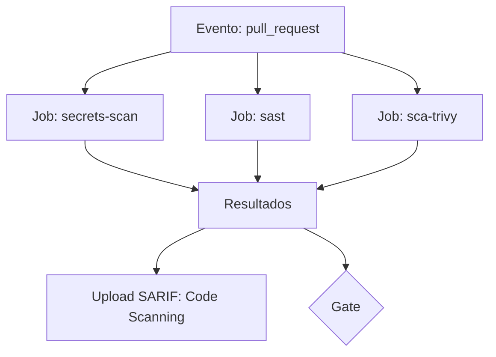

# GitHub Actions

## Resumo

**GitHub Actions** é a plataforma de CI/CD integrada ao GitHub: workflows em YAML disparados por eventos (push, pull request, agenda) executam jobs em *runners*. É um ambiente comum para rodar verificações de segurança (CodeQL, Semgrep, Trivy, gitleaks) e publicar resultados no **Code Scanning** via SARIF. Por executar código com acesso a segredos e ao repositório, o próprio pipeline é um alvo: configurações ruins (permissões amplas, actions não verificadas) são caminhos clássicos de comprometimento da cadeia de suprimentos.

## Conceitos-chave

- **Workflow, job, step, runner:** hierarquia de execução.
- **`permissions`:** limitam o `GITHUB_TOKEN`; adote `contents: read` por padrão.
- **Secrets e variáveis:** por repositório, ambiente ou organização; *environments* com aprovação manual.
- **Actions de terceiros:** fixar por **SHA de commit**, não por tag mutável.
- **`pull_request` vs. `pull_request_target`:** o segundo roda com privilégios no contexto do repositório base e exige extremo cuidado com código de forks.
- **OIDC para nuvem:** autenticar em provedores sem segredos de longa duração.
- **Upload de SARIF** para Code Scanning.

## Como funciona



Jobs independentes rodam em paralelo para manter o feedback rápido. O `GITHUB_TOKEN` de cada job recebe somente as permissões necessárias; para publicar SARIF, por exemplo, `security-events: write`.

## Exemplo prático

Workflow de segurança com permissões mínimas:

```yaml
name: seguranca
on:
  pull_request:
  schedule:
    - cron: "0 6 * * 1"        # varredura semanal

permissions:
  contents: read               # padrão restrito

jobs:
  trivy:
    runs-on: ubuntu-latest
    permissions:
      contents: read
      security-events: write   # só este job publica SARIF
    steps:
      - uses: actions/checkout@v4   # em produção, fixe pelo SHA do commit
      - name: Trivy fs scan
        uses: aquasecurity/trivy-action@master  # troque por SHA fixo
        with:
          scan-type: fs
          format: sarif
          output: trivy.sarif
          severity: HIGH,CRITICAL
      - uses: github/codeql-action/upload-sarif@v3
        with:
          sarif_file: trivy.sarif
```

> [!warning] Fixe versões
> `@master` e tags móveis aparecem acima só para legibilidade. Em produção, use o SHA completo do commit da action.

## Boas práticas

- Defina `permissions` no topo do workflow e amplie por job somente se necessário.
- Fixe actions de terceiros por SHA e use Dependabot para atualizá-las.
- Use *environments* com revisores obrigatórios para deploy.
- Nunca imprima segredos; evite interpolar entradas não confiáveis (títulos de PR, branches) diretamente em `run:`.

## Erros comuns

- Usar `pull_request_target` e fazer checkout do código do fork.
- Interpolar `${{ github.event.pull_request.title }}` em um script shell (injeção de comando).
- Tokens de longa duração quando OIDC está disponível.
- Runners self-hosted persistentes expostos a repositórios públicos.

> [!question] Revisão
> Quem pode editar `.github/workflows/`? Essa pasta merece CODEOWNERS.

## Referências para aprofundar

- GitHub Docs: *Security hardening for GitHub Actions*; OpenSSF Scorecard.

## Veja também

- [[Security Gates e Shift-Left]]
- [[SBOM - CycloneDX e SPDX]]
- [[Assinatura de Artefatos - Sigstore e cosign]]
- [[GitLab CI e Jenkins]]
- [[MOC - DevSecOps e CI-CD]]

#seguranca/devsecops/github-actions #seguranca/ci-cd
