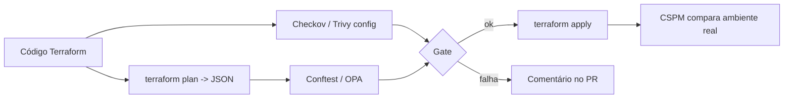

# IaC Scanning - Checkov e tfsec

## Resumo

**Infraestrutura como código** (IaC) descreve a infraestrutura em arquivos (Terraform, CloudFormation, Kubernetes, Dockerfile). Isso permite revisar e testar a segurança **antes** de criar recursos. O **IaC scanning** analisa esses arquivos estaticamente e detecta configurações inseguras: buckets públicos, portas abertas ao mundo, discos sem criptografia, contêineres privilegiados. **Checkov** (Prisma Cloud/Bridgecrew) é um scanner multi-framework. O **tfsec**, focado em Terraform, foi incorporado ao **Trivy** (`trivy config`), que hoje é o caminho recomendado pelo projeto.

## Conceitos-chave

- **Checkov:** milhares de checagens (CKV_*), suporte a Terraform, CloudFormation, Kubernetes, Dockerfile, GitHub Actions, entre outros; saídas CLI, JSON, SARIF.
- **Trivy config (herdeiro do tfsec):** `trivy config .` analisa Terraform, Kubernetes, Docker etc.
- **Supressões inline** com justificativa (por exemplo, `#checkov:skip=CKV_AWS_18:motivo`).
- **Escaneamento do plano:** analisar `terraform show -json` captura valores resolvidos.
- **Drift:** ligação com CSPM, que verifica o ambiente real.
- **Benchmarks:** CIS para nuvem e Kubernetes.

## Como funciona



O scan estático barra erros óbvios no PR; as políticas OPA aplicam regras específicas da organização sobre o plano; o CSPM fecha o ciclo detectando alterações manuais fora do código.

## Exemplo prático

Recurso Terraform inseguro e corrigido (conceito defensivo):

```hcl
# Antes: bucket sem bloqueio de acesso público
resource "aws_s3_bucket" "logs" {
  bucket = "logs-da-empresa"
}

# Depois: bloqueio de acesso público e criptografia
resource "aws_s3_bucket_public_access_block" "logs" {
  bucket                  = aws_s3_bucket.logs.id
  block_public_acls       = true
  block_public_policy     = true
  ignore_public_acls      = true
  restrict_public_buckets = true
}

resource "aws_s3_bucket_server_side_encryption_configuration" "logs" {
  bucket = aws_s3_bucket.logs.id
  rule {
    apply_server_side_encryption_by_default { sse_algorithm = "aws:kms" }
  }
}
```

Execução no CI:

```bash
checkov -d infra/ --framework terraform --output sarif --output-file-path resultados/
trivy config --severity HIGH,CRITICAL --exit-code 1 infra/
```

## Boas práticas

- Escaneie no PR e proteja a branch principal.
- Suprima apenas com justificativa e revisão.
- Combine scan estático, políticas sobre o plano e CSPM em produção.
- Mantenha módulos Terraform internos já endurecidos (*golden modules*).

## Erros comuns

- Escanear só `main`, depois do merge.
- Supressões em massa para "limpar" o relatório.
- Ignorar o estado e os segredos que ele pode conter (state files sensíveis).
- Confiar apenas no scan estático e não monitorar drift.

> [!warning] Estado do Terraform
> Arquivos de estado podem conter segredos em texto claro; guarde-os em backend remoto criptografado e com acesso restrito.

## Referências para aprofundar

- Documentação do Checkov e do Trivy (config); CIS Benchmarks.

## Veja também

- [[Políticas como Código - OPA e Rego]]
- [[Ferramentas de Postura e Proteção - CSPM WAF Scanners e Segredos]]
- [[Security Gates e Shift-Left]]
- [[SBOM - CycloneDX e SPDX]]
- [[MOC - DevSecOps e CI-CD]]

#seguranca/devsecops/iac #seguranca/nuvem/iac-scanning
