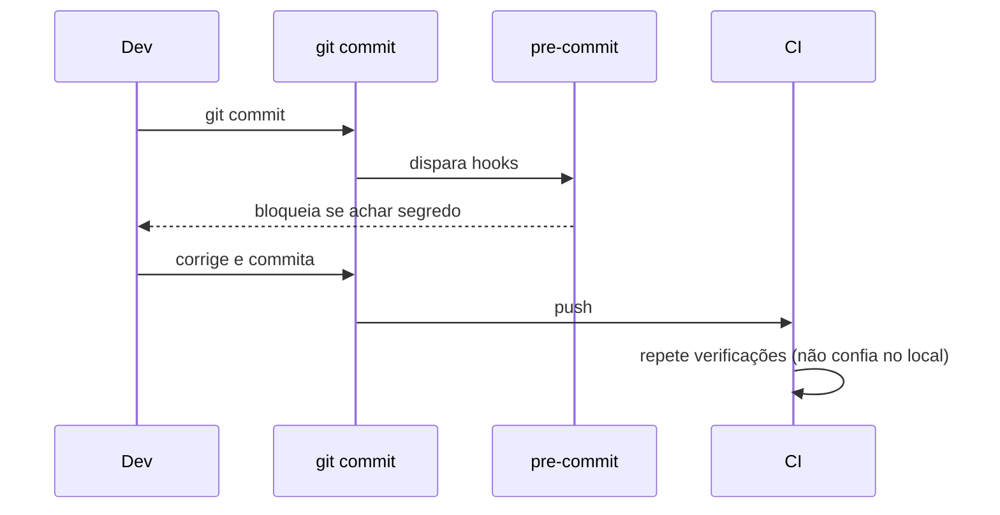

# Pré-commit Hooks

## Resumo

**Git hooks** são scripts executados em eventos do git (antes do commit, antes do push). O framework **pre-commit** padroniza sua configuração em um arquivo versionado (`.pre-commit-config.yaml`), instalando e executando ferramentas de verificação automaticamente. É a forma mais "à esquerda" de shift-left: pega segredos, erros de formatação e problemas simples **antes** de entrarem no histórico. Como hooks locais podem ser ignorados (`--no-verify`), o pre-commit é complementar, nunca substituto, dos gates no CI.

## Conceitos-chave

- **`.pre-commit-config.yaml`:** lista de repositórios de hooks, versões (`rev`) e ids.
- **Estágios:** `pre-commit`, `pre-push`, `commit-msg`.
- **Hooks úteis em segurança:** gitleaks (segredos), detect-private-key, check-added-large-files, bandit (SAST Python), hadolint (Dockerfile), checkov/terraform.
- **Velocidade:** hooks rápidos nos commits; verificações pesadas no `pre-push` ou CI.
- **Autoupdate:** `pre-commit autoupdate` atualiza as versões fixadas.
- **Bypass e política:** o CI repete as verificações para garantir a aplicação.

## Como funciona



O desenvolvedor instala uma vez (`pre-commit install`). A partir daí, cada commit passa pelos hooks sobre os arquivos alterados, o que mantém o tempo baixo.

## Exemplo prático

Configuração de exemplo:

```yaml
repos:
  - repo: https://github.com/gitleaks/gitleaks
    rev: v8.18.4              # confira a versão mais recente e fixe
    hooks:
      - id: gitleaks
  - repo: https://github.com/pre-commit/pre-commit-hooks
    rev: v4.6.0
    hooks:
      - id: detect-private-key
      - id: check-added-large-files
        args: ["--maxkb=500"]
  - repo: https://github.com/PyCQA/bandit
    rev: 1.7.9
    hooks:
      - id: bandit
        args: ["-ll"]         # apenas severidade média ou maior
```

Instalação e execução:

```bash
pip install pre-commit
pre-commit install
pre-commit run --all-files
```

## Boas práticas

- Fixe `rev` e atualize com revisão.
- Mantenha o tempo de hook abaixo de poucos segundos.
- Repita as mesmas verificações no CI.
- Documente a instalação no README e automatize no *onboarding*.

## Erros comuns

- Acreditar que o hook local garante algo (pode ser pulado).
- Hooks lentos que levam o time a desativá-los.
- Usar `rev: main` em vez de versões fixas.
- Não tratar um segredo já commitado: remover do índice não basta; é preciso revogar.

> [!tip] Cultura
> Explique *por que* o hook existe; mensagens claras de erro aumentam a adesão.

## Referências para aprofundar

- pre-commit.com; documentação do gitleaks e do Bandit.

## Veja também

- [[Security Gates e Shift-Left]]
- [[Integração com Gestão de Segredos - Vault e gitleaks]]
- [[GitHub Actions]]
- [[GitLab CI e Jenkins]]
- [[MOC - DevSecOps e CI-CD]]

#seguranca/devsecops/pre-commit #seguranca/devsecops/shift-left
