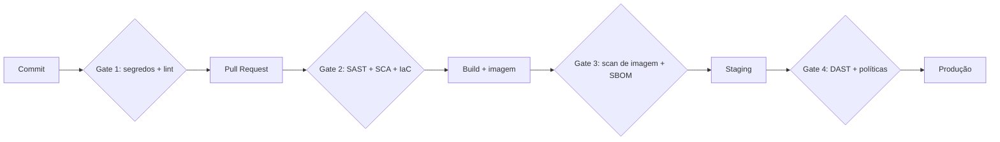

# Security Gates e Shift-Left

## Resumo

**Shift-left** é a prática de antecipar atividades de segurança para o início do ciclo de desenvolvimento, quando corrigir é mais barato e rápido. Um **security gate** é um ponto de decisão automatizado no pipeline: se o resultado de uma verificação violar um critério (por exemplo, "nenhuma vulnerabilidade crítica com correção disponível"), o fluxo é interrompido. Gates bem desenhados dão feedback rápido aos desenvolvedores, aplicam a política da organização de forma consistente e geram evidências para auditoria. Mal desenhados, viram obstáculo e são contornados.

## Conceitos-chave

- **Pontos de gate:** pre-commit, pull request, build, pré-deploy e pós-deploy.
- **Tipos de verificação:** segredos, SAST, SCA, IaC, imagem de container, DAST em staging, políticas de conformidade.
- **Critérios:** limiar de severidade, achados *novos* vs. legado, exceções aprovadas com prazo.
- **Modos de aplicação:** *informativo* (só reporta), *aviso* (comenta no PR) e *bloqueante* (falha o pipeline).
- **Feedback rápido:** gates lentos perdem adesão; mantenha verificações de PR em minutos.
- **Exceções (waivers):** processo formal com dono, justificativa e expiração.

## Como funciona



A estratégia de adoção é **gradual**: começar em modo informativo para medir o ruído, depois promover regras de alta confiança a bloqueantes e, por fim, expandir. Em cada estágio, mede-se a taxa de falsos positivos e o tempo para corrigir.

## Exemplo prático

Avaliador de gate em Python, com exceções que expiram:

```python
from datetime import date

ORDEM = {"baixa": 1, "media": 2, "alta": 3, "critica": 4}

def avaliar(achados, limiar="alta", excecoes=None):
    # excecoes: {id_do_achado: "2026-12-31"} (data de expiração)
    excecoes = excecoes or {}
    bloqueantes = []
    for a in achados:
        if ORDEM[a["severidade"]] < ORDEM[limiar]:
            continue
        validade = excecoes.get(a["id"])
        if validade and date.fromisoformat(validade) >= date.today():
            continue                       # exceção válida
        bloqueantes.append(a)
    return bloqueantes                      # lista vazia = gate aprovado
```

> [!example] Uso no CI
> O script retorna exit code `1` se `avaliar(...)` não estiver vazio; o pipeline falha e comenta no PR.

## Boas práticas

- Comece informativo, meça, depois bloqueie apenas o que tem alta confiança.
- Foque em achados **novos** no PR; trate a dívida antiga em backlog separado.
- Documente a política e o processo de exceção.
- Colete métricas: tempo de pipeline, taxa de bloqueio, falsos positivos, tempo de correção.

## Erros comuns

- Ativar todos os gates bloqueantes no primeiro dia.
- Exceções permanentes e sem dono.
- Gate que depende de serviço externo instável e derruba todos os pipelines.
- Permitir que o próprio autor do PR altere as regras do gate sem revisão.

> [!warning] Integridade do pipeline
> A configuração do pipeline é código crítico: exija revisão de segurança (CODEOWNERS) para alterá-la.

## Referências para aprofundar

- NIST SP 800-218 (SSDF); OWASP DevSecOps Guideline.

## Veja também

- [[SDLC e SSDLC]]
- [[Ferramentas de Teste de Aplicação - SAST DAST IAST SCA]]
- [[GitHub Actions]]
- [[GitLab CI e Jenkins]]
- [[MOC - DevSecOps e CI-CD]]

#seguranca/devsecops/gates #seguranca/devsecops/shift-left
