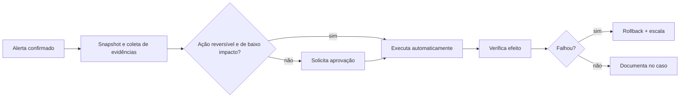

# Automação de Resposta a Incidentes

## Resumo

A **resposta a incidentes** (IR) segue um ciclo: preparação, detecção e análise, contenção/erradicação/recuperação e lições aprendidas (NIST SP 800-61). A **automação** acelera as etapas repetitivas, como coletar contexto, desativar uma credencial comprometida, isolar um host, bloquear um indicador e notificar partes interessadas. Quando bem projetada, reduz drasticamente o MTTR; quando mal projetada, pode causar indisponibilidade, perder evidências ou agir sobre falsos positivos. O princípio é **automatizar o rápido e reversível; aprovar o lento e arriscado**.

## Conceitos-chave

- **Contenção:** isolar host (EDR), bloquear IP/domínio, desabilitar conta, revogar tokens.
- **Erradicação e recuperação:** remover persistência, restaurar de backup, rotacionar segredos.
- **Preservação de evidências:** coletar antes de alterar (memória, logs, snapshots).
- **Raio de impacto (blast radius):** limitar o alcance da ação automática (por exemplo, apenas hosts não críticos).
- **Reversão (rollback)** e **tempo de expiração** de bloqueios automáticos.
- **Comunicação:** notificações internas e requisitos legais (LGPD: comunicação à ANPD e aos titulares quando aplicável).

## Como funciona



Cada ação automática tem: **pré-condições** (confirmação de que o alvo é o correto), **escopo limitado**, **expiração** e **registro**. A verificação pós-ação confirma que a mitigação teve o efeito esperado.

## Exemplo prático

Ação de contenção com salvaguardas (Python, usando uma interface fictícia de EDR):

```python
from datetime import datetime, timedelta, timezone

CRITICOS = {"srv-pagamentos", "dc-01"}      # nunca isolar automaticamente

def isolar_host(edr, host: str, motivo: str, aprovado_por: str | None = None):
    if host in CRITICOS and not aprovado_por:
        raise PermissionError("host crítico exige aprovação humana")
    expira = datetime.now(timezone.utc) + timedelta(hours=4)
    edr.isolar(host, ate=expira)             # isolamento com expiração automática
    return {"host": host, "acao": "isolar", "motivo": motivo,
            "aprovado_por": aprovado_por, "expira": expira.isoformat()}
```

> [!example] Auditoria
> O dicionário retornado é anexado ao caso, registrando quem, quando, por quê e até quando.

## Boas práticas

- Colete evidências antes de agir.
- Limite o escopo e defina expiração para bloqueios automáticos.
- Teste os playbooks em exercícios (*tabletop*) e em laboratório.
- Mantenha lista de ativos críticos que exigem aprovação.

## Erros comuns

- Isolar automaticamente servidores críticos por um falso positivo.
- Destruir evidências ao reinstalar um host antes da análise.
- Bloqueios sem expiração que se acumulam.
- Ações sem verificação posterior.

> [!warning] Aspectos legais
> Incidentes com dados pessoais têm obrigações de comunicação; envolva jurídico e encarregado (DPO) conforme a LGPD.

## Referências para aprofundar

- NIST SP 800-61 Rev. 2/3; Guia de resposta a incidentes do CERT.br e GOV.BR.

## Veja também

- [[Playbooks e Runbooks]]
- [[Human-in-the-Loop]]
- [[Métricas - MTTD e MTTR]]
- [[SOAR - Shuffle TheHive Cortex e n8n]]
- [[MOC - Automação e Orquestração]]

#seguranca/automacao/incident-response #seguranca/resposta-incidentes
