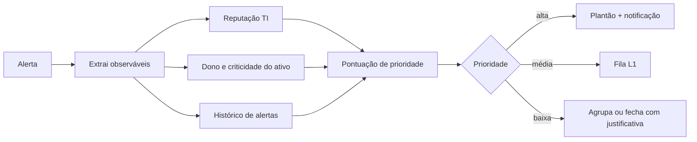

# Enriquecimento de Alertas e Escalonamento

## Resumo

Um alerta bruto raramente contém o contexto necessário para decidir. **Enriquecimento** é o processo de anexar informações de várias fontes ao alerta: reputação de IP/hash (VirusTotal, MISP), dono do ativo (CMDB), criticidade, histórico de alertas, usuário e seu departamento, geolocalização, técnica [[MITRE ATT&CK - Integração]]. O resultado alimenta uma **pontuação de prioridade** e regras de **escalonamento**: alertas críticos vão para plantão; os de baixo risco ficam em fila ou são fechados com justificativa. Isso reduz o tempo de triagem e a fadiga de alertas.

## Conceitos-chave

- **Fontes de contexto:** TI, CMDB/inventário, IAM, EDR, vulnerabilidades do ativo.
- **Normalização de observáveis:** extrair e padronizar IPs, domínios, hashes e usuários.
- **Pontuação de risco:** combinação ponderada de severidade da regra, reputação, criticidade do ativo e histórico.
- **Escalonamento:** níveis (L1, L2, plantão), SLAs por severidade, escalonamento por tempo sem resposta.
- **Deduplicação e agrupamento:** alertas relacionados no mesmo caso.
- **Cache e cotas:** evitar consultas repetidas.
- **Explicabilidade:** registrar *por que* o alerta recebeu aquela prioridade.

## Como funciona



As consultas rodam em paralelo com *timeout* e tolerância a falha: se uma fonte estiver fora, o alerta segue com o que existe e marca o enriquecimento como parcial, em vez de travar.

## Exemplo prático

Pontuação de prioridade explicável (Python):

```python
def pontuar(alerta: dict, ctx: dict) -> dict:
    motivos, pontos = [], 0
    base = {"baixa": 10, "media": 30, "alta": 55, "critica": 75}[alerta["severidade"]]
    pontos += base; motivos.append(f"severidade da regra: +{base}")

    if ctx.get("vt_malicioso", 0) >= 5:
        pontos += 20; motivos.append("reputação ruim em múltiplas engines: +20")
    if ctx.get("ativo_critico"):
        pontos += 15; motivos.append("ativo crítico: +15")
    if ctx.get("alertas_recentes_mesmo_host", 0) >= 3:
        pontos += 10; motivos.append("recorrência no host: +10")

    nivel = "plantao" if pontos >= 80 else "l2" if pontos >= 50 else "l1"
    return {"pontos": min(pontos, 100), "nivel": nivel, "motivos": motivos}
```

> [!tip] Motivos
> Salve `motivos` no caso: o analista confia mais na pontuação quando entende a origem.

## Boas práticas

- Enriqueça apenas o necessário e respeite cotas e privacidade.
- Torne a pontuação explicável e revise os pesos com dados reais.
- Use timeouts e degrade com elegância.
- Meça precisão: quantos alertas "alta prioridade" eram realmente relevantes.

## Erros comuns

- Pontuação opaca, que ninguém sabe ajustar.
- Enviar dados internos sensíveis a serviços públicos durante o enriquecimento.
- Falha em uma fonte travando todo o fluxo.
- Fechar alertas automaticamente sem amostragem para checar erros.

> [!question] Calibração
> Que percentual dos alertas fechados automaticamente você revisa por amostragem?

## Referências para aprofundar

- Documentação de playbooks de enriquecimento do TheHive/Cortex e Shuffle; FIRST sobre priorização (EPSS, SSVC).

## Veja também

- [[Integração com Threat Intelligence - MISP OpenCTI e VirusTotal]]
- [[SOAR - Shuffle TheHive Cortex e n8n]]
- [[Human-in-the-Loop]]
- [[Métricas - MTTD e MTTR]]
- [[MOC - Automação e Orquestração]]

#seguranca/automacao/enriquecimento #seguranca/automacao/triagem
