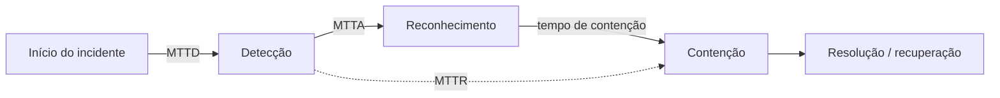

# Métricas - MTTD e MTTR

## Resumo

Métricas mostram se a operação de segurança está melhorando. As mais usadas são **MTTD** (*Mean Time To Detect*: tempo médio entre o início do incidente e sua detecção), **MTTA** (*Acknowledge*: até alguém assumir), **MTTR** (*Respond/Resolve/Recover*: até conter ou resolver; defina qual variante) e a taxa de **falsos positivos**. A automação deve ser avaliada por seu efeito nessas medidas. Atenção: métrica sem definição precisa engana. "MTTR" pode significar resposta, recuperação ou reparo; documente a definição adotada e o ponto de início e fim da medição.

## Conceitos-chave

- **MTTD:** `detecção − início` (o início real nem sempre é conhecido; estima-se pela evidência mais antiga).
- **MTTA:** `reconhecimento − alerta`.
- **MTTR:** `resolução/contenção − detecção`.
- **Mediana e percentis (p90):** mais informativos que a média, sensível a *outliers*.
- **Taxa de falsos positivos e cobertura de detecção** (por técnica ATT&CK).
- **Volume de alertas por analista e % de automação.**
- **Lei de Goodhart:** quando a métrica vira meta, deixa de ser boa métrica.

## Como funciona



Os timestamps vêm do sistema de casos (TheHive, Jira, SIEM): `created_at`, `acknowledged_at`, `contained_at`, `resolved_at`. A qualidade da métrica depende da disciplina de preencher esses campos, de preferência automaticamente pelos playbooks.

## Exemplo prático

Cálculo de MTTD/MTTR com mediana e p90 (Python):

```python
from datetime import datetime
from statistics import mean, median, quantiles

def horas(a: str, b: str) -> float:
    fmt = "%Y-%m-%dT%H:%M:%S"
    return (datetime.strptime(b, fmt) - datetime.strptime(a, fmt)).total_seconds() / 3600

incidentes = [
    {"inicio": "2026-10-01T08:00:00", "detectado": "2026-10-01T09:30:00", "contido": "2026-10-01T11:00:00"},
    {"inicio": "2026-10-03T22:00:00", "detectado": "2026-10-04T02:00:00", "contido": "2026-10-04T03:30:00"},
    {"inicio": "2026-10-10T10:00:00", "detectado": "2026-10-10T10:20:00", "contido": "2026-10-10T12:00:00"},
]
mttd = [horas(i["inicio"], i["detectado"]) for i in incidentes]
mttr = [horas(i["detectado"], i["contido"]) for i in incidentes]
print(f"MTTD média={mean(mttd):.1f}h mediana={median(mttd):.1f}h")
print(f"MTTR média={mean(mttr):.1f}h mediana={median(mttr):.1f}h")
```

> [!tip] Amostra pequena
> Com poucos incidentes, `quantiles` (p90) não é confiável; reporte também a contagem.

## Boas práticas

- Defina formalmente cada métrica e documente.
- Use mediana e percentis, além da média.
- Segmente por severidade e por tipo de incidente.
- Automatize a coleta de timestamps via integração.

## Erros comuns

- Comparar médias entre períodos com volumes muito diferentes.
- Premiar a redução do MTTR e incentivar fechar casos sem resolver.
- Medir sem agir: métricas sem plano de melhoria.
- Ignorar a qualidade do dado de entrada (campos vazios).

> [!question] Pergunta
> Qual parte do seu MTTR é espera por aprovação humana e qual é execução técnica?

## Referências para aprofundar

- Livros e guias de SOC metrics; NIST SP 800-61; relatórios Verizon DBIR e IBM Cost of a Data Breach (referências de mercado).

## Veja também

- [[Automação de Resposta a Incidentes]]
- [[Enriquecimento de Alertas e Escalonamento]]
- [[SOAR - Shuffle TheHive Cortex e n8n]]
- [[Playbooks e Runbooks]]
- [[MOC - Automação e Orquestração]]

#seguranca/automacao/metricas #seguranca/operacoes/kpi
