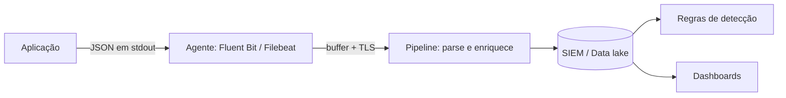

# Logging Estruturado

## Resumo

**Observabilidade** é a capacidade de entender o estado interno de um sistema a partir de suas saídas: **logs**, **métricas** e **traces**. Os logs registram eventos discretos; quando são **estruturados** (campos nomeados em JSON, em vez de frases livres), podem ser filtrados, agregados e correlacionados por máquina. Para ferramentas de segurança, o log estruturado cumpre dois papéis: depurar a própria ferramenta e fornecer *telemetria de detecção* (quem fez o quê, onde, quando e com que resultado). A qualidade dos logs determina a qualidade das regras de detecção que virão depois.

## Conceitos-chave

- **Campos essenciais:** `timestamp` (UTC, ISO 8601), `nivel`, `evento`, `servico`, `versao`, `correlation_id`, `usuario`, `origem`, `resultado`.
- **Correlation/trace ID:** liga todos os logs de uma operação, mesmo entre serviços.
- **Níveis e volume:** INFO para fluxo normal, WARNING para anomalias, ERROR para falhas; evite DEBUG em produção.
- **Esquema consistente:** nomes de campos padronizados (alinhe a ECS/OCSF, veja [[Normalização de Dados - OCSF ECS CEF STIX e TAXII]]).
- **Dados sensíveis:** redação de segredos e minimização de dados pessoais.
- **Imutabilidade e retenção:** logs de segurança exigem integridade e prazo definido.
- **Transporte:** stdout → agente (Fluent Bit, Filebeat) → SIEM, com buffer e retry.

## Como funciona



A aplicação escreve uma linha JSON por evento em stdout; o agente coleta, bufferiza e envia com TLS. No pipeline, campos são normalizados e enriquecidos (geolocalização, dono do ativo). As regras de detecção operam sobre campos nomeados, por isso a consistência do esquema é crítica.

## Exemplo prático

Logger JSON com contexto e correlation ID (Python):

```python
import json, logging, sys, uuid
from contextvars import ContextVar

correlation_id: ContextVar[str] = ContextVar("correlation_id", default="-")

class JsonFmt(logging.Formatter):
    def format(self, r: logging.LogRecord) -> str:
        base = {
            "ts": self.formatTime(r, "%Y-%m-%dT%H:%M:%S%z"),
            "nivel": r.levelname,
            "evento": r.getMessage(),
            "servico": "conector-jira",
            "correlation_id": correlation_id.get(),
        }
        base.update(getattr(r, "campos", {}))   # campos extras estruturados
        return json.dumps(base, ensure_ascii=False)

h = logging.StreamHandler(sys.stdout)
h.setFormatter(JsonFmt())
log = logging.getLogger("app"); log.addHandler(h); log.setLevel(logging.INFO)

correlation_id.set(str(uuid.uuid4()))
log.info("ticket_criado", extra={"campos": {"ticket": "SEC-12", "resultado": "sucesso"}})
```

> [!example] Evento de segurança
> `log.warning("autenticacao_falhou", extra={"campos": {"usuario": "ana", "origem_ip": "203.0.113.7"}})` alimenta uma regra de força bruta no SIEM.

## Boas práticas

- Use um esquema comum entre serviços e documente-o.
- Registre eventos de segurança relevantes: autenticação, autorização negada, mudanças de configuração, ações administrativas.
- Aplique redação e minimização antes de emitir o log.
- Proteja a integridade: envio imediato a armazenamento centralizado.

## Erros comuns

- Logs em texto livre impossíveis de consultar.
- Logar dados pessoais ou segredos por conveniência.
- Sem correlation ID, dificultando a investigação.
- Perder logs por falta de buffer quando o destino cai.
- Timestamps em fuso local ou sem fuso.

> [!warning] Log injection
> Dados externos com quebras de linha podem forjar entradas em logs de texto; JSON escapa esses caracteres.

## Referências para aprofundar

- OWASP Logging Cheat Sheet; documentação do Fluent Bit; Elastic Common Schema.

## Veja também

- [[Métricas e Tracing - Prometheus e OpenTelemetry]]
- [[Detecção como Código]]
- [[Normalização de Dados - OCSF ECS CEF STIX e TAXII]]
- [[Auditoria e Logs de Ações]]
- [[MOC - Observabilidade e Detecção]]

#seguranca/observabilidade/logs #seguranca/deteccao/telemetria
