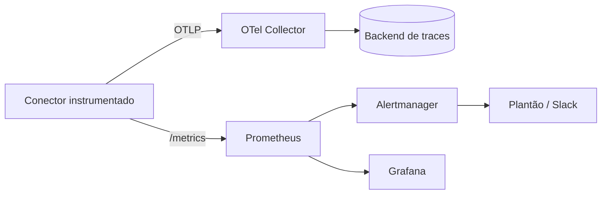

# Métricas e Tracing - Prometheus e OpenTelemetry

## Resumo

Além dos logs, a observabilidade se apoia em **métricas** (séries numéricas agregadas, baratas e ideais para alertas e painéis) e **traces** (o caminho de uma requisição por vários serviços, dividido em *spans*). **Prometheus** é o padrão de fato para métricas: expõe-se um endpoint `/metrics` e o servidor faz *scrape* periódico. **OpenTelemetry** (OTel) é o padrão aberto para instrumentar aplicações e exportar logs, métricas e traces. Em uma ferramenta de integração, métricas e traces revelam gargalos, falhas de conectores, filas crescendo e picos de erro, tudo isso relevante para segurança e disponibilidade.

## Conceitos-chave

- **Tipos de métrica:** *counter* (só cresce), *gauge* (sobe e desce), *histogram* (distribuição, p95/p99).
- **Rótulos (labels):** dimensões como `conector` e `status`; evite alta cardinalidade (ids de usuário, IPs).
- **Golden signals:** latência, tráfego, erros e saturação.
- **Trace/span:** unidade de trabalho; atributos e eventos; propagação de contexto por cabeçalhos (`traceparent`, W3C).
- **Alertas de saúde da integração:** taxa de erro, idade da mensagem mais antiga na fila, tamanho da DLQ, cotas de API restantes.
- **Segurança da observabilidade:** `/metrics` e coletores não devem ser expostos publicamente nem vazar dados sensíveis em atributos.

## Como funciona



O Prometheus coleta métricas e avalia regras de alerta (por exemplo, "taxa de falha do conector Jira > 5% por 10 minutos"). O OTel Collector recebe traces, filtra atributos sensíveis e os encaminha ao backend. Em um incidente, o trace mostra em qual salto (webhook → fila → conector → Jira) o tempo ou o erro apareceu.

## Exemplo prático

Instrumentação com Prometheus e OpenTelemetry (Python):

```python
import time
from prometheus_client import Counter, Histogram, start_http_server
from opentelemetry import trace

ENVIOS = Counter("conector_envios_total", "Envios ao destino", ["destino", "status"])
LATENCIA = Histogram("conector_latencia_segundos", "Latência por destino", ["destino"])
tracer = trace.get_tracer("conector")

def enviar(achado: dict, destino: str = "jira"):
    with tracer.start_as_current_span("enviar_achado") as span:
        span.set_attribute("destino", destino)
        span.set_attribute("severidade", achado["severidade"])   # sem dados sensíveis
        inicio = time.perf_counter()
        try:
            # ... chamada ao destino ...
            ENVIOS.labels(destino, "sucesso").inc()
        except Exception:
            ENVIOS.labels(destino, "erro").inc()
            raise
        finally:
            LATENCIA.labels(destino).observe(time.perf_counter() - inicio)

start_http_server(9100, addr="127.0.0.1")   # expõe /metrics apenas localmente
```

Regra de alerta Prometheus:

```yaml
groups:
  - name: conector
    rules:
      - alert: ConectorComMuitosErros
        expr: sum(rate(conector_envios_total{status="erro"}[10m])) / sum(rate(conector_envios_total[10m])) > 0.05
        for: 10m
        labels: {severity: warning}
```

## Boas práticas

- Padronize nomes e rótulos; use cardinalidade baixa.
- Alerte sobre sintomas (erro, latência) e não só sobre causas.
- Remova dados pessoais e segredos dos atributos de spans.
- Restrinja o acesso a `/metrics` e ao coletor (rede interna, autenticação).

## Erros comuns

- Rótulos com valores ilimitados (explosão de cardinalidade).
- `/metrics` exposto na internet.
- Atributos de trace com tokens, e-mails ou payloads completos.
- Alertas ruidosos que ninguém lê.

> [!question] Saúde
> Como você saberia, em minutos, que o conector parou de entregar alertas ao ticketing?

## Referências para aprofundar

- prometheus.io; opentelemetry.io; Google SRE Book (golden signals).

## Veja também

- [[Logging Estruturado]]
- [[Retries com Backoff e Tratamento de Falhas]]
- [[Rate Limiting]]
- [[Detecção como Código]]
- [[MOC - Observabilidade e Detecção]]

#seguranca/observabilidade/metricas #seguranca/observabilidade/tracing
