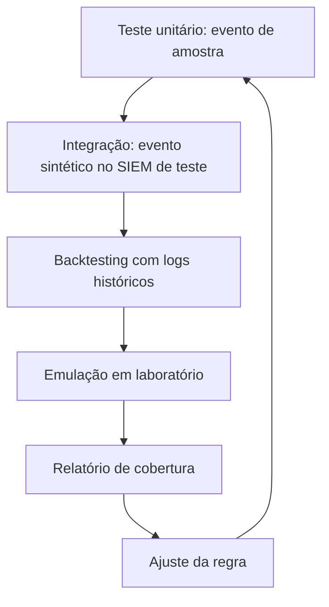

# Testes de Regras de Detecção

## Resumo

Uma regra de detecção não testada é uma hipótese. **Testar regras** significa verificar que elas disparam quando devem (verdadeiro positivo), não disparam em atividade legítima (falso positivo) e continuam funcionando após mudanças no SIEM, no esquema ou nos dados (regressão). Há três níveis: testes **unitários** com eventos de amostra; testes de **integração** que enviam eventos sintéticos ao SIEM e verificam o alerta; e **emulação de adversário** em laboratório (Atomic Red Team, exercícios *purple team*), que valida a detecção ponta a ponta contra comportamento real, sempre em ambiente autorizado e isolado.

## Conceitos-chave

- **Eventos de amostra positivos e negativos** por regra, versionados.
- **Teste de regressão:** o conjunto roda a cada mudança de regra ou de pipeline.
- **Replay de logs históricos** (*backtesting*) para estimar volume de alertas e falsos positivos.
- **Teste de integração** com dados sintéticos injetados no SIEM de teste.
- **Emulação:** execução controlada de técnicas ATT&CK em laboratório para verificar a telemetria e o alerta.
- **Cobertura:** técnicas com regra testada vs. regra existente.
- **Falha silenciosa:** campos que deixam de ser coletados fazem a regra "passar" sem disparar nunca.

## Como funciona



O teste unitário é rápido e roda no PR. A emulação é mais cara e roda agendada. O relatório de cobertura mostra, por técnica ATT&CK, se existe regra, se há teste e quando foi validada a última vez.

## Exemplo prático

Teste unitário com um avaliador simples do subconjunto da regra (Python/pytest):

```python
import pytest

REGRA = {
    "imagem_termina_com": ["\\powershell.exe", "\\pwsh.exe"],
    "cmd_contem": [" -enc ", " -encodedcommand "],
}

def casa(regra: dict, evento: dict) -> bool:
    img = evento.get("Image", "").lower()
    cmd = evento.get("CommandLine", "").lower()
    return (any(img.endswith(s) for s in regra["imagem_termina_com"])
            and any(s in cmd for s in regra["cmd_contem"]))

POSITIVOS = [
    {"Image": "C:\\Windows\\System32\\WindowsPowerShell\\v1.0\\powershell.exe",
     "CommandLine": "powershell.exe -enc SQBFAFgA"},
]
NEGATIVOS = [
    {"Image": "C:\\Windows\\System32\\notepad.exe", "CommandLine": "notepad.exe -enc"},
    {"Image": "C:\\Windows\\System32\\WindowsPowerShell\\v1.0\\powershell.exe",
     "CommandLine": "powershell.exe Get-Date"},
]

@pytest.mark.parametrize("ev", POSITIVOS)
def test_dispara(ev): assert casa(REGRA, ev)

@pytest.mark.parametrize("ev", NEGATIVOS)
def test_nao_dispara(ev): assert not casa(REGRA, ev)
```

> [!warning] Emulação
> Use Atomic Red Team ou ferramentas equivalentes apenas em laboratório isolado, com autorização formal e plano de limpeza.

## Boas práticas

- Mantenha pares positivo/negativo para cada regra.
- Rode backtesting antes de ativar alertas.
- Valide a telemetria (a regra só funciona se o log existir).
- Registre a data do último teste bem-sucedido por regra.

## Erros comuns

- Testar apenas o caso feliz.
- Confiar em regra "ativa" sem prova de que dispara.
- Emulação em produção sem coordenação, causando alertas e incidentes reais.
- Eventos de amostra com dados pessoais reais.

> [!question] Cobertura
> Se o agente de coleta parasse hoje, quanto tempo levaria para você notar que as regras ficaram cegas?

## Referências para aprofundar

- Atomic Red Team (Red Canary); MITRE ATT&CK Evaluations; SANS *Purple Team*.

## Veja também

- [[Detecção como Código]]
- [[Regras Sigma]]
- [[Redução de Falsos Positivos]]
- [[MITRE ATT&CK - Integração]]
- [[MOC - Observabilidade e Detecção]]

#seguranca/deteccao/testes #seguranca/qualidade
