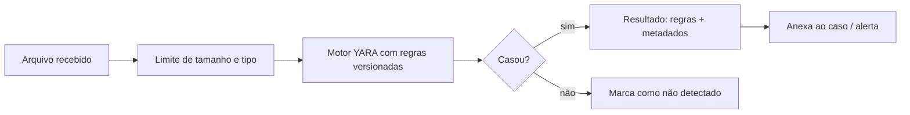

# YARA - Integração

## Resumo

**YARA** é uma ferramenta e linguagem para identificar e classificar arquivos (ou regiões de memória) com base em padrões textuais ou binários. Uma regra YARA combina *strings* e *condições* lógicas. É amplamente usada por equipes de resposta a incidentes, analistas de malware e plataformas de segurança para varrer arquivos, anexos de e-mail, imagens de container e dumps. Integrações típicas: um serviço recebe um arquivo, executa as regras YARA e devolve os nomes das regras que casaram, para enriquecer um caso. O foco deste material é **detecção e integração defensiva**.

## Conceitos-chave

- **Estrutura:** `rule nome { meta: ... strings: ... condition: ... }`.
- **Strings:** texto (`"abc"`), hexadecimais (`{ 4D 5A ... }`), expressões regulares; modificadores `nocase`, `wide`, `ascii`.
- **Condições:** `any of them`, `all of them`, contagens (`#a > 3`), offsets e `filesize`.
- **Módulos:** `pe`, `elf`, `hash` ampliam recursos de análise de formatos.
- **Desempenho:** regras com strings muito curtas ou genéricas deixam a varredura lenta e ruidosa.
- **Metadados:** autor, data, descrição, referência, severidade.
- **Uso programático:** `yara-python` para integrar em serviços.

## Como funciona



Em um serviço de varredura, o arquivo é analisado em ambiente isolado, com limites de tamanho e tempo. As regras são carregadas (compiladas) uma vez e reutilizadas. O resultado traz o nome da regra e seus metadados, que o SOAR usa para decidir prioridade.

## Exemplo prático

Regra YARA inofensiva, para testes de pipeline (casa com um marcador de teste):

```yara
rule Marcador_De_Teste_Laboratorio
{
    meta:
        description = "Regra de teste: detecta o marcador textual de laboratorio"
        author = "Equipe SecOps"
        date = "2026-10-26"
        severidade = "baixa"

    strings:
        $marcador = "MARCADOR-DE-TESTE-LAB-123" ascii

    condition:
        $marcador
}
```

Usando a regra em Python com `yara-python`:

```python
import yara

regras = yara.compile(filepath="regras/teste.yar")   # compila uma única vez

def varrer(dados: bytes) -> list[str]:
    # timeout evita travamentos em arquivos patológicos
    casos = regras.match(data=dados, timeout=30)
    return [c.rule for c in casos]

print(varrer(b"conteudo com MARCADOR-DE-TESTE-LAB-123 aqui"))
```

> [!tip] Teste sem malware
> Use marcadores benignos como acima para validar a integração, sem manipular amostras perigosas.

## Boas práticas

- Escreva regras específicas e documente o que cada uma detecta.
- Meça tempo de varredura e falsos positivos em um corpus de arquivos legítimos.
- Execute o scanner em ambiente isolado, com limites de recursos.
- Versione as regras e acompanhe sua origem e qualidade.

## Erros comuns

- Strings genéricas que casam com arquivos legítimos.
- Varrer arquivos enormes sem limite de tamanho ou timeout.
- Executar amostras suspeitas no mesmo host de produção da ferramenta.
- Considerar "nenhuma regra casou" como "arquivo seguro".

> [!warning] Manuseio seguro
> Manipule amostras reais apenas em laboratório isolado, por profissionais treinados.

## Referências para aprofundar

- yara.readthedocs.io; repositório YARA-Rules da comunidade; *Writing YARA rules* (VirusTotal).

## Veja também

- [[Regras Sigma]]
- [[Suricata - Integração]]
- [[Detecção como Código]]
- [[Integração com Threat Intelligence - MISP OpenCTI e VirusTotal]]
- [[MOC - Observabilidade e Detecção]]

#seguranca/deteccao/yara #seguranca/deteccao/regras
