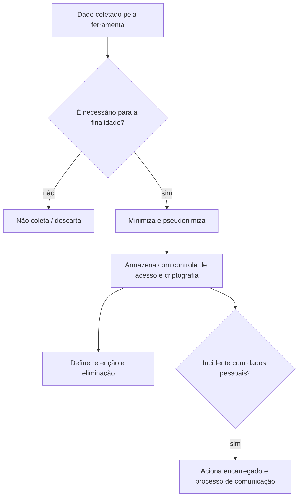

# LGPD e Privacidade

## Resumo

A **LGPD** (Lei Geral de Proteção de Dados Pessoais, Lei nº 13.709/2018) regula o tratamento de dados pessoais no Brasil. Ferramentas de segurança tratam dados pessoais com frequência: endereços IP, e-mails, nomes de usuário, identificadores de dispositivo, conteúdo de mensagens em análises de phishing, logs de acesso. Dependendo do contexto, tudo isso é **dado pessoal**. Ao projetar a ferramenta, é preciso aplicar os princípios da lei, garantir uma **base legal** adequada (por exemplo, legítimo interesse, cumprimento de obrigação legal ou prevenção à fraude e garantia da segurança) e adotar **medidas técnicas de segurança**. Este material é educativo e não substitui orientação jurídica ou do encarregado (DPO).

## Conceitos-chave

- **Princípios (art. 6º):** finalidade, adequação, necessidade (minimização), livre acesso, qualidade dos dados, transparência, segurança, prevenção, não discriminação e responsabilização.
- **Bases legais (art. 7º):** consentimento, obrigação legal, execução de contrato, legítimo interesse, proteção do crédito, entre outras.
- **Direitos do titular (art. 18):** confirmação, acesso, correção, anonimização, eliminação e outros.
- **Segurança e prevenção (art. 46 e seguintes):** medidas técnicas e administrativas para proteger os dados.
- **Incidentes (art. 48):** comunicação à ANPD e aos titulares quando houver risco ou dano relevante.
- **RIPD:** relatório de impacto à proteção de dados pessoais, quando aplicável.
- **Anonimização vs. pseudonimização:** a primeira, irreversível, afasta a aplicação da lei; a segunda reduz riscos, mas os dados seguem pessoais.
- **Encarregado (DPO):** canal com titulares e ANPD.

## Como funciona



Privacy by design significa decidir, já no desenho, o que coletar, por quanto tempo guardar, quem acessa e como eliminar. Muitos dados de segurança têm valor por um tempo limitado; reter para sempre amplia risco sem ampliar valor.

## Exemplo prático

Pseudonimização de identificadores em logs com HMAC (Python):

```python
import hmac, hashlib, os

# A chave fica em cofre e é rotacionada; sem ela, não é possível recompor o identificador
CHAVE = os.environ["PSEUDO_KEY"].encode()

def pseudonimizar(valor: str) -> str:
    # HMAC mantém consistência (mesmo valor -> mesmo token) para correlação,
    # sem expor o dado original
    return hmac.new(CHAVE, valor.strip().lower().encode(), hashlib.sha256).hexdigest()[:16]

evento = {
    "usuario": pseudonimizar("ana.silva@empresa.com"),
    "acao": "login_falho",
}
```

Política de retenção como configuração:

```yaml
retencao:
  logs_tecnicos: 30d
  logs_de_auditoria: 12m
  evidencias_de_incidente: "conforme política do caso"
  amostras_de_phishing: 90d
```

> [!warning] Orientação jurídica
> Prazos de retenção e bases legais dependem do contexto e da legislação aplicável; defina-os com o jurídico e o encarregado.

## Boas práticas

- Colete o mínimo necessário e documente a finalidade.
- Pseudonimize ou anonimize quando possível, especialmente em ambientes de teste e treinamento.
- Controle acesso por papel, registre acessos e defina retenção e eliminação.
- Tenha um fluxo claro para comunicar incidentes e responder a solicitações de titulares.

## Erros comuns

- Copiar dados reais de produção para ambientes de teste.
- Reter logs indefinidamente "por segurança".
- Enviar dados pessoais a serviços externos (como plataformas de inteligência) sem avaliar base legal e contrato.
- Tratar anonimização reversível como anonimização.

> [!tip] Teste
> Gere dados sintéticos para fixtures e treinamentos; evita risco e simplifica a conformidade.

## Referências para aprofundar

- Texto da Lei 13.709/2018; guias da ANPD (Autoridade Nacional de Proteção de Dados); ISO/IEC 27701.

## Veja também

- [[Auditoria e Logs de Ações]]
- [[Logging Estruturado]]
- [[Gestão de Segredos na Ferramenta]]
- [[Validacao de Entrada]]
- [[MOC - Segurança da Própria Ferramenta]]

#seguranca/ferramenta/lgpd #seguranca/governanca/privacidade
