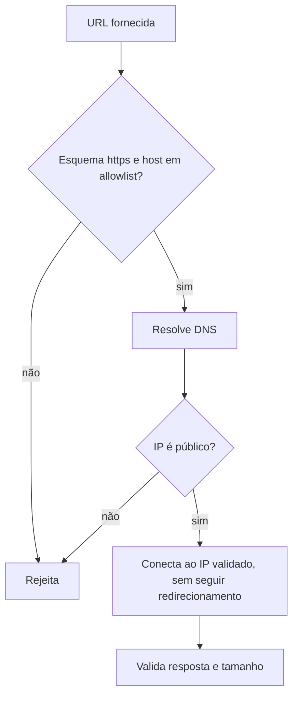

# SSRF Injeção e Desserialização Insegura

## Resumo

Três classes de falha afetam ferramentas de integração com frequência. **SSRF** (Server-Side Request Forgery): a ferramenta faz requisições a URLs fornecidas externamente e pode ser induzida a acessar serviços internos (metadados de nuvem, painéis administrativos). **Injeção**: dados externos interpretados como código ou comando (SQL, shell, templates, LDAP). **Desserialização insegura**: reconstruir objetos a partir de dados não confiáveis com formatos que podem executar código (`pickle`, `yaml.load` sem modo seguro). O foco aqui é a **prevenção**: desenho que elimina a classe de problema, em vez de depender de filtros.

## Conceitos-chave

- **SSRF:** validar esquema (`https`), resolver o DNS e rejeitar IPs privados, *loopback*, *link-local* e de metadados; **desabilitar redirecionamentos** ou revalidar a cada salto; usar allowlist de destinos; segmentar a rede de saída (egress).
- **Injeção SQL:** consultas parametrizadas / ORMs; nunca concatenar.
- **Injeção de comando:** evitar shell; `subprocess.run([...])` com lista; `shell=False`.
- **Injeção em templates:** não renderizar entrada como template; usar *sandbox*.
- **Desserialização:** preferir JSON + validação de schema; nunca `pickle.loads` em dado externo; `yaml.safe_load`.
- **Defesa em profundidade:** privilégio mínimo do processo e rede restrita limitam o dano se a prevenção falhar.

## Como funciona



Um ponto sutil é o *DNS rebinding*: o nome pode resolver para um IP público na validação e para um privado na conexão. Mitigação: conectar ao IP já validado (ou verificar o IP efetivamente usado na conexão) e manter egress restrito na rede.

## Exemplo prático

Validação de URL de destino de webhook (Python):

```python
import ipaddress, socket
from urllib.parse import urlparse
import requests

HOSTS_PERMITIDOS = {"hooks.slack.com", "api.exemplo.com"}

def url_segura(url: str) -> str:
    p = urlparse(url)
    if p.scheme != "https" or p.hostname not in HOSTS_PERMITIDOS:
        raise ValueError("destino não permitido")
    for info in socket.getaddrinfo(p.hostname, p.port or 443):
        ip = ipaddress.ip_address(info[4][0])
        if not ip.is_global:                    # bloqueia privado, loopback, link-local
            raise ValueError("endereço resolvido não é público")
    return url

def enviar(url: str, dados: dict):
    r = requests.post(url_segura(url), json=dados, timeout=10,
                      allow_redirects=False)     # não segue redirecionamentos
    r.raise_for_status()
```

Alternativas seguras às práticas perigosas:

```python
import json, subprocess, yaml

dados = json.loads(corpo)                       # em vez de pickle.loads(corpo)
config = yaml.safe_load(texto)                  # em vez de yaml.load(texto)
subprocess.run(["trivy", "image", imagem], check=True, timeout=600)  # sem shell
cur.execute("SELECT * FROM achados WHERE id = ?", (id_,))            # parametrizada
```

## Boas práticas

- Combine allowlist de destinos com controle de egress na rede.
- Elimine `shell=True`, `eval`, `exec` e `pickle` de dados externos.
- Use bibliotecas de templates com autoescape e sem execução arbitrária.
- Cubra essas classes com testes e com SAST (regras do Semgrep para estes padrões).

## Erros comuns

- Validar o hostname na string e esquecer que o DNS pode apontar para IP interno.
- Seguir redirecionamentos automaticamente após validar.
- Filtrar caracteres como `;` e `|` em vez de eliminar o shell.
- Usar `yaml.load` por hábito.

> [!warning] Metadados de nuvem
> Endpoints de metadados de instâncias são alvos clássicos de SSRF; configure a versão restrita do serviço de metadados e limite o egress.

## Referências para aprofundar

- OWASP SSRF Prevention Cheat Sheet; OWASP Deserialization Cheat Sheet; CWE-918, CWE-78, CWE-502.

## Veja também

- [[Validacao de Entrada]]
- [[OWASP Top 10 - Integração]]
- [[Gestão de Segredos na Ferramenta]]
- [[Privilégio Mínimo e Hardening de Containers]]
- [[MOC - Segurança da Própria Ferramenta]]

#seguranca/ferramenta/ssrf #seguranca/ferramenta/injecao #seguranca/appsec
