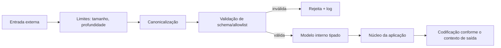

# Validacao de Entrada

## Resumo

Toda ferramenta de segurança recebe dados que não controla: payloads de webhook, relatórios de scanners, campos de alertas, nomes de arquivos, parâmetros de CLI e respostas de APIs de terceiros. **Validação de entrada** é a prática de aceitar apenas dados que atendam a um contrato explícito (tipo, formato, tamanho, faixa de valores) e rejeitar o restante o mais cedo possível. É a defesa-base contra injeção, travessia de diretórios, negação de serviço por payloads gigantes e confusão de parsers. A regra de ouro: **valide na fronteira, de forma positiva (allowlist), e trate o resultado como dado, nunca como código**.

## Conceitos-chave

- **Allowlist vs. denylist:** definir o que é permitido é mais robusto do que tentar listar o que é perigoso.
- **Validação sintática e semântica:** formato (um IPv4 válido) e significado (o IP está no escopo autorizado?).
- **Canonicalização:** normalizar antes de validar (caminhos, Unicode, URL encoding), para evitar contornos.
- **Limites:** tamanho do corpo, profundidade de JSON, número de itens, tempo de processamento.
- **Validação vs. escape/codificação de saída:** validar na entrada e codificar conforme o contexto de saída (HTML, SQL, shell, log).
- **Schemas:** JSON Schema, pydantic, validação de OpenAPI ([[OpenAPI]]).
- **Falhar de forma segura:** entrada inválida gera erro claro e log, sem efeitos colaterais.

## Como funciona



A fronteira é única e bem definida: tudo que passa dela já é um objeto tipado e validado. O núcleo não precisa "desconfiar" de strings soltas, pois só manipula modelos.

## Exemplo prático

Validação com pydantic e proteção contra travessia de diretórios (Python):

```python
from pathlib import Path
from pydantic import BaseModel, Field, field_validator
import ipaddress

class AlertaEntrada(BaseModel):
    model_config = {"extra": "forbid"}          # rejeita campos inesperados
    regra: str = Field(min_length=1, max_length=120)
    severidade: str = Field(pattern=r"^(baixa|media|alta|critica)$")
    ip_origem: str
    descricao: str = Field(default="", max_length=2000)

    @field_validator("ip_origem")
    @classmethod
    def ip_valido(cls, v: str) -> str:
        ipaddress.ip_address(v)                  # levanta ValueError se inválido
        return v

BASE = Path("/var/lib/conector/relatorios").resolve()

def caminho_seguro(nome: str) -> Path:
    alvo = (BASE / nome).resolve()               # resolve '..' e links simbólicos
    if not alvo.is_relative_to(BASE):            # deve permanecer dentro da base
        raise ValueError("caminho fora do diretório permitido")
    return alvo
```

> [!tip] Corpo bruto
> Limite o tamanho do corpo **antes** de parsear o JSON (no servidor web ou no proxy).

## Boas práticas

- Defina schemas estritos e rejeite campos desconhecidos.
- Imponha limites de tamanho, profundidade e quantidade em todas as entradas.
- Valide e canonicalize caminhos e URLs antes de usá-los.
- Trate dados de terceiros (inclusive de ferramentas "de confiança") como não confiáveis.

## Erros comuns

- Validar só no front-end ou só em uma das rotas.
- Denylists de caracteres "perigosos" facilmente contornáveis.
- Validar antes de decodificar (o dado muda depois da checagem).
- Confiar em campos do relatório de um scanner porque "vem de dentro".

> [!warning] Contextos de saída
> Um texto válido como dado pode ser perigoso como HTML, comando de shell ou linha de log; a codificação depende do destino.

## Referências para aprofundar

- OWASP Input Validation Cheat Sheet; documentação do pydantic; CWE-20.

## Veja também

- [[SSRF Injeção e Desserialização Insegura]]
- [[OWASP Top 10 - Integração]]
- [[Parsing de Formatos - SARIF JSON e XML]]
- [[OpenAPI]]
- [[MOC - Segurança da Própria Ferramenta]]

#seguranca/ferramenta/validacao #seguranca/appsec/entrada
