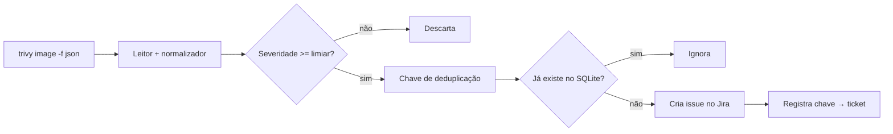

# Projeto 1 - Conector Trivy para Jira

> [!warning] Laboratório
> Execute os exercícios apenas em ambiente isolado e autorizado, com dados sintéticos e credenciais de teste.

## Resumo

Neste projeto você constrói uma ferramenta de linha de comando em Python que lê o relatório JSON do **Trivy**, normaliza os achados, aplica um limiar de severidade, **evita duplicatas** com um registro local e cria issues no **Jira**. Ele reúne conceitos de várias partes do vault: parsing defensivo, idempotência, retries, configuração segura e testes com *fakes*.

## Objetivo

Gerar tickets de vulnerabilidades de forma automática, sem duplicar e sem expor segredos, com modo `--dry-run` e exit codes úteis para CI.

## Pré-requisitos

- Python 3.11+, `requests` e `pytest`.
- Trivy instalado (ou um relatório JSON de exemplo).
- Uma instância Jira de **teste** (ou use o modo `--dry-run`) e um API token com permissão apenas de criar issues.
- Leitura prévia: [[Integração com Scanners - Nessus OpenVAS Trivy e Nuclei]], [[Integração com Ticketing - Jira e GitHub Issues]], [[Idempotência]].

## Conceitos-chave

- Normalização para um modelo interno.
- Chave de deduplicação determinística + registro em SQLite (`PRIMARY KEY`).
- Cliente HTTP com timeout, retries e tratamento de 429.
- Credenciais por variável de ambiente.
- Gate por severidade.

## Como funciona



## Passo a passo

1. Gere o relatório: `trivy image --format json --output trivy.json python:3.12-slim`.
2. Crie o projeto com a estrutura da nota [[Estrutura de Projeto]] e o arquivo `trivy_jira.py` abaixo.
3. Rode com `--dry-run` e confira a saída.
4. Configure `JIRA_URL`, `JIRA_USER`, `JIRA_TOKEN`, `JIRA_PROJECT` no ambiente (nunca em argumentos).
5. Execute sem `--dry-run` contra o Jira de teste e confirme que um segundo run **não** cria duplicatas.
6. Escreva os testes (abaixo) e rode `pytest`.

## Exemplo prático

### Código de referência

```python
# trivy_jira.py
import argparse, hashlib, json, os, sqlite3, sys, time
import requests

ORDEM = {"UNKNOWN": 0, "LOW": 1, "MEDIUM": 2, "HIGH": 3, "CRITICAL": 4}

def ler_trivy(caminho):
    with open(caminho, encoding="utf-8") as f:
        dados = json.load(f)
    for res in dados.get("Results", []):
        for v in res.get("Vulnerabilities") or []:        # pode vir None
            yield {
                "cve": v["VulnerabilityID"],
                "pacote": v["PkgName"],
                "instalada": v.get("InstalledVersion", ""),
                "corrigida": v.get("FixedVersion", ""),
                "severidade": v["Severity"],
                "alvo": res.get("Target", "?"),
                "titulo": v.get("Title", "")[:200],
            }

def chave(a):
    base = f"{a['cve']}|{a['pacote']}|{a['alvo']}"
    return hashlib.sha256(base.encode()).hexdigest()[:16]

class Registro:
    def __init__(self, caminho="registro.db"):
        self.c = sqlite3.connect(caminho)
        self.c.execute("CREATE TABLE IF NOT EXISTS t (chave TEXT PRIMARY KEY, ticket TEXT)")
    def existe(self, k):
        return self.c.execute("SELECT 1 FROM t WHERE chave=?", (k,)).fetchone() is not None
    def salvar(self, k, ticket):
        with self.c:
            self.c.execute("INSERT OR IGNORE INTO t VALUES (?, ?)", (k, ticket))

class Jira:
    def __init__(self, url, user, token, projeto, http=requests):
        self.url, self.auth, self.projeto, self.http = url.rstrip("/"), (user, token), projeto, http
    def criar(self, a):
        payload = {"fields": {
            "project": {"key": self.projeto},
            "summary": f"[{a['severidade']}] {a['cve']} em {a['pacote']}"[:250],
            "description": (f"Alvo: {a['alvo']}\nInstalada: {a['instalada']}\n"
                            f"Corrigida: {a['corrigida'] or 'sem correção disponível'}\n{a['titulo']}"),
            "issuetype": {"name": "Bug"},
            "labels": ["seguranca", "trivy"],
        }}
        for tentativa in range(4):
            r = self.http.post(f"{self.url}/rest/api/2/issue", json=payload,
                               auth=self.auth, timeout=(3, 15))
            if r.status_code in (429, 500, 502, 503, 504):
                time.sleep(2 ** tentativa)                 # backoff simples
                continue
            r.raise_for_status()
            return r.json()["key"]
        raise RuntimeError("Jira indisponível após retries")

def principal(argv=None):
    p = argparse.ArgumentParser()
    p.add_argument("relatorio")
    p.add_argument("--limiar", choices=ORDEM, default="HIGH")
    p.add_argument("--dry-run", action="store_true")
    args = p.parse_args(argv)
    reg = Registro()
    jira = None if args.dry_run else Jira(
        os.environ["JIRA_URL"], os.environ["JIRA_USER"],
        os.environ["JIRA_TOKEN"], os.environ["JIRA_PROJECT"])
    criados = 0
    for a in ler_trivy(args.relatorio):
        if ORDEM.get(a["severidade"], 0) < ORDEM[args.limiar]:
            continue
        k = chave(a)
        if reg.existe(k):
            continue
        if args.dry_run:
            print("DRY-RUN:", a["cve"], a["pacote"]); continue
        reg.salvar(k, jira.criar(a)); criados += 1
    print(json.dumps({"criados": criados}))
    return 0

if __name__ == "__main__":
    sys.exit(principal())
```

### Testes

```python
# test_trivy_jira.py
from trivy_jira import chave, Jira

class RespFake:
    status_code = 201
    def json(self): return {"key": "SEC-1"}
    def raise_for_status(self): pass

class HttpFake:
    def __init__(self): self.chamadas = []
    def post(self, *a, **kw):
        self.chamadas.append(kw["json"]); return RespFake()

ACHADO = {"cve": "CVE-2026-0001", "pacote": "libx", "alvo": "img", "instalada": "1.0",
          "corrigida": "1.1", "severidade": "HIGH", "titulo": "exemplo"}

def test_chave_estavel():
    assert chave(ACHADO) == chave(dict(ACHADO))

def test_cria_issue():
    http = HttpFake()
    assert Jira("https://j.local", "u", "t", "SEC", http=http).criar(ACHADO) == "SEC-1"
    assert "libx" in http.chamadas[0]["fields"]["summary"]
```

## Critérios de conclusão

- O relatório de exemplo gera tickets apenas para severidade ≥ `--limiar`.
- Rodar duas vezes seguidas não cria duplicatas.
- `--dry-run` não faz chamadas de rede ao Jira.
- Nenhum segredo aparece em logs, argumentos ou no repositório.
- Testes passam e cobrem chave estável e criação de issue.

## Extensões

- Agrupar achados por pacote em um único ticket.
- Fechar tickets quando a vulnerabilidade desaparecer do scan.
- Aceitar também SARIF (veja [[Parsing de Formatos - SARIF JSON e XML]]).
- Publicar métricas Prometheus (criados, falhas).
- Empacotar em container não root ([[Empacotamento e Containers]]).

## Boas práticas

- Mantenha `core` (normalização, chave) livre de I/O para testar sem rede.
- Use token de serviço com permissão mínima.
- Registre contagens e erros, nunca o token ([[Logging e Configuração Segura]]).

## Erros comuns

- Gravar o `INSERT` antes de criar o ticket e perdê-lo se o Jira falhar (aqui ele só salva após sucesso).
- Esquecer o caso `Vulnerabilities: null`.
- Descrições gigantes ou com dados sensíveis.

## Referências para aprofundar

- Documentação do Trivy (formato JSON) e da API REST do Jira.

## Veja também

- [[Integração com Scanners - Nessus OpenVAS Trivy e Nuclei]]
- [[Integração com Ticketing - Jira e GitHub Issues]]
- [[Idempotência]]
- [[Retries com Backoff e Tratamento de Falhas]]
- [[MOC - Projetos Práticos]]

#seguranca/projetos/trivy-jira #seguranca/integracao/ticketing
