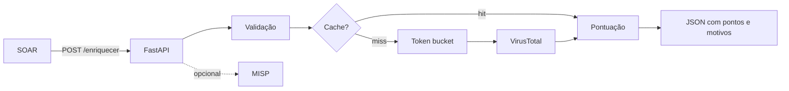

# Projeto 3 - Enriquecedor de Alertas com VirusTotal e MISP

> [!warning] Laboratório
> Execute os exercícios apenas em ambiente isolado e autorizado, com dados sintéticos e credenciais de teste.

## Resumo

Construa um microsserviço HTTP que recebe IoCs de um alerta (IPs e hashes), consulta o **VirusTotal** (com cache e limite de taxa) e, opcionalmente, o **MISP**, e devolve um **resumo com pontuação explicável**. O serviço valida entrada, nunca envia IPs privados a serviços externos e respeita as cotas da API gratuita.

## Objetivo

Entregar um endpoint `POST /enriquecer` que um SOAR possa chamar para anexar reputação e prioridade ao caso.

## Pré-requisitos

- Python 3.11+, `fastapi`, `uvicorn`, `requests`, `pytest`.
- Chave da API do VirusTotal (conta gratuita) em variável `VT_API_KEY`.
- Leitura prévia: [[Integração com Threat Intelligence - MISP OpenCTI e VirusTotal]], [[Rate Limiting]], [[Enriquecimento de Alertas e Escalonamento]], [[Validacao de Entrada]].

## Conceitos-chave

- Validação estrita de IoCs (IP público, SHA-256 hexadecimal).
- Cache com TTL e *token bucket* cliente.
- Pontuação explicável.
- Degradação elegante quando uma fonte falha.

## Como funciona



## Passo a passo

1. Instale dependências e crie `enriquecedor.py`.
2. Exporte `VT_API_KEY` e rode `uvicorn enriquecedor:app --port 8080`.
3. Teste com `curl` usando IPs públicos de documentação (ex.: `203.0.113.7`; o VT poderá não ter dados) e verifique a validação rejeitando `10.0.0.5`.
4. Escreva testes para a pontuação e a validação.
5. Simule falha do VT (chave inválida) e confirme a resposta parcial.

## Exemplo prático

### Código de referência

```python
# enriquecedor.py
import ipaddress, os, re, threading, time
import requests
from fastapi import FastAPI
from pydantic import BaseModel, Field

app = FastAPI()
SHA256 = re.compile(r"^[a-fA-F0-9]{64}$")

class Entrada(BaseModel):
    model_config = {"extra": "forbid"}
    ips: list[str] = Field(default_factory=list, max_length=20)
    hashes: list[str] = Field(default_factory=list, max_length=20)

class Bucket:
    def __init__(self, taxa, cap):
        self.taxa, self.cap, self.t, self.u, self.l = taxa, cap, cap, time.monotonic(), threading.Lock()
    def aguardar(self):
        while True:
            with self.l:
                agora = time.monotonic()
                self.t = min(self.cap, self.t + (agora - self.u) * self.taxa); self.u = agora
                if self.t >= 1:
                    self.t -= 1; return
            time.sleep(0.1)

BUCKET = Bucket(taxa=4 / 60, cap=1)          # 4 consultas por minuto
CACHE: dict[str, tuple[float, dict]] = {}
TTL = 3600

def vt(caminho: str, id_: str) -> dict:
    chave = f"{caminho}:{id_}"
    if chave in CACHE and time.time() - CACHE[chave][0] < TTL:
        return CACHE[chave][1]
    BUCKET.aguardar()
    r = requests.get(f"https://www.virustotal.com/api/v3/{caminho}/{id_}",
                     headers={"x-apikey": os.environ["VT_API_KEY"]}, timeout=15)
    r.raise_for_status()
    s = r.json()["data"]["attributes"]["last_analysis_stats"]
    res = {"malicioso": s.get("malicious", 0), "suspeito": s.get("suspicious", 0)}
    CACHE[chave] = (time.time(), res)
    return res

def pontuar(resultados: list[dict]) -> dict:
    motivos, pontos = [], 0
    for r in resultados:
        if r["malicioso"] >= 5:
            pontos += 40; motivos.append(f"{r['ioc']}: {r['malicioso']} engines maliciosas (+40)")
        elif r["malicioso"] >= 1 or r["suspeito"] >= 3:
            pontos += 15; motivos.append(f"{r['ioc']}: sinais fracos (+15)")
    return {"pontos": min(pontos, 100), "motivos": motivos}

@app.post("/enriquecer")
def enriquecer(e: Entrada):
    resultados, erros = [], []
    for ip in e.ips:
        try:
            if not ipaddress.ip_address(ip).is_global:
                erros.append(f"{ip}: ignorado (não público)"); continue
            resultados.append({"ioc": ip, **vt("ip_addresses", ip)})
        except Exception as ex:
            erros.append(f"{ip}: {type(ex).__name__}")
    for h in e.hashes:
        if not SHA256.match(h):
            erros.append(f"{h[:12]}...: hash inválido"); continue
        try:
            resultados.append({"ioc": h, **vt("files", h.lower())})
        except Exception as ex:
            erros.append(f"{h[:12]}...: {type(ex).__name__}")
    return {"resultados": resultados, "avaliacao": pontuar(resultados), "avisos": erros}
```

Teste da pontuação:

```python
from enriquecedor import pontuar

def test_pontuacao_alta():
    r = pontuar([{"ioc": "203.0.113.7", "malicioso": 7, "suspeito": 0}])
    assert r["pontos"] == 40 and "engines maliciosas" in r["motivos"][0]
```

## Critérios de conclusão

- IPs privados nunca são enviados ao VT.
- A segunda consulta ao mesmo IoC usa cache.
- Falha do VT retorna 200 com `avisos`, sem derrubar o serviço.
- A resposta traz pontuação **e** motivos.
- Chave da API só no ambiente.

## Extensões

- Adicionar consulta ao MISP com PyMISP.
- Cache persistente (Redis).
- Autenticação do endpoint (token ou mTLS: [[mTLS]]).
- Métricas e tracing ([[Métricas e Tracing - Prometheus e OpenTelemetry]]).
- Mapear resultados para técnicas ATT&CK.

## Boas práticas

- Consulte por hash, não envie arquivos ao VirusTotal.
- Trate "sem detecções" como informação incompleta.
- Registre apenas o necessário (LGPD).

## Erros comuns

- Tratar o endpoint interno como confiável e dispensar validação.
- Cache sem TTL, mantendo reputações obsoletas.
- Estourar a cota e deixar o SOAR em espera indefinida (use timeouts).

## Referências para aprofundar

- API v3 do VirusTotal; documentação do FastAPI e do PyMISP.

## Veja também

- [[Integração com Threat Intelligence - MISP OpenCTI e VirusTotal]]
- [[Enriquecimento de Alertas e Escalonamento]]
- [[Rate Limiting]]
- [[Validacao de Entrada]]
- [[MOC - Projetos Práticos]]

#seguranca/projetos/enriquecimento #seguranca/integracao/threat-intel
