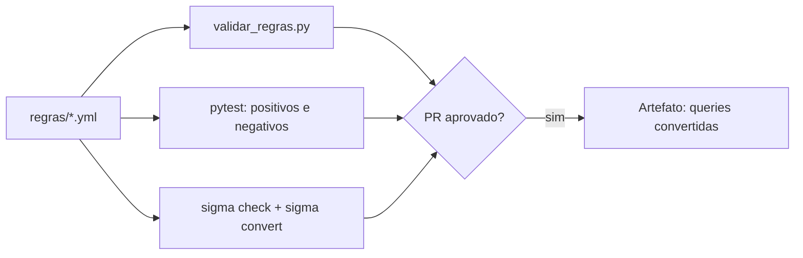

# Projeto 5 - Pipeline de Detecção como Código com Sigma

> [!warning] Laboratório
> Execute os exercícios apenas em ambiente isolado e autorizado, com dados sintéticos e credenciais de teste.

## Resumo

Monte um repositório de **detecção como código**: regras Sigma versionadas, validação de metadados, testes com eventos positivos e negativos e um workflow que roda tudo em cada PR e gera as consultas convertidas para o seu SIEM. O projeto concretiza o ciclo descrito em [[Detecção como Código]] e [[Testes de Regras de Detecção]].

## Objetivo

Impedir que regras sem metadados ou sem testes cheguem à produção, e produzir as consultas do SIEM a partir da regra, sem edição manual.

## Pré-requisitos

- Python 3.11+, `pyyaml`, `pytest`, `sigma-cli` (pySigma).
- Leitura prévia: [[Regras Sigma]], [[Detecção como Código]], [[Testes de Regras de Detecção]], [[Redução de Falsos Positivos]].

## Conceitos-chave

- Estrutura de repositório com `regras/`, `tests/amostras/`, `ferramentas/`.
- Validador de metadados (UUID único, status, tags).
- Avaliador mínimo de regras para testes unitários (didático).
- Conversão automatizada com `sigma convert`.

## Como funciona



## Passo a passo

1. Crie a estrutura: `regras/`, `tests/amostras/`, `ferramentas/validar_regras.py`, `tests/avaliador.py`, `tests/test_regras.py`.
2. Copie a regra Sigma da nota [[Regras Sigma]] para `regras/powershell_enc.yml`.
3. Crie o arquivo de amostras e o avaliador abaixo.
4. Rode `python ferramentas/validar_regras.py`, `pytest` e `sigma check regras/`.
5. Quebre a regra de propósito (apague um campo) e veja o CI falhar.
6. Ajuste a regra para reduzir falsos positivos e adicione o caso ao conjunto negativo.

## Exemplo prático

### Amostras de teste

```yaml
# tests/amostras/powershell_enc.yml
regra: regras/powershell_enc.yml
positivos:
  - Image: 'C:\Windows\System32\WindowsPowerShell\v1.0\powershell.exe'
    CommandLine: 'powershell.exe -enc SQBFAFgA'
negativos:
  - Image: 'C:\Windows\System32\notepad.exe'
    CommandLine: 'notepad.exe -enc'
  - Image: 'C:\Windows\System32\WindowsPowerShell\v1.0\powershell.exe'
    CommandLine: 'powershell.exe Get-Date'
```

### Avaliador mínimo (didático)

```python
# tests/avaliador.py  (suporta equals, startswith, endswith, contains; condition com and/or)
def _casa_campo(evento, chave, esperado):
    campo, *mods = chave.split("|")
    valor = str(evento.get(campo, "")).lower()
    valores = [str(v).lower() for v in (esperado if isinstance(esperado, list) else [esperado])]
    if "endswith" in mods:
        return any(valor.endswith(v) for v in valores)
    if "startswith" in mods:
        return any(valor.startswith(v) for v in valores)
    if "contains" in mods:
        return any(v in valor for v in valores)
    return any(valor == v for v in valores)

def avaliar(regra, evento):
    det = regra["detection"]
    selecoes = {k: all(_casa_campo(evento, c, v) for c, v in sel.items())
                for k, sel in det.items() if k != "condition"}
    return any(all(selecoes[n.strip()] for n in parte.split(" and "))
               for parte in det["condition"].split(" or "))
```

### Testes

```python
# tests/test_regras.py
import pathlib, yaml, pytest
from avaliador import avaliar

def casos():
    for arq in pathlib.Path("tests/amostras").glob("*.yml"):
        d = yaml.safe_load(arq.read_text(encoding="utf-8"))
        regra = yaml.safe_load(pathlib.Path(d["regra"]).read_text(encoding="utf-8"))
        for ev in d.get("positivos", []):
            yield pytest.param(regra, ev, True, id=f"{arq.stem}-pos")
        for ev in d.get("negativos", []):
            yield pytest.param(regra, ev, False, id=f"{arq.stem}-neg")

@pytest.mark.parametrize("regra,evento,esperado", list(casos()))
def test_regra(regra, evento, esperado):
    assert avaliar(regra, evento) is esperado
```

### Workflow

```yaml
name: deteccao-ci
on: [pull_request]
permissions: {contents: read}
jobs:
  validar:
    runs-on: ubuntu-latest
    steps:
      - uses: actions/checkout@v4
      - run: pip install pyyaml pytest sigma-cli
      - run: python ferramentas/validar_regras.py
      - run: sigma check regras/
      - run: PYTHONPATH=tests pytest -q
      - run: sigma convert -t splunk -p splunk_windows regras/ > consultas-splunk.txt
      - uses: actions/upload-artifact@v4
        with: {name: consultas, path: consultas-splunk.txt}
```

O `validar_regras.py` é o script apresentado em [[Detecção como Código]].

## Critérios de conclusão

- O CI falha para regra sem `id` UUID único, sem `tags` ou sem `status` válido.
- Cada regra tem pelo menos um caso positivo e dois negativos.
- `sigma check` passa e as consultas convertidas são publicadas como artefato.
- Há registro do motivo de cada ajuste para reduzir falsos positivos.

## Extensões

- Adicionar mais regras (por exemplo, criação de serviço, mudança de política) e mapeá-las ao [[MITRE ATT&CK - Integração]].
- Backtesting com logs históricos anonimizados.
- Implantação por API no SIEM de staging.
- Painel de cobertura por técnica.
- Regras YARA e Suricata no mesmo repositório ([[YARA - Integração]], [[Suricata - Integração]]).

## Boas práticas

- Use dados sintéticos nos testes.
- Mantenha dono e data de revisão em cada regra.
- Promova por ambientes e observe os disparos antes de notificar o plantão.

## Erros comuns

- Avaliador do projeto não substitui o motor do SIEM: valide também no ambiente de teste.
- Regras copiadas sem adaptar ao esquema local.
- Exceções sem validade.

## Referências para aprofundar

- SigmaHQ; documentação do pySigma e do sigma-cli.

## Veja também

- [[Detecção como Código]]
- [[Regras Sigma]]
- [[Testes de Regras de Detecção]]
- [[Redução de Falsos Positivos]]
- [[MOC - Projetos Práticos]]

#seguranca/projetos/detection-as-code #seguranca/deteccao/sigma
